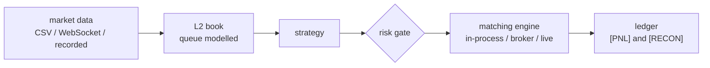

<div align="center">

# ToyQuant

**A C++20 limit-order-book replay engine: deterministic execution, a stage-level latency budget, and a gate that re-derives
every number this project publishes.**

[](CMakeLists.txt)
[](CMakePresets.json)
[](tests)
[](LICENSE)

[Documentation map](docs/MAP.md) · [Quickstart](docs/using/01-getting-started.md) ·
[Retrospective](docs/RETROSPECTIVE.md) · [Decisions](docs/adr/index.md)

</div>

---



ToyQuant tests trading hypotheses with arithmetic rather than assumption: it reads market data, builds an L2 ladder,
matches in price-time with an explicit queue model, charges a broker's schedule, and books the result in a ledger --
byte-for-byte reproducibly, so a result is re-derived instead of remembered. Eight markets were measured, each closed by
a number rather than an opinion, and the engine is the instrument rather than the product.

## Run it

Requirements: CMake 3.16+, a C++20 compiler, and Python 3.

```bash
cmake --preset linux-debug && cmake --build --preset linux-debug
bash tools/gate/verify_l2.sh fast      # the invariants, and every number the documents quote re-derived
```

## Read it

| I want | Read |
|---|---|
| the whole system on one page | [Quickstart](docs/using/01-getting-started.md) -- one diagram, the eight closures, three commands |
| what the project found, and why each line ended | [Retrospective](docs/RETROSPECTIVE.md) |
| the tiers, the route for a question, who owns which claim | [Documentation map](docs/MAP.md) |


**Not a production trading system.** No venue connectivity, no authentication, no market impact, no contract lifecycle,
and no claim about future profitability; each boundary is stated with its reason in
[the design review](docs/DESIGN_REVIEW.md) and [the roadmap](docs/ROADMAP.md#deliberately-not-planned). It is a
measurement exercise, not investment advice, and none of the eight markets it examined cleared its gates.

The record behind the closures is [the retrospective](docs/RETROSPECTIVE.md) -- every number in it re-derived by the
gate -- beside [the engine retrospective](docs/LOW_LATENCY.md) and [the decisions](docs/adr/index.md), one append-only
file per technical decision. What changed, release by release, is [CHANGELOG.md](CHANGELOG.md); the pre-queue-model line
stays at the tag `v1.0-demo`. Bug reports and focused tests are welcome, and [`.clinerules`](.clinerules) says what a
change has to satisfy before it counts.

<div align="center">
Created and maintained by <a href="https://github.com/12mango">12mango</a> · <a href="mailto:1498159938@qq.com">Contact</a> · <a href="LICENSE">MIT License</a>
</div>
