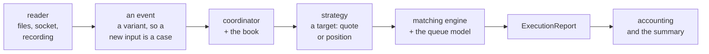

# Architecture

*The module reference for a small event-driven simulator: input, book, strategy, matching, reports, accounting. What
the instrument was pointed at is [the retrospective](RETROSPECTIVE.md); how to run it is the [User
Guide](USER_GUIDE.md).*

## The path, and the page that owns each stage

The six parts are the six stages above, one page each. The tables there show ownership; the prose explains only the
decisions that are not visible from the code.

| part | what it covers | start here if |
|---|---|---|
| [1. System map](architecture/01-system-map.md) | the whole flow in one picture, and the ownership rule behind it | you want the end-to-end event flow |
| [2. Inputs and shared types](architecture/02-inputs-and-types.md) | every reader, the event types they produce, and the validation boundary | you are adding an input or debugging a parse |
| [3. Coordinator and the book](architecture/03-coordinator-and-book.md) | how the application wires the pieces, then the book view a strategy reads | you need object ownership or the callback order |
| [4. Matching engine](architecture/04-matching-engine.md) | price–time priority, the queue model, partial fills, self-trade prevention, the reports | you need to know how a fill is decided |
| [5. Strategy](architecture/05-strategy.md), in two parts | the decision layer, its lifecycle, the order state machine, every family including the mainline | you are working on a strategy |
| [6. Accounting and the summary](architecture/06-accounting-and-the-summary.md) | what a fill does to cash and inventory, and every field of every report line | you are reading a report line |

## Four things worth reading for

| what | why it is the part most simulators get wrong |
|---|---|
| **the queue** | a quote's fills are decided by what is ahead of it; the model carries four settings from a conservative lower bound to an optimistic upper bound, and the bound sweep recorded in [Performance History](performance/history-03-studies.md) shows the conclusions do not move between them |
| **the fee** | it is charged the way a broker charges it -- a per-unit commission, maker and taker rates, a floor per order instance, a fee on a sale's proceeds, a credit for displayed liquidity -- which is what made a one-cent tick visible as a cost rather than an assumption |
| **the state machine** | the order audit keeps what a strategy *did*: filled instances with their size histogram, cancels before and after a fill, the queue consumed, and the markout of the fills that arrived |
| **the honesty of the measurement** | every number in [Performance](PERFORMANCE.md) is re-derived by `tools/gate/verify_l2.sh` rather than copied, and designs that were measured and rejected are kept rather than deleted -- [Low-Latency Design](performance/design.md) is that record |

The rationale behind any of it is in [Design Review](DESIGN_REVIEW.md), and the order to read the *source* in is [Main
Line](MAINLINE.md).

