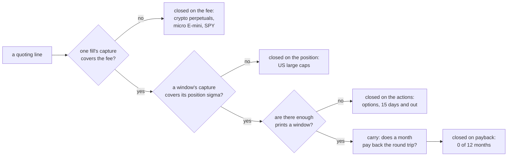

# Retrospective

This is the record of what this project tried, what each attempt cost, why the ones that failed failed, and what is
left. It exists because the value of a negative result is the reason for it, and because the same wrong turns are
cheap to repeat: every row below is a question that has been answered and no longer needs asking -- and the frontier
map near the end says which of them could still be asked *differently*, what that would cost, and what would have to
change before it is worth asking at all.

## What the project was asking

Whether a personal account executed by a program can quote both sides of a market and earn the spread. The engine,
the gates and the pre-registration discipline in `docs/ROADMAP.md` exist to answer that with numbers rather than with
opinions, and the answer now has a shape: **the quoting earns money, and the inventory it must carry decides the
outcome by an order of magnitude.**

## The order the gates fire in

A quote is closed at the first gate it fails, and the gates are asked in this order because the next one is only worth
asking if the one before it passed. `tools/study/viability.py` encodes the same order and fails the gate if a recorded
line names a different one as binding.

Two closures sit outside that chain because they are not quotes: the options line at one day to expiry is set aside by
a **restriction** written before it was measured, and the low-turnover reversion rule is closed on the **sign** of its
own payoff rather than on a cost.

## The dead ends, what each cost, and why

| attempt | what it cost | why it ended |
|---|---:|---|
| Crypto perpetuals (Deribit, Binance, OKX) | free archives | a fee of 2.57 ticks against 0.088 ticks captured a fill — and the ratio holds on each of the five free sample days, where the capture runs 0.035 to 0.462 ticks and 0.353 at most at equal half hours, so the best day still earns 18% of the fee and the best equal-time day 14%. The fee is a multiple of the edge, and no lever moves a ratio like that |
| Micro E-mini futures | 0.97 USD | a commission of about half a tick against 0.0131 ticks captured, which is the same wall one market over |
| SPY, the window that started the fee question | 0.36 USD | capture 0.268 ticks against a 0.35 fee, and the latency gate then killed it: 1 ms of order latency took +262 USD to +1.89, and 5 ms took it to -1143 |
| The latency gate itself | free | a personal account does not control its round trip, so this is a structural ceiling rather than a parameter |
| The fee arrangements, to four decimal places | free | the four arrangements differ by 0.28 of a tick and this system's noise is 30: the precision mattered for the **sign** and for nothing else |
| The kill-switch threshold sweep, four thresholds | free | two would have shown the same thing: no threshold paid on the sample, and a dollar threshold against a varying notional is a control on size |
| Top of book as a cheap substitute for ten levels | free | measured against the same window it halves the fills, 1182 against 2324, because a one level book has nothing left when its touch is taken; the real saving was the window length, not the schema |
| Recording our own feed instead of buying history | free, in calendar time | correct in principle and slower than the question needed; it stays the default once a live line exists |
| The commission-only screen rule | 0.52 USD | it ranked a symbol by a fee that is a fifth of what the account is charged, so AAPL passed a rule that the account's own schedule then failed it on |
| The Avellaneda and Stoikov shift, first attempt | free | the shift was given in ticks against a one-tick quote spacing, so a six-tick shift was six half spreads: a unit error, recorded rather than hidden |
| The same shift, at the scale the model asks for | free | it made both columns worse at every width, which closed the quote-placement axis |
| A MES hedge of a MU inventory | free | MES explains 9.4 percent of MU's one second variance, so the hedge removes 8 percent of the inventory term at the horizon a fill lives on against 61 percent at five minutes: the common factor is slower than a quote |
| Reading a table by its sums | free | the summed ratio read as a sevenfold improvement where the dispersion said twenty percent, because the mean of the position term is not its risk |
| A passive entry for the trend line (`--trend-entry=side=own`) | free, five replays on tracked data | the fill is adversely selected: the markout is -0.75, -0.33, -0.29 and -0.05 ticks on four of five runs (+0.76 on TSLA), and the gross is -0.45 to -0.79 bps of maker notional on every name against 2.2 to 3.2 bps of fee, 37 to 53 percent of it the per-order floor. The bar registered before the run (net +2 bps, markout +4 bps, three windows) fails on the two signs; the third is a data condition -- one tracked session per name -- and cannot flip a sign the fee already fixes |
| `SSV-USDT-SWAP`, the screen's third-ranked capture | free archives, one portal download | **the actions gate, not the fee**: at one tick it captures +2.65 bps closed on 4 of 6 days and fills **14 times a window** against the 30 the bar asks, because the tape carries 5,000 to 22,000 prints a day where NES carries 450,000. A wide book with no prints cannot be quoted, whatever its half-spread |
| `CT-USDT-SWAP`, the fine-tick branch's first instrument | free archives, one portal download | **its tick is 0.76 bps**: 14 bps of distance is eighteen ticks against a book eight ticks wide, so it fills 2 to 12 times a window at 14 bps and 0 to 4 at 28. The branch's last test is the two high-turnover representatives, `PROS` (1.43 bps a tick) and `BLUR` (1.08) |

## The rules that came out of it

1. **Cost the venue before tuning the strategy.** A fee that is a multiple of the edge cannot be optimised away, and
   neither can a spread that is one tick wide.
2. **Separate the edge from the position before reading any result.** Every window here that looked profitable looked
   profitable because of the position, and the one that looked like a pass on the fee was one.
3. **Pre-register the scope as well as the rule.** A rule that does not say which size it applies to produces two
   true readings and no decision, which is what the eight-window campaign found.
4. **A sum is not a measure.** What decides whether an edge is measurable is the dispersion of the term it competes
   with, not the sum of either.
5. **Unverified facts are labelled.** The account's schedule is read from pages rather than from a statement and the
   minimum per order is reported rather than confirmed, and both are marked where they are used.
6. **Print the interval, and read the range before it.** "Below thirty fills is not a conclusion" was a rule this
   campaign applied by hand, and a rule applied by hand is applied by mood. The tool that now applies it showed the
   mean of five monthly windows pinned inside 1.9 bps while the draws themselves spanned 2.75 and fell in order: an
   interval says how well the mean is known, not whether the population is one thing, and the second question was
   the one being asked.

## What is established

* The quoting margin -- capture less markout less every fee including the minimum per order -- is **positive in
  sixteen of sixteen rows**, eight MU windows at two sizes, averaging 940.59 USD a window at the pinned size against
  AAPL's -181.
* The position term that competes with it has a per window standard deviation of about 10588 USD, so separating the
  edge at two standard deviations needs about **506 windows**, two years of daily two-hour sessions.
* **No quoting parameter moves that ratio by more than twenty percent.** Distance from the touch, quote width, the
  inventory shift, size, the exposure cap, the kill switch and the fee schedule have all been swept.
* Five markets have therefore been falsified with numbers: crypto perpetuals, the micro E-mini, SPY and the US large
  cap equities, and in each case the reason is the ratio of the fee and the spread to the inventory's own move. The
  fifth is the demo account measured live, below.
* **The demo milestone closed on 2026-11-22: the instrument was proven and the strategy's edge was not there to pay the
  fee.** Three five-minute live windows through the relay and the operator's proxy: gross capture -0.41, +0.92 and
  +1.07 bps of maker notional against 3.36, 3.88 and 3.80 bps charged, net -3.77, -2.95 and -2.73 bps (`net_pnl_usd`
  -23.309, -15.7405, -11.7888). `[PNL]`'s own `breakeven_maker_rate` (-4.09e-05, 9.217e-05, 1.07135e-04) says the same
  in the venue's language: the line needs a maker fee at or below about one basis point, and the demo venue charges two.
  The structural ceiling is lower still, and it is a ratio rather than a window: the half-spread this instrument
  measures is 0.101 bps (the 2026-11-17 window's `[WIND-DOWN] spread_bps`), so a maker that captured a *whole* half-spread
  on every fill would still pay twenty times the fee it collects -- 2.00 / 0.101 = 19.8, and the same table for four
  markets is in [the fee history](performance/history-04-the-fee-is-not-the-wall.md#the-ratio-across-the-markets-this-repository-owns).
  What the same three windows establish about the *infrastructure* is the other half: every fill, cancel, refusal, late
  fill and position reconciled against the venue's own statement at both ends of every session -- worst
  `equity_break_usd=-0.00386365`, one session comparing a nonzero position to the contract (`-1400` against `-1400`), and
  every fault named in a field of its own (`late_fill_reports`, `duplicates`, `refused=1`, `grew=<units>`). A cost
  boundary measured by an instrument that agrees with the venue to a third of a cent is a result, not a failure of the
  measurement.
* **A passive entry does not rescue that line, and the reason is the fill rather than the fee.** Five own-side runs on
  AMD, AAPL and TSLA put the clip inside our own touch, so the fee is the maker rate and `taker_trade_count=0`, and the
  fill probability is the one the queue model grants; the markout after the fill is -0.75, -0.33, -0.29 and -0.05 ticks
  on four of the five (+0.76 on TSLA), and the gross is -0.45 to -0.79 bps on every name against 2.2 to 3.2 bps charged,
  a third to a half of it the 0.35 per-order floor. The bar registered before the run (net +2 bps, markout +4 bps, three
  windows) fails on the two signs, and the third is one tracked session per name, which cannot move them.

* **The equity line is placed in hibernation rather than continued**, and its reasons are numbers rather than a
  shortage of effort: the fee floor binds on seventy-nine percent of order instances, no swept parameter moves the
  ratio by more than twenty percent, and separating a 941 USD capture from a 10,588 USD position term would take five
  hundred and six windows. The C++ core stays as infrastructure; what is closed is the direction.

## The demo line's three decisions, closed (2026-11-22)

| decision | the policy, and why it is the cheap one |
|---|---|
| an exit that did not fill, or a position that grew while it worked | one attempt and stop: `refused=1` or `grew=<units>` says which, the position stays on the ledger, and the operator restarts from a checked account. A re-sizing loop would be a state machine racing a venue that has just shown it is faster than the client |
| a recovery that could not resolve an inherited order | refuse to start: the query is asked again rather than read as "gone", `orders_unknown` counts it, and the run exits non-zero naming the symbol and the count. `tools/live/okx_probe.py` is what the operator checks the account with before the next start |
| a strategy whose gross capture is below the fee | recorded, not tuned: the windows above are the answer to the question the line asked, and a sweep is the wall the four earlier markets hit |

## What is open, and how each would be verified

* ~~Whether a US options venue pays a retail account for adding liquidity.~~ **Measured and closed**, and not on the
  fee: the exchange schedule was read rather than summarised -- a market maker adding liquidity against non-customer flow
  is credited 0.25 USD a contract, a customer order under 100 contracts is free on some routes, and the account's own
  schedule is 0.65 a contract with a 1.00 floor an order -- so the fee axis passed for the first time in this project.
  What closed the venue is the number of times a monthly series trades: 5 to 246 prints in two hours against its own price
  moving tens of dollars a contract, best R_max 56 against the reference of 71
  ([the studies](archive/studies.md#test-a-executed-the-high-flow-names-at-20-to-45-days-which-closes-the-options-line)).
* **Whether a crypto venue offers a zero or rebate maker fee at a retail tier.** The recorded venues charge 0.0002,
  which is positive, so a claim of a negative fee needs a named venue, tier and pair before it is used.
* **Which instrument explains an inventory's move at the horizon it is held.** The MES measurement above is one row
  of that table, and a same industry instrument (SMH or SOXX for a memory name, MU options for MU) is the next.
* ~~Whether an options book can be read by this engine at all.~~ **Answered while the venue line was being closed**: a
  single series fits the readers, a chain does not -- it is thousands of instruments on one underlying, and the readers
  take one file at a time. That is a data-contract answer, and it is why the venue closed on activity before anyone
  argued about architecture.

## What this cleanup did not delete, and why

Nothing in `src/` or `tests/` is unused. `src/lines/legacy/` holds the L1 market maker family that
`src/app/strategy_factory.cpp`, `src/app/strategy_benchmark.h`, `src/backtest/` and the CSV and UDP feeds all
include; and each of the six tools that look unreferenced from `docs/` -- `fetch_okx_trades.py`,
`multi_day_check.sh`, `inspect_source.py`, `check_okx_book.py`, `benchmark_replay_windows.py` and `trace_order.sh` --
is documented in `docs/DATA.md` or `docs/USER_GUIDE.md`. What was actually redundant was generated or ignored: a
stale `site/` build of these documents and the working logs under `out/`, both of which stay out of the repository by
construction. Deleting a referenced strategy would break the gates that make every number above re-derivable, which
is the asset this phase produced.

**The second pass, recorded 2026-11-02.** The directory was flat at that point, forty-eight files in one list, and the
reader's problem was not that a tool was dead but that nothing said which tool answered which question. So the tools
are grouped by the kind of thing they do -- `gate/`, `sweep/`, `fetch/`, `study/`, `live/`, `bench/`, `legacy/` --
with `docs/TOOLS.md` as the map, and the two shapes of "cut a slice" became one entry point,
`tools/fetch/slice.py`, with a subcommand for each. One file was deleted: `lf_windows.sh`, which no document, no
other tool and no gate tier named, and which asked the question `equity_schedule_sweep.sh` already asks on the same
windows. The stale `site/` build was deleted again, because a build of these documents that is not rebuilt is a
second, older copy of every number in them.

## The eight lines, and what is left when they are all closed

The project set out to find a market where a personal account's quote pays for itself. It now has eight answers, each
one a number rather than an opinion.

| line | the number that closed it |
|---|---|
| crypto perpetuals, the micro E-mini, SPY | a fee that is a multiple of the spread the venue offers, so a quote cannot pay for itself at any width |
| US large cap equities (MU, MSTR, AMD) | the quoting margin was positive in 16 of 16 windows and the position term was 10,588 USD against 941, which is 506 windows to separate; and the fee floor binds on 79 percent of order instances |
| options at one day to expiry | the spread is payment for tail risk rather than a quoting edge, and the premium can be smaller than the fee floor |
| options from fifteen days out | the fee axis passed for the first time in the project, and the print count then failed: the best of eight classes is R_max 56 against a reference of 71 |
| funding rate carry, BTC, two venues, twelve months | 0 of 12 months clear the level and payback gates, and no run of a positive differential in any month earns the 36 USD round trip |
| a low turnover reversion rule | the sign does not replicate: 4 of MU's 8 windows positive, median net -23.34 cents a share, and the best window earned 149.76 while the worst lost 980.38, so it wins small and loses big |

**Those eight rows are data now, not prose.** `tools/study/viability.py` re-derives every quotient from the inputs the
rows carry, checks that the first gate to fire is the one each line is recorded as binding on, and prints what each
gate rested on. Two things in it are there because the alternative is a lie: a gate that was not measured prints as
`not measured` rather than as a pass, and a bound taken on the most favourable case -- the widest spread, the smallest
position move -- may close a line and is refused if it is ever read as an opening, because the best case passing
proves nothing about the rest. The MU row's 506 windows is not carried as a number of its own either: it is
`(2 x 10,588 / 941)^2`, at the two standard deviations the row names, so it falls out of the same two inputs the gate
is read from. The inputs are in `tests/fixtures/verdicts.json` and tier 1 of `tools/gate/verify_l2.sh` runs it on every
edit.

**Two of those inputs are no longer copies.** `python3 tools/study/viability.py --derive` runs the tools that produced them
and compares what comes back with what the fixture recorded: the low turnover rule over MU's eight windows returns a
median of -23.34 cents a share either way, and `tools/study/venue_ratio.py` over the option series returns 56 prints a fill
as the best of them either way. The option series that second measurement needs were bought again into
`data/v2/options/`, because the first copy lived in `/tmp` and nothing behind it could be re-derived once it was
gone; it cost 0.011938 USD and its print counts and R_max reproduce the table in `docs/ROADMAP.md` row for row. The
campaign is not in the gate, because it needs the archives and takes minutes where the gate runs on every edit.

## The frontier map: what kind of death each closure was

A closure is a boundary with a condition on it, and the condition decides whether the line deserves another hour. The
table above is the verdicts; this one is the same rows read by **why** each stopped, so that a reopen starts from the
assumption instead of from the number. Four kinds are worth telling apart, and the fourth is the one this project paid
for twice.

| line | kind | the assumption it is bound to | the cheapest test, and its trigger |
|---|---|---|---|
| crypto perpetuals, symmetric quoting at retail | arithmetic | a fee of 2.00 bps against a 0.101 bps half-spread, so 19.8 half-spreads of fee per fill | none while the account is retail. Trigger: **a maker fee at or below about 1 bps, or a rebate tier** -- `breakeven_maker_rate` across the recorded windows runs from -4.09e-05 to 1.07135e-04, which is the price of that trigger |
| micro E-mini | arithmetic | a commission of about half a tick against 0.0131 ticks captured a fill | none; the same wall one market over, and the row above is its general form |
| US large cap equities, the position term | arithmetic | 941 USD of capture a window against 10,588 USD of the same window's sigma, which is 506 windows | an instrument that explains the inventory at a fill's horizon: MES removes 8 percent of that term there against 61 percent at five minutes, and the second column of that table is what remains |
| options from fifteen days out | arithmetic | 5 to 264 prints in two hours, so the best `R_max` is 43 against the 71-print reference | a series that trades more at the same expiry; nothing cheap, and the row below is why the cheap alternative was refused |
| options at one to three days | **restriction** | the tail-risk restriction pre-registered before the measurement, `DTE > 15` | reopening is the owner's decision and not a measurement. What it would cost is one series' fill ratio: those are the only expiries clearing `R_max` 71 (254, 203, 113, 111 and 104 prints a fill) |
| funding rate carry, BTC, twelve months | arithmetic | 0 of 12 months clear the level and payback gates; no positive run earns the 36 USD round trip | a month whose differential clears it. The archives are free, so the scan is re-run rather than argued |
| **the wide-spread screen, and the UP instrument** | **method** | one REST read per symbol, ranked by half-spread alone, which read 8.51 bps and missed 10 to 90 percent of the width | the tiered screen: thirty reads twenty seconds apart, a two-tick width floor and a 500,000 USD notional floor, inside one 13:30-15:30 UTC window. Free, and the window is the only gate. **Done 2026-11-25**: the screen ran 13:31-13:40 UTC -- 127 of 555 clear 1.2 bps and 101 clear 2 bps of capture -- the download ranking put its two groups at four and eight, and the ladders measured them: **NES clears the bar at three ticks** (46 fills, closed +9.07 on 5 of 7) and is the second seat, while **SSV** (14 fills at one tick, 5-22 thousand prints a day) and **CT** (eighteen ticks out at 14 bps) are closed, and **OL** joins them on the same wall -- 13 fills a window at three ticks with `fees_bps` exactly 2.00 on all seven days, so what refuses it is turnover rather than rate |
| **the fine-tick deep-book branch** | **method, a small-size cell: it passes at one and ten contracts and fails its own hundred-contract bar** | a tick under 2.5 bps against a book at least four ticks wide, where 7 to 28 bps of distance is ten to forty ticks -- the branch the `--quote-distance-bps` rule exists for | CT is closed at 2 to 12 fills a window. The two representatives were run at their registered distances over the same seven days (2026-11-26): **PROS at ten ticks reads a median of 59 fills** with a closed median of **+5.82** on 4 of 7 and a net of -12.50, and **BLUR at thirteen reads 33 fills, a closed median of +31.74 and a net of +26.12, positive on 5 of 7** -- the only cell in the second pool to clear both the fill floor and the sign. The branch is therefore not written off. What stands between the cell and a seat is **size**: BLUR's maker notional is 0.13 to 1.07 USD a window, one day inside it is -283 bps, so the next run was registered as ten times the size at the same thirteen ticks, keeping a positive closed median on 5 of 7. **That run is done (2026-11-26) and the cell survives it**: at ten times the size BLUR reads a median of **35 fills**, a closed median of **+23.66** and a net of **+12.41**, positive on 5 of 7 both. The capture decays from +31.74 as size should make it decay rather than collapsing, and what is left open is absolute money -- 0.67 to 10.63 USD of notional a window -- and the one day inside the seven that reads -283 bps net on three fills. **A hundred contracts is where it ends, by the bar registered before that run**: 38 fills, a closed median of **+9.32** and a net of **-2.87** -- another 61 percent of capture gone, under the +10 floor the registration named as the line between size cost and luck, with the fee climbing to 2.13-42.84 bps as the quote grows into the prints. So the cell is a **small-size phenomenon**: it earns at one and ten contracts and stops earning at the size where the notional (6.7 to 100 USD a window) is real money |
| **the UP configuration** | **method, closed at zero latency; the fee and the route both bind** | quoting at the touch, where a 2 to 3 tick spread cannot pay 2.00 bps | `--base-spread-ticks=3 --refresh-price-ticks=1 --edge-cover-ticks=1` reads +2.01 to +3.12 closed at zero latency, and the fee rises from 2.00 to 4.5-10.3 bps at 10 ms, 7-16 at 30 and 13-129 at 80, with the capture falling from +2 ticks to +0.05..+0.99 at 10 ms and negative from 30. The measured route is 77 to 118 ms a placement direct (two runs the same day) and 414 through the proxy. What is left is a few-millisecond round trip and the fee tier |
| **the maker's entry gating** | **method, one variant closed and one open** | the decision rather than the delay: a jump cooldown and an asymmetric refresh, both off by default | at 80 ms both fail -- fills fall to 0-4, because every quote there is stale on arrival and there is nothing to save. At 10 ms the cooldown kills the flow (0-1 fills; the first explanation -- a half-basis-point tick making "two ticks in 40 ms" normal -- was 10x wrong on the tick, which is 5.2 bps, and the mechanism is not established) while the asymmetric refresh halves the fills and turns the closed median from -4.61 to **+12.40 on 6 of 7 days**. That is under the thirty-fill floor, and neither widening the clock to eight hours (49-93 fills, median **-1.89**, 3 of 7) nor bringing the closing side in (median +11.41 after 12.40, 4 of 7) reaches the bar -- the two hours are the best part of the session and the skew trades capture for turnover. The open bar stays 30+ fills a window with a positive median on 5 of 7 |
| **multi-layer quoting** | **method, built and the best cell in its table** | one passive layer three ticks behind the touch, which a deeper sweep steps over | two layers (three and four ticks) inside the same refresh and the same `--post-only`: at 10 ms with one contract, fills rise from 17 to **26** a window (one day at 37) and the closed median from +12.40 to **+26.18** on 5 of 7 days. Two layers at two contracts lifts the count to 29 and drops the median to +4.53, which is the size result again. `max_abs_inventory` goes from 3-9 to 4-10 contracts and reaches the default cap of ten, so the layer is a sized decision. **The two capture numbers are recorded rather than re-derived**: the same flags read 26 fills and **+9.83** on a re-run, and the one-layer row +17.93, so the fills reproduce and the closed median does not -- the attribution is in the studies record |
| **the trading window** | **method, measured over four blocks and closed** | a fixed 13:30-15:30 window, widened to eight hours at the cost of the edge, then -- because the night is denser than the afternoon -- questioned as selection | the half-hour profile first: half spread 4.78-7.10 bps in every bucket, so quiet hours are thin rather than wide, and the flow dies only after 16:00 UTC. Then the same frozen cell over four blocks: 13:30-15:30 gives 26 fills a day with a closed median of **+26.18** (recorded; the attribution is in the studies record) and a net median of **+15.13** on 5 of 7, 08:00-13:30 gives 61-97 fills and a net median of **+4.59** on 4 of 7, 00:00-08:00 gives 51-152 fills and **-16.51** on 2 of 7, 16:00-24:00 gives two fills in eight hours. So the window is not selection -- it is the only block clearing 30 fills with a positive median on 5 of 7 -- and density cannot be the gate that selects it, since 1.5 a second opens the night too. The night's loss is mostly carried inventory (ten contracts -16.51, three -6.80, one -7.20) and the tape's own markout is depth rather than hour -- -0.03 to -2.99 bps over every print, +0.34 to +5.69 over the prints that reached two ticks or more (positive in thirty-one of the forty buckets measured, 00:00-19:30, the two hours +1.21 to +2.11) -- with the deep prints *more* frequent at night (719 at 00:00, 1,153 at 05:00) than in the two hours (410 at 13:30, 733 at 14:30). What differs is our own fill set, +0.71 bps a closed fill against +0.07 in the morning and -0.09 at night, which is the open measurement. The handover is priced now as well: `--settle-residual` puts the residual through the far touch plus a tick with a 5 bps taker fee, which costs 0.73-4.88 bps a day in the two hours and leaves a settled median of **+11.22** on the same 5 of 7, so the window survives the worst case; and the round trips live 0.62-4.37 seconds there against 1.53-10.75 at night, so the time stop a long-dwell diagnosis would have justified had nothing to act on and was not built. Our own fills bucketed by half hour (`okx_fill_profile.py`, from the trade stream every replay writes) close the per-bucket question too: across the night's sixteen buckets the net a bucket moves is **-2.00 to +3.00 contracts** and the share of fills that open a position stays **37-62 per cent**, so the loss is the same churn spread evenly rather than a few bad buckets a gate could switch off |
| **the link** | arithmetic (infrastructure) | 77 to 118 ms a placement on a direct kept-alive tunnel (two runs on 2026-11-25) and 414 through the operator's proxy -- the proxy's upstream is the larger half, and 98 ms of the direct path is Cloudflare reaching the venue's origin; a `post_only` quote at the touch was declined **12 of 12** at a 113 ms round trip, so the quote arrives marketable on every attempt | a colocation beside the venue's matching engine, because 10 ms already costs two to five times the maker fee; `tools/live/okx_probe.py rtt` measures it and costs nothing to re-run |
| **`trend_l2`, the signal line** | **method, built and unmeasured** | it pays the **taker** fee on every entry: 514 of 514 fills in the pinned window, `fees_paid=2.57` at 5 bps, and `--post-only` declines **1,814 of 1,814** of its quotes rather than making them passive. The family's gross was measured at **+6.09 bps at a 30 s horizon** on BTC with the depth-conditioned variant smaller at +3.40, against a taker round trip of 10 bps of fee alone at 5 a side, so the best net that family reached was **-3.88** | a **maker-first entry**, which is **already built and has never been run**: `--trend-entry=side=own[,ticks=N][,max_age=VIEWS][,cooldown=VIEWS]` prices the clip on our own side of the touch so it rests at the maker rate, cancels an entry nobody hit after `max_age` views and waits `cooldown` before the next, and it is off by default, so every recorded trend number keeps the behaviour it was taken with. The trigger is a recorded window where the signal's gross, measured entry-to-exit on the fills a queue model grants, clears the 2 x 2.00 bps maker round trip plus the half-spread it gives away -- a number no run has produced yet, because every trend run so far crossed on arrival |
| **`execution_l2`, the schedule line** | **method, built and unmeasured** | it has no number at all: the only measurement in hand is the fee differential it would trade against -- a maker fill at **2.00 bps** against a taker one at **5** -- and the 83.2 ms amend that would let a resting child follow the book instead of re-crossing 163.1 ms. The tool that would measure it (`--algo=T WAP:N`, `--algo-entry=CROSS\|POST:SECONDS`) has a unit test and no replay | implementation shortfall on a recorded window: the parent's arrival mid against the average fill, split into delay, impact and fee, with the maker share beside it. The trigger is a shortfall whose impact or fee half a passive peg plus an amend would halve; **absent that number the row is not a frontier yet, only a built executor**, and the first run is what turns it into one |
| **burst and trend, the horizon** | **method, tested and closed** | a 30 s horizon against a 10 bps taker round trip, then the same burst with both legs passive and a longer hold | done on the five BTC days on disk: each day's best horizon pays +1.33 to +6.09 bps of gross against the 10 bps toll, so all five net -3.91 to -8.67, and one net cell of the fifteen the three-horizon run prints is positive -- the 2020-04-01 one -- with a negative median on all five. The direction is real and its size is a fraction of the fee, so nothing here is left to try at this cost |
| **the latency column** | **a defect in the instrument** | the replay dropped a cancel that raced its placement, and the collapse it produced was read as a property of the configuration | done, 2026-11-25: the 5 ms row went from 9 fills to 901. What is left is that a two-hour window cannot price one millisecond and above |
| **the recording flag** | **a defect in the instrument, cause found and fixed** | `--record-orders` was documented as changing no number, and it changed the run | done, 2026-11-25: the decorator forwarded `process_bbo` and not `process_l2_top`, whose interface default answers `process_bbo`, so an L2 feed arrived at the engine as a BBO feed and the queue accounting never ran -- 207 fills with `queue_ahead_consumed=0` against 123 with 142,572,001,537. With both forwarded (and the six queue queries too) the same day, window, cell and input read **123 fills on both sides** with every queue field equal, and `order_recorder_test` pins the forwards. The hypothesis this row carried -- the recorder stamping untimed reports -- was wrong and is replaced by the measurement |

**A reopen changes the method, never the margin.** The method is the sampling resolution, the execution mechanism (taker
against passive, a marketable limit), the holding period, the state gate on the entry, or the fee tier -- the five things
the rows above say were changed. Re-running the same window with a different numeric threshold is not a reopen: it is the
window selection this record refuses, and the only thing it reliably produces is a row that looks better. The bar is
registered before the run, in the section that opens the line, the way the passive-entry bar (net +2 bps, markout +4 bps,
three windows) was written before those five replays existed.

**An arithmetic row is revisited when its trigger fires and not before.** The trigger is a number in the table -- a fee, a
print count, a variance -- so "the market may have changed" is not one. That is what keeps a hard wall from consuming the
compute that a method row can still turn into a measurement.

**The fourth kind is the one to be afraid of.** A defect in the instrument looks exactly like a market boundary until
someone traces it: the latency column closed the equity line on a row that was nine fills and -1143.75 USD, and the row
was the replay discarding the strategy's own cancels. A row of that kind is re-measured, never quoted, and the first
question about any row that looks too clean is which mechanism produced the number rather than which market produced it.

**Three things survive all of them.** The engine: a market data handler, a matching engine, an order state machine, a
queue model and a fee model, re-derived by four gate tiers on every commit. The criteria, which turned out to be the
same three in a fixed order -- **the fee, then the position's own move, then the number of actions a window contains**
-- with the binding one moving down that list on each new venue. And the recipe, which is what the eight lines actually
bought: **one question a step, stated before the step; the measurement named before the money is spent; every claim
re-derived by the binary; and two non-adjacent windows before anything is believed.**

Total spent on data across all eight: **1.27 USD**, of which the funding histories were free.

## Held for later: four directions, and the number that would buy each one

The UP configuration is **frozen**: two structural upgrades (the asymmetric refresh and the second layer) took it to a
closed median of +26.18 bps and a settled +11.22 on 5 of 7 days, and a seventh variant on the same seven days would be the
window selection this record refuses. The closed median is quoted **as recorded**: a re-derivation of the same flags reads
+9.83, and until the run that produced +26.18 is found the cell's economics is a recorded number rather than a re-derived
one (the attribution is in the studies record). The four directions below are therefore *not built*, and each is written here with
the measurement already in hand that constrains it and the quotient that would start it -- because an unconstrained idea is
the thing that gets built next for no reason.

| direction | what it would do | what we already measured that binds it | the number that would buy it |
|---|---|---|---|
| **cross-book lead-lag** (BTC's micro-price leads the alt) | pull or skew the quote when the leader jumps, before the sweep arrives | our own round trip is **77 to 118 ms a placement and 76 to 78 ms a cancel** direct (two runs the same day), 414/341 through the proxy. If the lead is the 10-100 ms the literature reports (unmeasured here), it is *shorter than the reaction it would have to beat* and the signal lands after the print that mattered. The two books on disk also share no day -- BTC's 400-level archives are 2024-05-15, 2024-05-20 and 2026-01-07 while UP's are the seven days this record was measured on -- so even the offline test needs one portal download of the leader for a day the follower already has | a measured cancel round trip below the measured lead on this venue, and a replay that shows which prints the gate would have avoided. The leader's depth for one overlapping day is the price of the test |
| **one-sided quoting at extreme inventory** | stop opening on the heavy side once \|net\| is near the cap, keep only the closing quote | the prize is bounded by the handover it would save: **0.73 to 4.88 bps a day** in the two hours. The nearest measured cousin, `--close-side-ticks=1`, lowered the closed median from +12.40 to +11.41 on 4 of 7 -- the same family, already slightly negative. `max_abs_inventory` reaches 4-10 contracts, so a gate at 6 acts on some days and not others | a candidate whose settlement reads **above 5 bps a day** (DNA reads 0.73 to 7.84), i.e. where the residual rather than the quoting is the leak. The ceiling is the settle number itself. **Measured 2026-11-25 and it fails the registered bar**: at twenty contracts on UP a half-cap retreat takes the worst day from -215.52 to -138.01 bps and three peak inventories down by 400 to 600 contracts, and the medians with it (closed +14.87 to +9.62, net +27.14 to +4.84), so what it buys is the tail and not the average |
| **amend instead of cancel and place** | one round trip instead of two, and no loss of queue priority | the queue half of the argument **does not apply here**: `queue_zero_orders` runs 20-40 against 19-37 fills a window, so nearly every quote joins an *empty* level three ticks out and is not queue-limited. The latency half is measured: an amend is **83.2 ms** p50 against cancel+place's **163.1**, applied 12 of 12 with no `sCode` and no decline. **The decision half is now measured in the replay too** -- it has no amend in its engine, so the request becomes the cancel it replaced and what is measured is the *choice*, not the round trip: amending every refresh read **49 fills and -5.92 bps closed** where the same cell's cancels read 26 and +9.83, because an amended quote always sits at the fresh price, at the back of the level that price just cleared. Restricted to a **retreat of at least two ticks** it reads **19 fills and +14.87** with `fees_bps` exactly 2.00 on all seven days; at **one tick** it reads **105 fills and +1.28** with the fee back to 4.45-12.48, which is the symmetric failure returning through the smaller deadband | a setting that clears both halves at once. The two-tick arm holds the fee at the maker rate and starves the count (11 to 34 against the 30-fill floor); the one-tick arm restores the count and pays two to six times the maker fee on the taker leg it re-admits. Until a setting does both, this is a **repricing mechanism whose value is the retreat**, not a seat |
| **depth in bps, not ticks** | `max(2, ceil(TARGET_BPS / tick_bps))` instead of a fixed 3 ticks, so one rule fits every tick width | **the evidence is already in hand and it is the strongest of the four**: DNA's tick is 7.3 bps, so three ticks is 22 bps out and it fills 7-20 a window; at two ticks it fills 21 and reads +10.37. A fixed tick count is a different economic distance on every instrument. `TARGET_BPS` is a hypothesis -- 12 bps is roughly six fees and half of UP's own 3-tick capture (16.21) -- and not a measured optimum | the first candidate whose `tick_bps` is **below about 2**, where three fixed ticks is worth under 6 bps before toxicity; the screen already reports that column for all 555 instruments. **Built 2026-11-25** as `--quote-distance-bps=D`: at D = 14 it picks 3 ticks on UP and 2 on DNA -- the hand-tuned distances -- and reproduces their fill counts (26 and 21) without either reaching the 30-fill floor, so the trigger this row carries is still the candidate whose `tick_bps` is below about 2 |

### The two non-maker lines: six directions, and the number that would buy each

`trend_l2` and `execution_l2` are the lines beside the maker, and neither has a measurement of its own economics yet -- the
first pays the taker fee on every entry and the second has no shortfall number at all. So they enter this record as
directions under the same rule the table above follows: a direction is written with the measurement already in hand that
constrains it and the number that would buy it, and nothing here is built until that number exists.

**What the signal line actually is, checked against its own code rather than assumed**: an EWMA cross of the midpoint --
fast and slow averages of 10 and 60 views, an entry when the gap exceeds `entry_ticks` and an exit when it falls inside
`exit_ticks` -- with a stop, a time stop and an exit band above it. It does **not** read the depth ladder: `on_l2_market_view`
is there to be handed the view, and the number it takes from it is the mid. That matters for the rows below, because it
means the deep-cancel direction is a *new signal* rather than a setting on this one, and the maker-entry direction is
**already built**: `--trend-entry=side=own[,ticks=N][,max_age=VIEWS][,cooldown=VIEWS]` prices the clip on our own side of
the touch so it rests and pays 2.00 bps, and it is off by default, so no run has ever used it.

| direction | what it would do | what we already measured that binds it | the number that would buy it |
|---|---|---|---|
| **trend: the maker entry that is already built, measured** | rest the entry inside the touch instead of crossing to it, with `max_age` to abandon an entry nobody hit and `cooldown` so a runaway market is not re-quoted at the new price | the entry rule *is* the fee: 514 fills, **all taker** at 5 bps, so a round trip costs 10 bps of fee alone, and `--post-only` on the crossing rule declines 1,814 of 1,814 quotes. `--trend-entry=side=own` changes that rule and has **never been run** | the same signal's gross on the fills a resting entry gets, clearing 2 x 2.00 bps plus the half-spread the post gives away -- against the +6.09 bps a 30 s horizon measured on BTC with the study tool, which is the number this has to beat |
| **trend: deep-cancel and trade-flow-imbalance resonance** | a **second signal**: enter on the far side's deep size withdrawing together with a spike in the short-window aggressive rate, rather than on an EWMA gap of the mid | the data exists and did not this morning -- **14 instruments x 7 days** of 400-level depth and trades on disk -- and the current signal has no depth input at all, which is why this is a new rule and not a tuning | a resonance event whose follow-through exceeds the round trip it pays by a margin that survives both fees, measured on the archived tape with no live leg |
| **trend: sharing the maker's volatility state** | hand `trend_l2` the halt state so the two lines hand over instead of quoting the same book in opposite directions | the state exists, is switchable (`--pause-ticks-per-second`), and is on in every recorded run at 9.0 with `risk_pause_count` **513** across the two hours of 11-16; the maker's own A/B says the halt earns its place, so the state is a real signal rather than an artefact | the covariance of the two lines' fills on one window: the hand-over is worth building only if the taker line's fills are positive exactly where the maker's are negative |
| **execution: passive pegging, followed with amend** | child orders rest post-only at the touch, follow the book with `amend_order`, and cross only when the schedule falls behind | the fee differential is **2.00 against 5 bps** a side, and the amend is **83.2 ms** against a re-crossing 163.1 | the implementation shortfall split into delay, impact and fee, with the maker share beside it -- the number that says whether the peg or the crossing should carry the order |
| **execution: liquidity- and toxicity-aware slicing** | size and pace the slices by the far side's displayed depth and the same-side sweep rate | `okx_book_depth.py` already reports level 1 and 2 in contracts, and the archive for fourteen instruments is on disk | the slice size at which the impact of the release stays under the fee the resting slice saves |
| **execution: reused as the maker's close-out** | the Q3 wind-down -- passive for the last ten to fifteen minutes, IOC for the last one -- is a deadline-bounded execution task, so it belongs on this line rather than in the maker | the handover is priced at **0.73 to 4.88 bps a day** by `--settle-residual`, and the passive close already has a measured failure mode: one recorded window filled nothing and grew the position by 10,000 units | a close-out whose cost on the same window beats the settle number `--settle-residual` prints today; that number is the bar, and it is printed by every run |

The question behind a size ladder is whether the quote is *invisible* -- a rounding error that collects a fee-free
measurement -- or whether it is a participant the book has to absorb. Two dimensionless ratios answer the first half of
that, and `tools/study/okx_quote_share.py` measures them from the archive and the tape rather than estimating them:
**one order over the USD resting at the level it joins**, and **our notional over the window's traded notional**. On the
seven days this line was measured on, 13:30-15:30 UTC:

| quantity | day range | median |
|---|---:|---:|
| the market's traded notional in the window | 0.56 to 1.85 M USD | **1.02 M USD** |
| time-weighted USD resting three ticks behind the touch | 259 to 854 USD | **538 USD** |
| at the touch, for scale | 149 to 908 USD | **561 USD** |
| one order, one contract | 1.78 to 2.25 USD | **2.09 USD** |

So one contract is **0.24 to 0.84 per cent of the level it joins (median 0.35)**, and about **0.005 per cent of the flow**.
The line is not merely invisible; it is invisible by two orders of magnitude, which is what a benchmark is for and a
problem for a business.

**The ladder says the ceiling is not the book.** Everything frozen, only the size changed (the position cap scaled with it
so the cap is not the binding constraint):

| contracts per order | one order USD | order / level | fills a day, median | median net bps | **median net USD a day** | our notional / market |
|---:|---:|---:|---:|---:|---:|---:|
| 1 | 2.09 | 0.39% | 26 | +15.13 | **+0.13** | 0.005% |
| 5 | 10.4 | 1.93% | 34 | +10.67 | **+0.40** | 0.024% |
| 10 | 20.9 | 3.88% | 37 | +24.11 | **+1.11** | 0.042% |
| 20 | 41.7 | 7.75% | 48 | +28.93 | **+2.44** | 0.081% |

**The dollars scale with the size and the rate does not fall**: twenty times the order pays 19.1 times the median day, so no
absorption break appears anywhere in the tested range and the offline ceiling is *beyond* 20 contracts -- 7.75 per cent of
the level, still under the 10 to 15 per cent at which a quote starts to matter. The limit this instrument does have is its
own turnover: **at twenty contracts the median day pays 2.44 USD** on 825 USD of maker notional in two hours, because the
market only trades about a million dollars there. Scaling cannot fix that, and a volume tier is not reachable from it --
which is the same answer the capacity arithmetic gave about the fee tiers, from the other side.

**Which is why the live stage is reserved rather than built here.** A candidate with a hundred times this turnover is where
"can the book absorb us" and "does someone start picking us off" become different questions, and the escalation ladder
(1x -> 3x -> 5x -> 8x every two to three sessions) belongs to a venue, not to a tape. What it would watch is the three
things a replay cannot show: **the fill notional scaling with the size** (five times the order should bring 4.5 to 5 times
the traded notional; a two-fold answer means someone is stepping in front), **the five-second markout** holding at its
one-contract level (a fall means the flow that reaches a large quote is informed), and the **`post-only` refusal rate**
staying flat (a rise means the book is racing the quote). The end form is the same measurement as a rule:
`size = min(cap, floor(alpha x level_usd / one_order_usd))` with `alpha` set from the ratio above -- 5 per cent of today's
538 USD level is about 13 contracts -- so a thin book shrinks the quote automatically and a deep one lets it out.

**The order the numbers suggest, if one is built at all**: the bps-adaptive depth first, because its evidence is already in
hand and it is one line rather than an architecture; then the inventory gate, whose prize is bounded and known; then the
lead-lag gate, which needs the link below the lead *and* one overlapping day of the leader's depth; and the amend last,
because it is live-only and blocked by the venue rather than by the market. None of them is a reason to touch the frozen
configuration, and a candidate that fails the fill floor -- DNA did, at all three distances -- will not be rescued by any
of the four.
