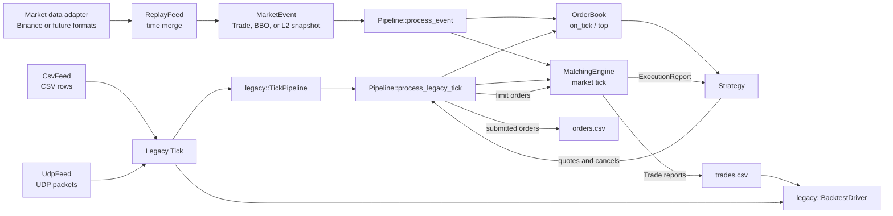
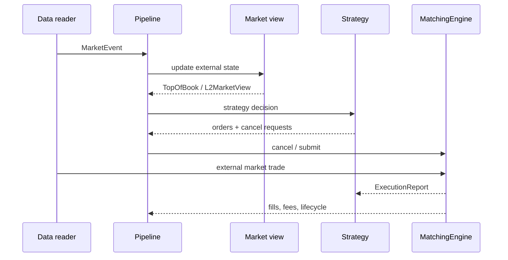

# System map

*Section 1 of the module reference. The index is [`../ARCHITECTURE.md`](../ARCHITECTURE.md).*

The whole flow in one picture, the five objects an event passes through, and the ownership
rule that keeps two modules from writing the same state.

## 1. System Map



The v2 central path is intentionally short:

```text
MarketEvent -> OrderBook / MatchingEngine -> Strategy -> orders -> reports -> output
```



CSV and UDP remain compatibility inputs for the original Tick model. They enter through the
`legacy` boundary and are not the v2 market-data contract.

The source map is:

| Responsibility | Main files | Key types or functions |
|---|---|---|
| Shared data | `src/common/types.h`, `src/common/market_event.h` | `Side`, `ExecType`, `MarketEvent` |
| Instrument rules | `src/common/instrument_spec.h` | `InstrumentSpec`, `btc_usdt_spec` |
| Legacy input | `src/lines/legacy/*` | `legacy::Tick`, `legacy::TickPipeline`, `legacy::tick_csv`, `OrderBook`, `CsvFeed`, `UdpFeed` |
| Market replay | `src/market/market_data_adapter.*` is the router, and each venue has its own file beside it: `binance_readers.*`, `deribit_readers.*`, `okx_readers.*`, sharing `field_parser.h`; plus `replay_feed.*`, `market_event_recorder.*`, `threaded_l2_replay.*` | `IMarketEventReader`, `ReplayFeed::run`, `MarketEventRecorder`, `ThreadedReplayFeed` |
| Hand-off between threads | `src/concurrency/spsc_ring.h` | `SpscRing::try_push`, `SpscRing::try_pop`, `LatencyHistogram` |
| Coordination | `src/app/application.*`, `src/app/pipeline.*`, `src/app/fill_accounting.*` | `Pipeline::process_event`, `FillAccounting::apply`, legacy adapter, output callbacks |
| Market view | `src/orderbook/top_of_book.h`, `l2_orderbook.*`, `l2_market_view.h`, `tick_ladder.*` | `TopOfBook`, `L2OrderBook`, `L2MarketView`, `TickLadder` |
| Matching | `src/exchange/matching_engine.*`, `queue_model.h` | `MatchingEngine::match`, `send_order`, `TimeInForce`, `QueueAheadModel::advance_quantity` |
| Strategy | `src/strategy/strategy.h`, `src/strategy/baseline_market_makers.h`, `src/lines/legacy/l1_market_maker.h`, L2 strategy headers | Shared API, frozen L1 compatibility family, baseline pair, active L2 family |
| Legacy analysis | `src/backtest/backtest_driver.*` | `legacy::BacktestDriver::run`, `print_report` |
| Runtime logging | `src/utils/logger.*` | `Logger::log`, `Logger::error` |

