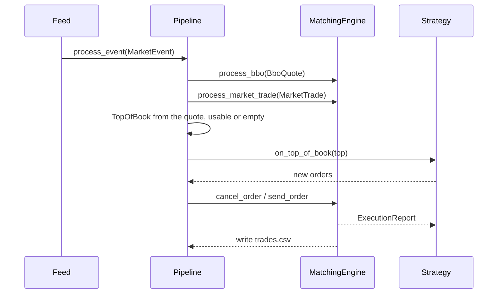

# The coordinator and the book

*Section 3 and 4 of the module reference. The index is [`../ARCHITECTURE.md`](../ARCHITECTURE.md).*

How the application wires the pieces together and what each dependency owns, then
the external book view the strategies read and the strategy orders they place.

## 3. Application Coordinator

**Files:** `src/app/application.*`, `src/app/pipeline.*`, `src/app/multi_book.*`

`main.cpp` is only the process bootstrap. `Application` wires concrete objects together. The
`LegacyCsv` and `LegacyUdp` modes create a legacy Tick adapter, `Replay` creates a Trades+BBO
event feed, and `L2Replay` creates a trade+depth feed. `Pipeline` owns the v2 domain sequence; the
application intentionally does not introduce separate runner abstractions yet.

An `L2Replay` given `--symbol-b` builds **two** of everything one book needs -- book, decision layer,
venue, pipeline -- and **one** `Portfolio`. `MultiBook` holds the legs, sends each event to the book its
symbol names, and reads the account once with every leg valued at its own last midpoint, which is the only
moment a gross and a net both exist. The books' readers are merged by timestamp before the feed sees them
(`src/market/merged_event_reader.*`), so the delivery path stays the single-stream one, and
`Portfolio::set_instrument` gives each symbol its own unit face value, because a ten dollar contract and a
one dollar one are not the same exposure. The hard cap is the account's as well: each book is told what
the other legs already hold (`Pipeline::set_account_marks`), so two books cannot each spend the same
ceiling. What the two-book run does not carry yet is named in the roadmap: the broker and the gateway wrap
one venue, `--metrics` samples one account's equity series, and `[PNL]`'s per-fill columns divide the
account's money by one book's fill count.

The diagram is the `Replay` path, and it has no book in it. A quote is already a top of book, and the
pipeline applies the book's own rule for one it can use -- both sides positive and not crossed -- rather
than writing the quote into an `OrderBook` and reading it back out, which is what that round trip was for
and what it added. The L2 path stopped building the book it never read for the same reason.



The report callback is the other important application boundary:

```cpp
engine_.set_report_callback(
    [this](const) ExecutionReport& report)
    {
        strategy_.on_order_update(report);
        write_trade_csv_row(trades_out_, report);
    });
```

The `[this]` lambda is a C++11 closure. `Pipeline` stores references to its collaborators rather than owning them; the run function constructs them in an enclosing scope and destroys them after the feed finishes. `std::unique_ptr<Strategy>` expresses exclusive ownership of the selected concrete strategy, while `std::atomic<uint64_t>` supplies the order-ID counter.

`orders.csv` is written when the pipeline submits a candidate order, before the matching result is known. `trades.csv` receives only `Trade` reports owned by `MarketMaker`; `Resting`, `Filled`, and `Cancelled` are lifecycle events, not additional executions. New trade files append `liquidity_role` and `fee` columns; the six required legacy columns remain unchanged for compatibility.

### 3.1 Dependency injection at the coordinator boundary

`Pipeline` does not construct the order book, strategy, matching engine, or output streams itself. They are created by the application mode and passed into the constructor:

```cpp
auto output_files = open_output_files(source);
OrderBook order_book;
auto strategy = make_strategy(cfg.strategy_name);
Logger logger(to_abs_path("logs/toy_quant.log"));
MatchingEngine engine(&logger);
Pipeline pipeline(output_files.orders, output_files.trades, *strategy, engine, portfolio);
```

The constructor receives the domain collaborators through their interfaces and stores references to them:

```cpp
Pipeline(std::ofstream& orders_out, std::ofstream& trades_out, Strategy& strategy,
         IMatchingEngine& engine, Portfolio& portfolio, double tick_size = PRICE_TICK_SIZE)
    : ledger_(orders_out, trades_out),
      strategy_(strategy),
      engine_(engine),
      portfolio_(portfolio),
      tick_size_(tick_size)
{
    // Install the report boundary after the collaborators are available.
}
```

This is constructor injection: the `Pipeline` declares what it needs, while the caller chooses the concrete implementations. `IMatchingEngine` makes the coordinator depend on behaviour rather than on `MatchingEngine` details, and the strategy arrives through the `Strategy` base class, so the same pipeline can run `NaiveMarketMaker`, `OptimizedMarketMaker`, or `L1MarketMaker`. There is no book among the collaborators: a `BboQuote` already carries its own top of book, so the coordinator converts it where it arrives instead of handing it to an `OrderBook` and asking for it back, which is what the L2 path used to pay for with a book it never read:

```cpp
std::unique_ptr<Strategy> make_strategy(const std::string& strategy_name)
{
    if (strategy_name == "naive")
    {
        return std::make_unique<NaiveMarketMaker>(100, 0.00001);
    }
    if (strategy_name == "l1")
    {
        L1MarketMakerConfig config;
        config.order_size = 100;
        config.base_spread = 0.000003;
        return std::make_unique<L1MarketMaker>(config);
    }
    return std::make_unique<OptimizedMarketMaker>(100, 0.000003);
}
```

Dependency injection keeps construction at the application boundary and the event sequence in
`Pipeline`. Interfaces and callbacks also give focused tests substitution points without requiring
the complete application.

### 3.2 RAII and lifetime-bound resources

The application uses RAII, or Resource Acquisition Is Initialization, to bind cleanup to object lifetime. In the legacy CSV mode, the local objects are created in dependency order and remain alive while the feed invokes the pipeline:

```cpp
auto output_files = open_output_files(source);
OrderBook order_book;
auto strategy = make_strategy(cfg.strategy_name);
Logger logger(to_abs_path("logs/toy_quant.log"));
MatchingEngine engine(&logger);
Pipeline pipeline(output_files.orders, output_files.trades, *strategy, engine, portfolio);
legacy::TickPipeline tick_pipeline(pipeline, order_book, order_book, engine);
CsvFeed feed(csv_file, [&](const) legacy::Tick& tick) { tick_pipeline.process(tick, true); }, cfg.delay,
             &logger);
feed.run();
```

When `run_legacy_csv_mode` returns, destruction runs in reverse declaration order. The feed, pipeline,
logger, strategy, order book, and output streams clean themselves up through object lifetime. The
same cleanup occurs during stack unwinding if the feed throws.

The locking code applies the same rule to synchronization:

```cpp
TopOfBook OrderBook::market_top(const std::string& symbol)
{
    std::lock_guard<std::mutex> lock(mtx_);
    // Read the protected book state and return a snapshot.
}
```

Constructing `lock` acquires `mtx_`; leaving the function releases it automatically. The same RAII
pattern protects order-book updates, while `std::unique_ptr<Strategy>` owns the selected strategy.

### 3.3 Unified runtime logging

**Files:** `src/utils/logger.h`, `src/utils/logger.cpp`

`Logger` owns the optional text log file and mirrors each message to the appropriate console stream. `log(...)` writes to `stdout`; `error(...)` writes to `stderr`. When an application supplies a file path, the constructor creates its parent directory, opens the file in truncate mode for the current run, and `write` copies every message to that file. An empty path preserves console output without opening a file.

The application entry points own the `Logger`: CSV and UDP runs use `logs/toy_quant.log`, while `backtest_main` uses its configurable backtest log path. They pass it to the components that emit runtime events. `Pipeline` and `BacktestDriver` require `Logger&`, because their lifetime is always within the entry point's logging scope. `CsvFeed` and `MatchingEngine` accept an optional `Logger*`, preserving standalone construction for narrow tests and other callers:

```cpp
Logger logger(to_abs_path("logs/toy_quant.log"));
MatchingEngine engine(&logger);
CsvFeed feed(path, callback, delay, &logger);
```

This is dependency injection rather than a global logger. Market data, matching, and backtesting describe events but do not decide file locations, create directories, or manage file streams. `orders.csv` and `trades.csv` remain separate: they are structured business records consumed by the backtest, not human-readable runtime logs.

`Logger` uses a variadic template so callers can stream several values without manually constructing a temporary string:

```cpp
template <typename... Args>
void log(Args&&... args)
{
    write(format(std::forward<Args>(args)...), std::cout);
}
```

`typename... Args` declares a template parameter pack: at each call, the compiler deduces zero or more argument types. For example, `logger.log("order=", id, " qty=", quantity)` deduces types for the string literals and numeric values. `Args&&...` is a forwarding-reference parameter pack, and `std::forward<Args>(args)...` preserves whether each argument was an lvalue or rvalue when passing it to `format`.

Inside `format`, the fold expression `(stream << ... << args)` expands the pack into chained stream insertions. The example above is conceptually `stream << "order=" << id << " qty=" << quantity`. The resulting `std::string` lets the non-template `write` method implement the destination policy only once. The template definitions remain in the header because the compiler must see their bodies when it instantiates them for each argument combination.

### 3.4 Three owners where there was one class

`Pipeline` was one class of 1,261 lines holding the counters, the risk gates, the account, the order
records and the PnL formula. It is now the coordinator plus three owners, and the line between them is
**which data a piece of state belongs to** rather than how many lines each piece took:

| Owner | Files | What it holds | The question it answers |
|---|---|---|---|
| `OrderLedger` | `src/app/order_ledger.*` | the two CSV writers, the trace of one named order, the per-order audit entry, the queue profile | what happened to *this order* |
| `RunAccounting` | `src/app/run_accounting.*` | the funding series and its settlements, the fill and market-print markout queues with the horizon they drain on, the marked-equity series, the round-trip and taker measurements behind `[ROUND_TRIPS]` and `[TAKER]`, the PnL formula | what the *run* measured |
| `RunSummary` | `src/app/run_summary.h` | `ExecutionQualityMetrics`, `PnlSummary`, and the lines that print them | what the run *reports* |

The counters, the risk gates and the account stay with the coordinator and the `Portfolio`, because they
are the run rather than a measurement of it. The two owners that were extracted are the ones whose state
is *not resolved when it is written*: an order's audit entry is opened at submission and closed by the
report that ends the order, and a markout is queued at the fill and resolved a horizon later -- five quote
cycles unless `--markout-horizon` says otherwise. Those two queues of unresolved things sat beside
twenty-one counters, which is what made the class hard to
read, and it is why the split is by ownership rather than by size.

The split is not a behaviour change, and the gate is what says so: tier 1 asserts the batch counts, the
orders, the fills, the PnL and the queue-ahead figures, and tier 2 hashes the full 1.5 GB of stdout against
a stored reference, so an extraction that moved a number fails both.

## 4. OrderBook: the frozen line's external view

**Files:** `src/lines/legacy/order_book.h`, `src/lines/legacy/order_book.cpp`

`OrderBook` contains external market data only, and it is the legacy line's book rather than the L2 path's:
it lives under `lines/legacy/` beside the `Tick` model it consumes, `src/orderbook/` holds nothing but the
L2 stack and the top-of-book type, and after the coordinator stopped taking a book the only production
caller of this one is `legacy::TickPipeline`. Legacy Tick input updates simplified bid or ask price maps,
while a stored BBO replaces the latest venue snapshot.

```cpp
struct SideBook
{
    std::map<PriceTick, uint64_t, std::greater<PriceTick>> external_bids_qty;
    std::map<PriceTick, uint64_t> external_asks_qty;
    BboQuote external_bbo;
    bool has_external_bbo{false};
};
```

For legacy input, the comparators make the first bid the highest price and the first ask the lowest.
`market_top()` returns the stored `external_bbo` when one is valid and the Tick maps otherwise, and since the
coordinator stopped holding a book, the stored-BBO half is reached only by
`tests/orderbook_state_test.cpp`: the one production caller left, `legacy::TickPipeline`, fills the Tick
maps and reads them back. The mutex protects market updates and snapshots. Local strategy orders do not
enter this object.

### 4.1 Single ownership of strategy orders

`MatchingEngine` is the single source of truth for working strategy orders:

```cpp
std::unordered_map<std::string, MEOrderBook> books_;
std::unordered_map<uint64_t, exchange::Order*> order_index_;
```

Each price level owns FIFO orders in a `std::list`, so pointers in `order_index_` remain stable until
that order is erased. Submission, partial fills, fills, and cancellation mutate this one structure;
execution reports notify the strategy of lifecycle changes. The former mirrored private
`OrderBook` state was removed to eliminate synchronization drift.

### 4.2 Price representation

External inputs, strategy calculations, CSV records, and reports use `double` for readability.
Before a price is used as an order-book key or in matching comparisons, the implementation converts
it to an integer tick:

```cpp
using PriceTick = int64_t;
std::map<PriceTick, uint64_t, std::greater<PriceTick>> bids_qty;
```

```cpp
inline PriceTick to_price_tick(double price)
{
    return static_cast<PriceTick>(std::llround(price / PRICE_TICK_SIZE));
}
```

The matching engine uses the same `PriceTick` keys for price-time priority and cancellation.
`to_price()` converts ticks back to `double` only at output boundaries. Integer ticks make level
identity, comparison, and ordering deterministic while retaining readable public records.

