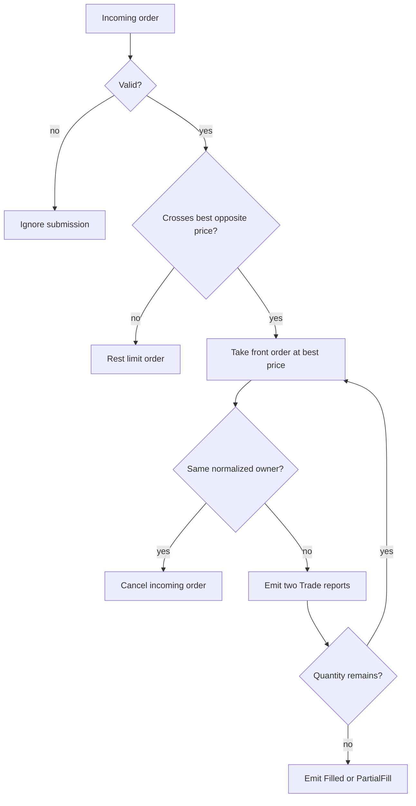

# The matching engine

*Section 5 of the module reference. The index is [`../ARCHITECTURE.md`](../ARCHITECTURE.md).*

Price–time priority, the queue model, partial fills, self-trade prevention, the time in
force terminals, and the reports the engine emits.

## 5. MatchingEngine: Orders, Queues, and Reports

**Files:** `src/exchange/order.h`, `execution_report.h`, `matching_engine.*`, `queue_model.h`

The exchange namespace defines the order vocabulary. `Order` carries identity, symbol, side, limit or market type,
original quantity, remaining quantity, timestamp, owner, and a `TimeInForce` (`gtc`, `ioc` or `fok`).
`ExecutionReport` adds the event type and reports either a fill or a lifecycle transition.

```cpp
struct ExecutionReport
{
    uint64_t order_id{};
    exchange::Side side{};
    ExecType exec_type{};
    std::string symbol;
    double price{};
    uint64_t quantity{};
    uint64_t ts{};
    std::string owner;
};
```

The main matching rules are:

- External ticks become `Market` orders, so they consume strategy liquidity but are never rested.
- Each price level uses FIFO order and matches the best executable price first.
- Owner normalization prevents `MarketMaker` from trading with itself.
- A public trade that prints at the stored best bid or ask reduces that stored best size, so a
    later taker order cannot fill against displayed liquidity that has already traded. This is
    separate from the queue model and applies on every replay path.
- In L2 replay, a maker order submitted at the displayed best price joins behind the displayed
    top-level quantity. Subsequent market trades consume this `external_queue_ahead` before local
    FIFO orders become eligible to fill. Ordinary L1 replay keeps its existing BBO semantics, so an
    L1 maker fill is not charged any queue position.
- A good-till-cancelled (`gtc`) order rests any unfilled quantity. An IOC matches the external touch and the
    internal book once, then emits `Cancelled` with `CancelReason::Ioc` for the remainder; it never rests. A
    FOK first computes the same immediately available quantity (external touch plus resting book, with
    self-trade prevention applied) and cancels with `CancelReason::Fok` without trading unless the whole
    quantity is available.
- `--participation-limit=X` caps the external-BBO part of an aggressive fill at X of the displayed best size.
    It is a capacity cap: the fill price stays the displayed touch, the rest is left to the order's time in
    force, and there is no price-impact model.

The matching algorithm is a direct price-time implementation:

```cpp
auto best_ask_it = book.asks.begin();
double best_price = best_ask_it->first;
if (new_order.price < best_price) break;

Order& resting = ask_queue.front();
uint64_t traded = std::min(qty, resting.remaining);
qty -= traded;
resting.remaining -= traded;
```

The engine emits `Trade` reports for executions, then `PartialFill` or `Filled` for the resting order. An
unfilled incoming limit order receives `Resting` and enters the appropriate queue only when it is GTC; an
immediate order's remainder is cancelled by `send_order_now` after `match` returns it.



Owner normalization removes whitespace and lowercases characters. A self-trade cancels the
aggressor. `Trade.quantity` is executed quantity; lifecycle quantities are remaining quantity.

### Per-symbol state is keyed by an integer id

The engine keeps its state in per-symbol containers: `books_`, `external_bbo_`, `l2_top_bbo_`, the two
last-trade clocks, and the set of symbols that have an L2 top. A replay touches one symbol millions of
times and reaches about ten of those containers per event, so keying them by the symbol string meant
hashing a thirteen character key ten times per event for a value that never changes.

`symbol_id()` resolves a symbol to a small `SymbolId` once per entry point and the containers are keyed
by that id instead. The public interface still takes strings, so nothing outside the engine changed:
`process_bbo` resolves once and hands the id to the private `process_bbo_for`, which is why the body of
`process_bbo` is separate from the override. `find_symbol()` is the lookup-only variant, used where a
rejected event must not register a new symbol.

[Low-Latency Design](../performance/design.md#3-the-engines-per-symbol-state-symbol-ids) explains the
mechanism and records the measured effect on the `engine` stage.

