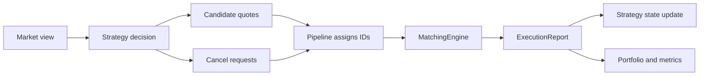
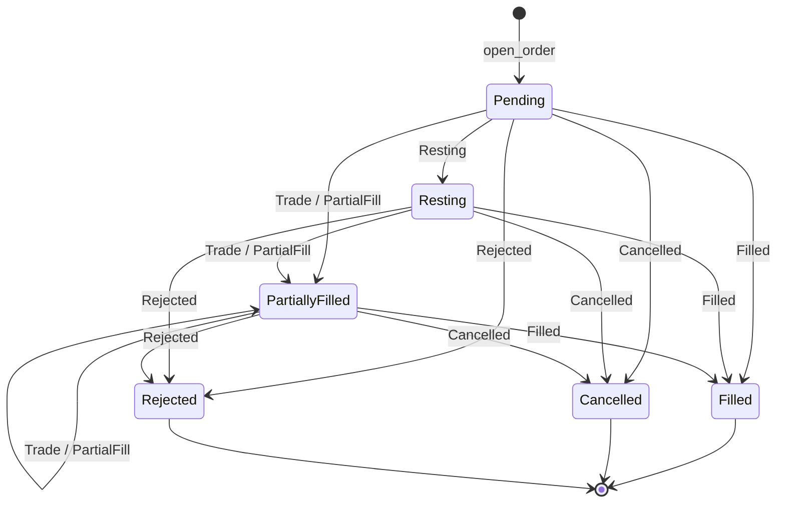
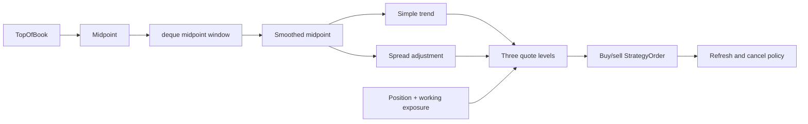
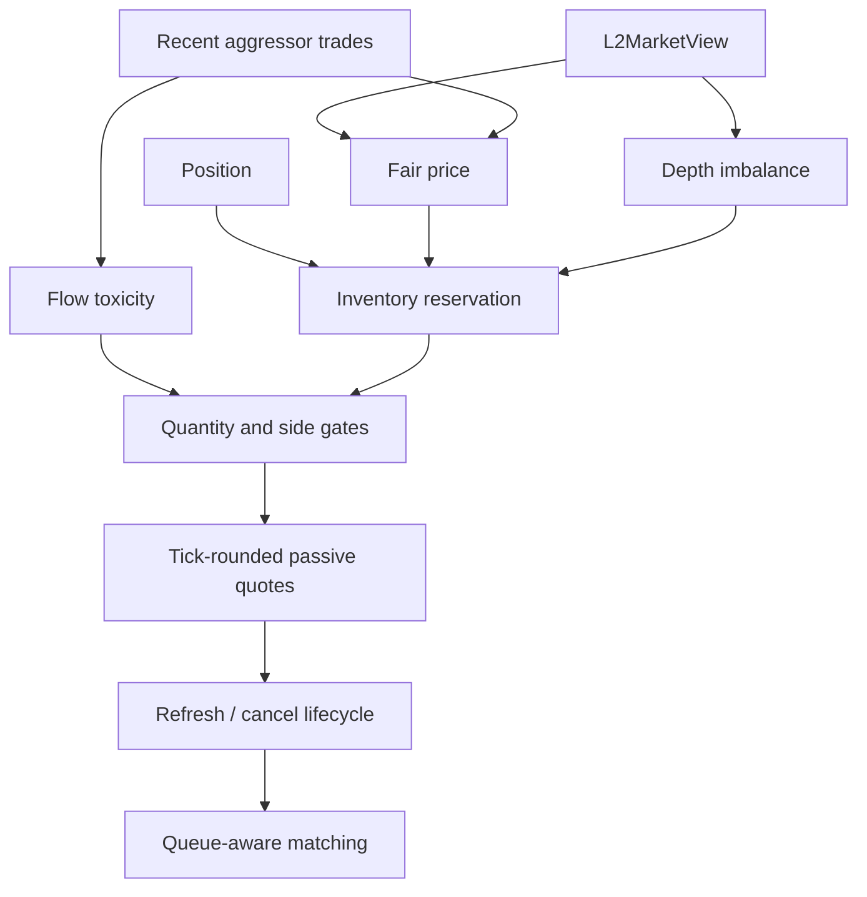

# Strategy

*Section 6 of the module reference. The index is [`../ARCHITECTURE.md`](../ARCHITECTURE.md).*

The decision layer: its lifecycle, the order state machine, the family map, and each strategy in
turn up to the `active_l2` mainline.

## 6. Strategy: The Main Decision Module

**Files:** `src/strategy/strategy.h`, `src/strategy/baseline_market_makers.h`, `src/strategy/l2_market_maker_base.h`, `src/strategy/inventory_aware_l2_market_maker.h`, `src/strategy/active_l2_market_maker.h`, `src/strategy/trend_l2.h`, `src/strategy/execution_l2.h`, `src/lines/legacy/l1_market_maker.h`

Eight files and four families, which is worth stating because the file names alone do not say it. `trend_l2.h` is deliberately outside the maker families: it has no quote lifecycle, only a target position. `execution_l2.h` is outside all of them and outside the signal families too: it has no view about direction, only a parent order and a schedule. `strategy.h` is the interface everything implements, and it is where the L2 family stops depending on the L1 one: `tools/gate/check_layering.py` keeps that true rather than trusting it, because a `legacy/` include anywhere under `src/strategy/` fails the gate. `baseline_market_makers.h` holds `NaiveMarketMaker` and `OptimizedMarketMaker`, neither of which implements `on_l2_market_view`: they see the touch and nothing else, and they are the baseline the rest is measured against. The active family is three files with one inheritance chain between them, and the middle one is the root:

| File | Class | Role |
|---|---|---|
| `l2_market_maker_base.h` | `L2MarketMakerBase` | the L2 family root: the fair-price signal, the quote lifecycle, the queue-hold refresh policy, the counters |
| `inventory_aware_l2_market_maker.h` | `InventoryAwareL2MarketMaker` | `final`, adds a position-scaled quote shift on top of the root |
| `active_l2_market_maker.h` | `ActiveL2MarketMaker` | `final`, adds the volatility halt and the warmup on top of the root |

The root's class and its file both carry `Base`, because three names ending in `_l2_market_maker.h` read as siblings otherwise, and the one every other one extends is not the one a reader would pick. Each of the leaves derives from the root rather than holding one and forwarding each callback: a wrapper has to hand-forward every virtual, and a forgotten forward changes behaviour silently rather than failing to compile, which is what happened when `InventoryAwareL2MarketMaker` was written the other way and never forwarded `on_queue_activity`.

The strategy is the decision layer, not the matching layer. It sees `TopOfBook`, keeps its own working-order and position state, and returns candidate `StrategyOrder` values. The pipeline later assigns IDs and converts them to `exchange::Order`.

```cpp
class Strategy
{
   public:
    virtual ~Strategy() = default;

    // Pure virtual: the pipeline calls these on every strategy, so every strategy must answer.
    virtual std::vector<StrategyOrder> on_top_of_book(
        const std::string& symbol, const TopOfBook& tob) = 0;
    virtual void on_order_submitted(const StrategyOrder& order) = 0;
    virtual std::vector<uint64_t> cancel_requests() = 0;
    virtual int64_t net_position() const = 0;
    virtual size_t working_order_count() const = 0;
    virtual void on_order_update(const ExecutionReport& report) = 0;

    // Defaulted, and deliberately not pure: a strategy that has nothing to say about the richer
    // entry point inherits the answer that drops back to the touch.
    virtual std::vector<StrategyOrder> on_l2_market_view(const L2MarketView& view)
    {
        return on_top_of_book(view.symbol, view.top);
    }
    virtual void on_market_trade(const MarketTrade& trade) { (void)trade; }
    virtual void on_queue_activity(Side side, uint64_t consumed_quantity) { ... }
    virtual StrategyMetrics metrics() const { return {}; }
    virtual void on_markout_estimate(const MarkoutEstimate& estimate) { (void)estimate; }
    virtual uint64_t markout_gate_skips() const { return 0; }
    virtual uint64_t flatten_orders() const { return 0; }
    virtual uint64_t flatten_quantity() const { return 0; }
};
```

The split between those two halves is the design, and it is six pure virtuals against nine defaulted
ones. A pure virtual is a question the pipeline asks of every strategy, so a strategy that cannot answer
it should not compile. A defaulted virtual is a question only some strategies have an answer to, and each
default is chosen so that the ones without an answer are still *correct* rather than merely empty:
`on_l2_market_view` falls back to the touch, so a strategy written against `TopOfBook` runs on the L2 path
unchanged, and `on_market_trade` with a `BboQuote` calls the one-argument version rather than duplicating
it. The remaining callbacks report execution quality, queue activity and the two optional gates, and they
default to doing nothing and returning zero, which is what keeps a run that did not ask for a gate
byte-for-byte identical to the same run before the gate existed.

`main.cpp` selects an implementation with `std::make_unique`; the pipeline then uses the common
interface without knowing which strategy is active. The virtual destructor makes polymorphic
ownership safe.

A reader who wants the family as a table rather than as a tour can start at section 6.5, which opens with
every strategy in the repository by the mechanisms it has.

### Strategy lifecycle at a glance



| Callback | Direction | Responsibility |
|---|---|---|
| `on_top_of_book` / `on_l2_market_view` | Pipeline -> strategy | Produce the next candidate quote set |
| `on_market_trade` | Pipeline -> strategy | Update aggressor-flow state |
| `on_order_submitted` | Pipeline -> strategy | Record exchange-assigned working orders |
| `on_order_rejected` | Pipeline -> strategy | A pre-trade control refused the order before it had an id; the default does nothing and `trend_l2` backs off |
| `cancel_requests` | Strategy -> pipeline | Return stale or unsafe order IDs |
| `on_order_update` | MatchingEngine -> strategy | Apply fills, cancellations, partial fills and terminal rejections |

The strategy chooses intent. The pipeline owns sequencing and IDs. The matching engine owns actual
working orders. This separation is the key invariant for every strategy family below.

A report that ends an order is `Filled`, `Cancelled` or `Rejected`, and one `is_terminal` predicate in
`exchange/execution_report.h` is what releases the pending quantity, closes the audit entry and removes
the order from the strategy's open set. `Rejected` carries a `reject_reason` (venue, broker, timeout or
risk) and is not a cancel the strategy asked for; a post-submission venue or broker refusal arrives this
way, while a pre-trade refusal has no order id and uses `on_order_rejected` instead. `Cancelled` carries a
`CancelReason` (user, venue, IOC, FOK, self-trade, timeout): a user cancel or an IOC/FOK expiry is expected,
while a venue, self-trade or timeout cancel is treated like a rejection by `trend_l2`, which backs off instead
of re-quoting immediately. Inside the ledger an order moves Pending -> Resting -> PartiallyFilled ->
Filled/Cancelled/Rejected; a transition that would move it backwards is counted in
`invalid_order_transitions` instead of being applied, and a report for an order whose audit is already
closed is counted in `orphan_order_reports`. Both counts are zero in a normal run and are printed only when
non-zero.

### Order state machine

The ledger's state machine is deliberately small: it covers the life of one order from the moment the
pipeline accepts it for submission to the report that ends it, and it is the one place a strategy's belief
about an order can be checked against the report stream.



| From | Event | To | Where it comes from |
|---|---|---|---|
| none | `open_order` | Pending | `Pipeline::submit_strategy_actions` after the risk checks |
| Pending | `Resting` | Resting | `OrderLedger::mark_resting` |
| Pending | `Trade` / `PartialFill` | PartiallyFilled | an immediate marketable fill |
| Pending | `Filled` | Filled | a full fill, or a fill that never rested |
| Pending | `Cancelled` | Cancelled | a cancel before the order rested |
| Pending | `Rejected` | Rejected | `Pipeline::handle_rejected_order` for a venue or broker refusal |
| Resting | `Trade` / `PartialFill` | PartiallyFilled | the first fill of a resting order |
| Resting | `Filled` | Filled | a terminal fill report |
| Resting | `Cancelled` | Cancelled | user, venue, IOC, self-trade or timeout cancel |
| Resting | `Rejected` | Rejected | a venue or broker refusal |
| PartiallyFilled | `Trade` / `PartialFill` | PartiallyFilled | more fills; the state does not move |
| PartiallyFilled | `Filled` | Filled | the remaining quantity completed |
| PartiallyFilled | `Cancelled` | Cancelled | the remainder was pulled |
| PartiallyFilled | `Rejected` | Rejected | the remainder was refused |
| Filled / Cancelled / Rejected | any further report | no state | counted in `orphan_order_reports` |
| any open state | a backwards event, e.g. `Resting` after a fill | no state | counted in `invalid_order_transitions` |

The three terminal states all run the same cleanup: release the quantity the position gate reserved, close
the audit entry and remove the order from the strategy's open set. A `Rejected` is not a `Cancelled`: it
carries a `RejectReason` (venue, broker, timeout or risk), while a `Cancelled` carries a `CancelReason`
(user, venue, IOC, self-trade or timeout). The reasons are annotations on the terminal report; they do not
add states.

Two things are intentionally outside this machine:

* **A pre-trade refusal** has no order id and no reservation, so it never enters the ledger. It is delivered
  through `Strategy::on_order_rejected` and a strategy that retries must do so itself.
* **A gateway timeout** is not a terminal state. The order is still `Pending` in the ledger; the gateway
  queries the venue with `OrderQuery` and reports `unacknowledged`, `timeouts_working` and `timeouts_unknown`.
  `Working` means the venue still holds it, `Unknown` means it does not, and neither result is a fill or a
  cancel. Treating a timeout as a cancellation would be inventing a fact.

| Component | State it owns | File |
|---|---|---|
| `MatchingEngine` | the resting book and the order index | `src/exchange/matching_engine.*` |
| `OrderGateway` | unacknowledged/in-flight orders, retries, timeout queries and their results | `src/lines/order_gateway.*` |
| `PaperBroker` | held orders, its own statement and the reports it withholds | `src/lines/paper_broker.*` |
| `RiskPipeline` | the pre-trade decision and its counters; no order state | `src/app/risk_pipeline.*` |
| `Pipeline` | position and pending reservations, plus the report fan-out | `src/app/pipeline.*` |
| `OrderLedger` | per-order state, audit and state-transition counters | `src/app/order_ledger.*` |
| each `Strategy` | its own open-order set and retry policy | `src/strategy/*` |

`tests/order_state_test.cpp` is the executable version of this table: it walks Pending -> Resting ->
PartiallyFilled -> Filled, checks that a backwards `Resting` is refused, checks that a duplicate terminal
report is an orphan, and checks that a refused order releases its pending reservation so the next order is
accepted.

### Strategy family map

| Family | Input view | Main purpose | Execution model |
|---|---|---|---|
| Legacy | `Tick` | Compatibility and simple demonstrations | Legacy tick pipeline |
| L1 replay | `TopOfBook` + trades | BBO-aware quoting | Trades+BBO matching |
| L2 replay | `L2MarketView` + trades | Depth-aware quoting and queue diagnostics | Queue-aware L2 matching |

### 6.1 NaiveMarketMaker: baseline quote

The naive strategy requires both sides of the top of book, computes the midpoint, places one quote on each side, and rounds both prices to the configured tick size:

```cpp
double mid = (tob.bid_price + tob.ask_price) / 2.0;
double buy_price = std::round((mid - base_spread / 2.0) / tick_size) * tick_size;
double sell_price = std::round((mid + base_spread / 2.0) / tick_size) * tick_size;

orders.push_back(StrategyOrder(Side::Buy, symbol, buy_price, base_order_size, 0));
orders.push_back(StrategyOrder(Side::Sell, symbol, sell_price, base_order_size, 0));
```

It does not request cancellations, so working orders can accumulate. It updates position from
`Trade` reports and serves as a deliberately simple baseline.

### 6.2 OptimizedMarketMaker: stateful quoting

The optimized strategy adds controls in a deliberate order:



`OptimizedMarketMaker` is the stateful strategy. It keeps a window of recent midpoints in a
`std::deque`, averages that window, and estimates short-term trend from the change in the smoothed
midpoint. It then builds up to three quote levels. The core price adjustment is:

```cpp
double raw_buy = smooth_mid - level_spread / 2.0 - std::max(0.0, trend) -
                 inv_spread_bias * (inventory > 0 ? 1.0 : 0.0);
double raw_sell = smooth_mid + level_spread / 2.0 + std::max(0.0, trend) +
                  inv_spread_bias * (inventory < 0 ? 1.0 : 0.0);

double buy_price = std::round(raw_buy / tick_size) * tick_size;
double sell_price = std::round(raw_sell / tick_size) * tick_size;
```

Inventory is `position + working_exposure`, with buys positive and sells negative. If inventory is
long, the strategy makes buys less attractive and reduces buy size, encouraging future sells. If
inventory is short, it applies the symmetric adjustment to sells. Once the limit is exceeded, the
risky side is disabled.

The refresh policy separates “should quote now?” from “which old orders must be cancelled?”:

- `quote_age_ticks` forces refresh after an age limit.
- `quote_refresh_ticks` compares the smoothed midpoint with `last_quote_mid`.
- `cancel_requests()` returns active IDs when a quote is stale.
- `on_order_submitted()` records IDs and resets quote age.

In short: observations create quotes, submitted IDs become working state, execution reports update
quantities and position, and stale quotes are cancelled before replacement.

### 6.3 L1MarketMaker: BBO-aware quoting

L1 strategies are frozen compatibility implementations. Their CLI names remain available for
reproducing earlier L1 replay and benchmark results; new strategy work belongs to the L2 path.
The archived implementations are in `src/lines/legacy/l1_market_maker.h`. Their behaviour is pinned rather than described: `bash tools/gate/verify_l2.sh fast` checks the L1
invariants on every edit and `bash tools/gate/verify_l2.sh all` compares a full-file run byte for byte,
so a change in those makers that moves the numbers is a change to a recorded result. Execution
quality is not computed inside them; `ExecutionQualityMetrics` in the pipeline owns edge, markout,
quote lifetime and inventory for every strategy, and prints them in `[EXECUTION]`.

#### The two gates

Two different things are called a gate in this project, and they fail in opposite directions. The first refuses a
change that would move a recorded number; the second refuses a quote that cannot pay for itself.

The verification gate is `tools/gate/verify_l2.sh`, and it has four tiers because the checks cost different amounts and
catch different mistakes. Tier zero runs the unit tests, because a failing test once shipped in a commit that the
older gate could not see. Tier one replays a two hundred thousand record slice and compares the event counts,
orders, fills, realized PnL and consumed queue position against the values the documents quote, re-derives every
`toyquant:check` block, including the ones a benchmark binary carries rather than the main one, and lints the prose
for a flag the code accepts that no document mentions. Tier two replays
1.5 GB and compares the hash of the whole output, which is what makes a claim about timing defensible. Tier three
builds with the address and undefined behaviour sanitizers and runs the tests and a slice through them, because a
leak in the block reader or an out-of-range slot in the ladder is invisible in a normal build. A tier that skips
says so on its own line, because a hidden skip and a pass are indistinguishable in a log.

The decision gate lives in the strategy and exists because the fee is larger than the edge at the touch. It has two
knobs and both are off at zero, which is what keeps every recorded run reproducible. `--edge-cover-ticks` requires
the edge a fill would capture, measured from the reference price in ticks, to cover the maker fee plus the ticks it
names, where the fee in ticks is `rate * price / tick_size`: 2.55 ticks on the Deribit contract at 2020 prices and
about 186 on the OKX contract at 2026 prices, which is the ratio that stops the policy being tuned into profit.
`--min-spread-ticks` refuses the situation rather than the price: when the top of book is narrower than it asks for,
nothing is placed at all, because a one tick book leaves the touch half a tick from the midpoint and those are the
fills the bucketed markout shows resolving at or below zero. Both refusals are counted, so a run can report how
often the decision layer declined to act and not only what it did.

One difference matters when reading L1 results: **the L1 path models no queue in front of a quote.** Its book
has no depth-derived levels, so a resting L1 order starts at the touch with nothing ahead of it and a print
through its price fills it. The L2 path fills only after the queue ahead has been consumed. Fill counts on
the two paths therefore answer different questions, and every queue-model result in
`docs/PERFORMANCE_HISTORY.md` comes from the L2 path.

`L1MarketMaker` is the replay-oriented single-level strategy. It consumes BBO updates for quoting
and venue trades for order-flow information. Its behavior is intentionally layered so each risk
control has a distinct purpose:

1. **Input filtering.** A trade is used for imbalance only when a latest BBO exists, the trade is
    not older than the BBO, its BBO age is below `max_market_trade_age`, and its price deviation
    from the BBO midpoint is below `max_trade_deviation_bps`. Direct one-argument calls remain
    available for focused tests; the replay pipeline uses the BBO-aware overload.
2. **Flow and volatility state.** A single FIFO window of `TradeSample` values tracks buy and sell
    aggressor volume. A rolling window of absolute midpoint changes estimates short-term movement.
    This is a simple educational volatility proxy, not a statistical volatility model.
3. **Reservation price.** Effective inventory is `position + working_exposure`, where working buys
    are positive and working sells are negative. The reservation midpoint is shifted by a bounded
    `tanh(inventory / inventory_limit)` term: long inventory shifts the center down to discourage
    more buying, while short inventory shifts it up to encourage buying back.
4. **Quote width.** The effective spread is at least the larger of the configured base spread and
    current market spread, plus twice the average midpoint change. Trade-flow and BBO-size imbalance
    add an adverse shift to both sides. Prices are rounded to the instrument tick and clipped to
    remain passive relative to the venue BBO.
5. **Quote size.** Volatility stress reduces both sides toward a configurable minimum quantity
    ratio. Inventory reduces only the risky side. Above `inventory_risk_threshold`, the risky side is
    disabled and only the inventory-reducing side remains.
6. **Lifecycle.** A changed quote first requests cancellation; replacement waits for cancellation
    reports. The strategy counts what it owns: submitted quantity, fills, cancels, quotes, quote
    refreshes and the queue it consumed. Execution quality is not among them; see below.

The tunable values are grouped in `L1MarketMakerConfig`. The legacy positional constructor remains
for compatibility, while the application entry point uses the named configuration object. The
configuration is deliberately in-process rather than JSON/YAML: this project is an educational
simulator, not a production configuration service.

`StrategyMetrics` carries only what a strategy owns, so the runtime summary can report L1-specific
counters without downcasting the strategy: submitted quantity, fills, cancels, quotes and quote
refreshes. Execution quality is deliberately not included. `captured_edge` is an immediate midpoint
comparison and `adverse_selection` is a later markout after five quote cycles; both belong to
`ExecutionQualityMetrics` in the pipeline, which computes them once for every strategy from the same
reports and the same market events, and prints them in `[EXECUTION]`. The L1 makers used to keep a
second copy of those quantities from their own view of the mid, and it was deleted rather than
reconciled because the two could disagree and nothing compared them. Neither number includes fees or
constitutes a complete portfolio PnL calculation.

### 6.4 ActiveL2MarketMaker: L2 mainline

The L2 strategy receives an explicit `L2MarketView` from `L2OrderBook`. The view contains the
top of book, micro-price, aggregated depth, depth imbalance, symbol, and snapshot timestamp. L2
strategy state is separate from the L1 `OrderBook`; it never consumes raw vendor rows.



| Production setting | Value | Used for |
|---|---:|---|
| Signal mode | `Flow` | Combines micro-price, depth, and trades |
| Trade window | `16` events | Recent aggressor-flow estimate |
| Imbalance shift | `2 * tick_size` | Depth contribution to fair price |
| Trade shift | `1 * tick_size` | Flow contribution to fair price |
| Refresh threshold | `2` ticks | Repricing trigger |
| Maximum quote age | `50` L2 decisions | Stale-quote fallback |
| Toxicity threshold | `0.65` | Disables the threatened side |
| Weak-flow threshold | `0.9` | Activates extreme-flow protection |
| Volatility alpha | `0.25` | Active-L2 EWMA smoothing |
| Pause threshold | `9` ticks/second | Extreme-volatility risk gate |

#### 6.4.1 Fair-price construction

`L2MarketMakerBase` supports `Baseline`, `Depth`, `Micro`, and `Flow` signal modes. The production
factory selects `Flow` with a 16-trade FIFO window. In that mode the fair price is:

```text
fair = micro_price
    + depth_imbalance * imbalance_shift
    + trade_imbalance * trade_imbalance_shift
```

`depth_imbalance` is the normalized bid-versus-ask quantity across the configured visible levels.
`trade_imbalance` is the normalized aggressor buy-versus-sell volume in the recent trade window.
The micro-price uses top-level quantities to move the reference toward the side with less displayed
liquidity. These signals shift the reservation price; they do not authorize crossing the spread.

#### 6.4.2 Inventory and toxicity controls

The base engine computes:

```text
inventory_ratio = clamp(position / inventory_limit, -1, 1)
inventory_shift = inventory_ratio * base_spread
```

Long inventory moves the reservation price down and makes additional buys less attractive; short
inventory applies the symmetric behavior. At the hard inventory limit, the risk-increasing side is
disabled.

For flow toxicity, the configured threshold is `0.65`. A strongly positive flow disables the sell
side; a strongly negative flow disables the buy side. When flow magnitude exceeds `0.9` while
inventory is already materially imbalanced, weak-flow protection halves both quote quantities and
moves both prices one tick farther from the center. The name `weak_flow` refers to weakening the
quotes, not to weak market flow.

#### 6.4.3 Passive quote construction and lifecycle

Prices are tick-rounded around the fair price, inventory shift, and weak-flow shift. A final passive
clip enforces:

```text
bid <= external_best_bid
ask >= external_best_ask
```

This keeps the L2 strategies maker-only. When orders are working, a fair-price move of two ticks
requests cancellation. The active mainline counts quote age only when the external top-of-book
midpoint moves by at least one tick; depth-only updates do not consume quote lifetime. This avoids
treating incremental feed granularity as market movement. The fallback maximum age remains 50
market-price decisions. The pipeline processes cancellation before allowing replacement, and the
active strategy records price refreshes, age refreshes, and risk pauses separately.

This behavior is specifically important for incremental input: many updates change displayed
quantity without moving the best price. Counting every such update as quote age creates artificial
refresh churn. The retained rule removes that data-resolution artifact without changing the fair
price, inventory, toxicity, or passive-price logic.

The pipeline also reports consumed queue volume back to the strategy. If a quote reaches its age
limit while the queue ahead is actively being consumed and fair price has not changed, L2 retains
the quote and resets its age instead of cancelling and losing time priority. A price change or risk
pause still takes precedence. The preservation is bounded to three holds before a stale quote must
be reconsidered. This is a queue-preservation rule, not a profitability assumption.

#### 6.4.4 Active risk overlay

`ActiveL2MarketMaker` composes `L2MarketMakerBase`; it does not duplicate its inventory or flow logic.
It maintains a time-normalized midpoint-movement EWMA:

```text
volatility = alpha * normalized_move + (1 - alpha) * previous_volatility
```

The production value is `alpha = 0.25`. Ordinary volatility does not widen quotes. When the EWMA
reaches `9` ticks per second, active L2 requests cancellation of all working orders and pauses new
submissions. This is a tail-risk gate, not a continuous spread signal. The historical
`adaptive_l2` name is accepted only at the factory boundary and constructs this same class.

For both snapshot and incremental batches, the EWMA uses exchange event time so strategy signals are
normalized against market time rather than file or network processing cadence. Incremental
`local_ts` remains available in `L2MarketView` for future latency diagnostics, but does not alter
the current trading decision. The same market period can still produce different quote-cycle counts
because incremental data contains more update batches; that execution-resolution difference must be
measured before comparing PnL.

#### 6.4.5 Execution and queue model

Before L2 strategy decisions, `Pipeline::process_l2_market_view` sends the snapshot top of book to
`MatchingEngine::process_l2_top`. If a maker order joins the displayed best price, the displayed
quantity is stored as `external_queue_ahead`. Subsequent market trades consume that quantity before
the local FIFO order. This prevents a new order from receiving queue-first fills.

The engine exposes `queue_ahead_consumed` in the run summary. Queue-clear diagnostics count price
levels whose external queue reaches zero; they do not measure cleared quantity. Fees are calculated at execution time
from `InstrumentSpec`; the current Deribit BTC perpetual benchmark assumes maker `0.02%` and taker
`0.05%`. The L2 replay is therefore evaluated on net PnL, fees, maker/taker role, queue consumption,
markout, inventory, and refresh-cause metrics together.

The matching engine supports four queue interpretations, and they are one family rather than four
opinions. They are one class with one method in `src/exchange/queue_model.h`, which is a name the table
below can be read against: the arithmetic used to be a lambda inside `MatchingEngine::process_bbo_for`, so
the four names the command line takes and the four rows here were separated by a hundred lines of book
update code. When a level's displayed size falls by `r` with no trade at that price, the only unknown is how
much of that `r` was ahead of a resting order, and each model is a claim about that one random variable,
`X(r)`, with `q` the share of the display that is ahead of the order:

| model | `X(r)` | mean | variance |
|---|---|---|---|
| `Conservative` | `0` | `0` | `0` |
| `ProRata` (default) | `r q` | `r q` | `0` |
| `Lumpy` | `(r / k) Binomial(k, q)` | `r q` | `r^2 q (1 - q) / k` |
| `Optimistic` | `r` | `r` | `0` |

The first and last bracket the **mean**, and `k` moves only the **variance**, which is why `ProRata` is
the neutral default rather than a compromise. `tools/study/calibrate_queue_model.py` measures this feed to put
99.96% of a level's size decrease on cancel or amendment rather than trade, so a queue that only moves
when a trade prints contradicts the mechanism; the cancellation sizes it measures, where a median
decrease removes 74% of a median level and the removed fraction is flat across four orders of magnitude
of level size, are what makes `k = 1` the lumpiest honest reading. The queue arithmetic tests in
`tests/matching_engine_test.cpp` pin the consequences: at `q = 1` every model but the conservative one
removes the whole decrease, and the lumpy mean matches pro-rata over 200 replications. The arrival rule
is separate and is the share `alpha` in `Q0 = alpha D0`, one for a FIFO venue; it is a knob, but a
second-order one, because `q` is a fixed point of the pro-rata dynamics and only trades, 0.04% of what
moves a level, break it. `docs/PERFORMANCE_HISTORY.md` carries the derivations and the measurements.

The C++ replay path supports both source types. The Python benchmark reconstructs a compact top-five
timeline from grouped incremental updates so execution and markout fields use the same report shape
for both sources. This is a top-five comparison timeline, not an order-level queue reconstruction.

The current active L2 implementation is intentionally a conservative research mainline. Its
18-window in-sample baseline and four-window 2020-05-01 sample-out-of-time check remain negative
after fees. The strategy is structurally complete for this simulator, but those results do not
establish live profitability.

Every L2 replay records its queue model. `prorata` is the default and the mainline result: it is the
neutral assumption about the one thing the data cannot show, which is where in a level's queue the
cancellations sit. `conservative` (nothing comes off the queue ahead) and `optimistic` (all of it
does) bracket it, and the measured cancel share says `conservative` reads as a floor that is harsher
than the mechanism. Both are models for information lost by aggregated L2 data, not proof of live fill
probability. A strategy comparison is useful only when its behavior remains reasonable across
multiple windows, dates, and queue models.

The L2 replay applies a fixed one-market-event cancellation delay. Legacy CSV/UDP and ordinary
snapshot replay use the configured delay path; this delay is event-count based, not milliseconds.
Every replay mode marks the portfolio to market at the last market price before reporting, so
`equity` and `unrealized_pnl` account for any position still open when the input ends. The L1
replay path used to skip that step, which left both fields at zero while `cash` was populated.

The run summary also records `audited_orders`, `audited_filled_orders`,
`audited_cancelled_orders`, `cancelled_after_fill_orders`, `cancelled_before_fill_orders`, and
`total_order_lifetime_cycles`. The last field counts quote decision cycles, not elapsed time.

### 6.5 Strategy families and comparison

Every strategy in the repository, by what it can actually do. The columns are the mechanisms that differ
between them rather than the ones they share, and the rows are classes rather than names: the L2 family is
one inheritance chain, so it is three rows, while the frozen L1 line is five separate classes that happen
to share an interface and seven of the L2 names are one class under seven configurations.

| Strategy | CLI name(s) | Input | Fair price from | Inventory | Flow | Queue | Gates | Halt | Discipline |
|---|---|---|---|---|---|---|---|---|---|
| `NaiveMarketMaker` | `naive` | touch | midpoint | none | — | — | — | — | — |
| `OptimizedMarketMaker` | `optimized` | touch | smoothed midpoint + trend | skew, size, limit | — | — | — | — | — |
| `PassiveL1MarketMaker` | `passive_l1` | touch | midpoint | limit | — | — | — | — | — |
| `InventoryAwareL1MarketMaker` | `inventory_aware_l1` | touch | midpoint + skew | skew, size, limit | — | — | — | — | — |
| `FlowAwareL1MarketMaker` | `flow_aware_l1` | touch | midpoint + flow | limit | window, weights 0.6/0.4 | — | — | — | — |
| `L1MarketMaker` | `l1` | touch | midpoint + skew + stress | skew, size, limit | window + weights | — | fee-aware spread | stress widening | — |
| `ActiveL1MarketMaker` | `active_l1` | touch | skew first | skew, size, limit | — | — | — | — | shorter lifetime |
| `L2MarketMakerBase` | `l2`, `passive_l2`, `l2_baseline`, `l2_depth`, `l2_micro`, `l2_flow`, `flow_aware_l2` | touch + depth | microprice + depth + flow, by mode | skew, limit | guards | **hold** | fee + edge + markout | — | flatten |
| `InventoryAwareL2MarketMaker` | `inventory_aware_l2` | touch + depth | as the root | skew, limit, **size, reducing side** | guards | hold | fee + edge + markout | — | flatten |
| `ActiveL2MarketMaker` | `active_l2`, `adaptive_l2` | touch + depth | as the root | skew, limit | guards | hold | fee + edge + markout | **yes, with warmup** | flatten |
| `TrendL2Strategy` | `trend_l2` | touch | EWMA cross | target position, clips at the touch | — | — | — | stop, time stop, cooldown | — |
| `ExecutionL2Strategy` | `execution_l2` | touch | none: a parent order from the configuration | child orders at the touch, by schedule | — | — | — | deadline | — |

Four things that table cannot say, and they matter more than the marks do:

* **The seven `l2` names are one class under seven configurations.** `l2`, `passive_l2`, `l2_baseline`,
  `l2_depth`, `l2_micro`, `l2_flow` and `flow_aware_l2` all build `L2MarketMakerBase` and differ only in
  `L2SignalMode` and in whether the flow guards are on, which is what makes the fair-price row a list
  rather than a value. Adding a signal is a `case` in `fair_price()`, not a class.
* **The L2 row's mechanisms are off unless a run asks for them.** `edge_cover_ticks` is `0`, `markout_cover`
  is `false` and `flatten_band_units` is `0` in every recorded run, and the reason is written into the
  config: a run that does not ask for a gate must behave exactly as it did before the gate existed. So the
  table describes what the strategies *can* do; what the recorded numbers exercised is in
  [Performance History](../PERFORMANCE_HISTORY.md).
* **`InventoryAwareL2MarketMaker` and `ActiveL2MarketMaker` are `final` and add one behaviour each** to the
  same root, so their rows repeat the root's columns on purpose: they inherit the queue-hold policy, the
  gates and the flatten band, and adding a mechanism to the root adds it to both.
* **The five L1 rows are frozen rather than maintained.** `src/lines/legacy/` carries them so the recorded
  L1 results stay reproducible, and the gate pins them instead of describing them: tier 1 asserts their
  invariants on every edit and tier 2 compares a full-file run byte for byte.

One capability is deliberately absent from the table twice. `NaiveMarketMaker` has no inventory control at
all — its own comment records what that cost before the refresh triggers were added: 234,576 orders, a 52%
fill rate and a position of -12,000 contracts on a 200,000-row window. And no strategy in the repository
crosses the spread on its own initiative: the L2 root rounds each quote onto the tick grid and then clamps
it to the touch (`bid <= best bid`, `ask >= best ask`), which is what keeps the family maker-only.

For the same `sample_ticks.csv` run, the two legacy Tick strategies diverge immediately:

| Strategy | Submitted orders | Submitted quantity | Cancel requests | Fill rate | Net position | Current equity | Max drawdown |
|---|---:|---:|---:|---:|---:|---:|---:|
| `naive` | 38 | 3800 | 0 | 0.231579 | -880 | 999.286800 | 0.000717 |
| `optimized` | 24 | 1379 | 9 | 0.31037 | -428 | 999.670190 | 0.000334 |

The table uses an initial capital of `1000.0`. It shows the core difference: `naive` is more aggressive and leaves more working orders behind, while `optimized` submits less, cancels stale quotes, and ends with smaller adverse position and drawdown. That is why the optimized version is the better demonstration of stateful market making in this project.

`L1MarketMaker` is evaluated on the Trades+BBO replay path rather than this legacy Tick-only
comparison. Its additional runtime measurements are useful for explaining quote safety and
execution quality, but they are not yet folded into the offline PnL report.

The Trades+BBO replay path has an L1 strategy family. These variants share the same `Strategy` interface,
instrument scale, matching engine, and fee model, so the comparison isolates decision behavior:

| Strategy | Main idea | Strength | Limitation | Role in this demo |
|---|---|---|---|---|
| `passive_l1` | Fixed two-sided L1 quotes with basic inventory limits | Simple and easy to explain | Does not use trade flow or volatility | Passive baseline |
| `inventory_aware_l1` | Inventory-dependent price and quantity skew | Demonstrates risk-aware quoting | Can still trade too much in a one-sided market | Inventory baseline |
| `flow_aware_l1` | Adds recent aggressor-flow and BBO-size imbalance | Avoids some flow-against trades | Still a transitional experiment; may reduce activity too much | Flow experiment |
| `active_l1` | Inventory-reversion-first quotes with shorter quote lifetime | More visible activity and inventory rotation | More adverse-selection and inventory risk | Active experiment |
| `l1` | Combines inventory, volatility, flow, markout, refresh, and fee-aware spread controls | Most complete replay strategy | More mechanisms and metrics to interpret | Mainline demo strategy |

`PassiveL1MarketMaker` refreshes quotes when the midpoint, BBO, or quote age changes, but its
prices remain symmetric around the midpoint. Its inventory logic limits the risky side without
using a forecast of short-term direction.

`InventoryAwareL1MarketMaker` shifts the two quote offsets according to the signed inventory and
reduces the risky-side quantity. It is useful for showing the difference between a neutral maker
and one that actively controls exposure, but it does not retain a trade-flow window.

`FlowAwareL1MarketMaker` keeps a quantity-weighted FIFO window of recent aggressor trades. It
combines trade imbalance and displayed BBO imbalance using the current demo weights `0.6` and
`0.4`. When the signal is sufficiently directional, it moves the threatened quote one tick away
and reduces the threatened-side quantity. It is intentionally bounded: it is a learning strategy,
not a claim of production alpha.

The mainline `L1MarketMaker` retains the more mature inventory and volatility controls, then adds
the useful flow-aware behavior as a constrained overlay. It also applies a fee-aware spread floor:
the configured base spread is compared with a fraction of the theoretical two-sided maker-fee
break-even spread. The current demo uses a `0.40` coverage factor, so the strategy does not treat
the result as a production profitability guarantee. The factor is a demonstration control that
helps make the relationship between gross PnL, fees, and net PnL visible.

`ActiveL1MarketMaker` is deliberately separate from `L1MarketMaker`. It gives inventory reduction
priority: when long, it moves the bid farther away and keeps the sell quote comparatively active;
when short, it does the opposite. It also expires quotes sooner and uses a simpler fee-aware
spread. This makes inventory rotation and trade activity easier to observe, but it accepts more
adverse-selection risk. It is an experiment for studying the activity-versus-execution-quality
trade-off, not a replacement for the defensive mainline. A fill immediately marks the quote as
stale, so the next BBO cycle can cancel and rebuild around the updated inventory. Its benchmark
metrics include submitted and filled quantity, quote count, captured edge, fees, average and peak
inventory, inventory sign changes, and quote lifetime.

The L2 replay family uses the separate `L2MarketView` contract described in section 6.4:

| Strategy | Main idea | Role |
|---|---|---|
| `passive_l2` | Baseline depth-aware quoting | Reference baseline |
| `inventory_aware_l2` | Adds an outer inventory adjustment layer | Inventory experiment |
| `flow_aware_l2` | Flow/depth fair-price behavior | Signal comparison |
| `active_l2` | Flow L2 engine plus volatility risk gate | L2 mainline |
| `adaptive_l2` | Compatibility name for `active_l2` | Legacy alias |
| `trend_l2` | EWMA cross sets a target position; clips at the touch; stop, time stop and exit band | Non-market-making line |
| `execution_l2` | Works a parent order from `--parent`; `market`, `twap:N` or `pov:X` children at the touch; shortfall in basis points | Execution line |

Unlike the L1 family, L2 decisions receive depth snapshots and use the queue-aware matching path.
L2 comparisons therefore include `queue_ahead_consumed`, maker/taker role, side-specific markout,
and refresh-cause metrics in addition to PnL and inventory. The detailed L2 decision sequence and
execution boundary remain in section 6.4; this subsection only defines comparison roles.

For the current BTCUSDT replay demo, the benchmark prints `gross_pnl`, `net_pnl`, `fees`,
`fee_ratio`, filtered market trades, filled quantity, final position, captured edge, adverse
selection, inventory path, markout counts, and quote lifetime. These execution-quality metrics are
computed by `Pipeline`, so simple and complex strategies share the same measurement basis. Always read gross PnL and fees together: a strategy can have
more fills or a positive captured edge while still losing after fees.

The benchmark can be run with:

```bash
./out/build/linux-debug/strategy_benchmark \
    --trades=data/v2/fixtures/test_aggTrades_5k.csv \
    --quotes=data/v2/fixtures/test_bookTicker_5k.csv --symbol=BTCUSDT --quantity-scale=1000000
```

The benchmark is an educational replay, not a live-trading validation. Its results depend on the
selected replay window, displayed BBO liquidity, fee assumptions, and the quality of the paired
Trades+BBO data.

