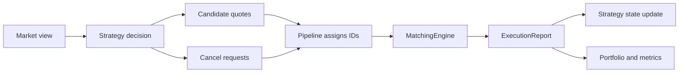
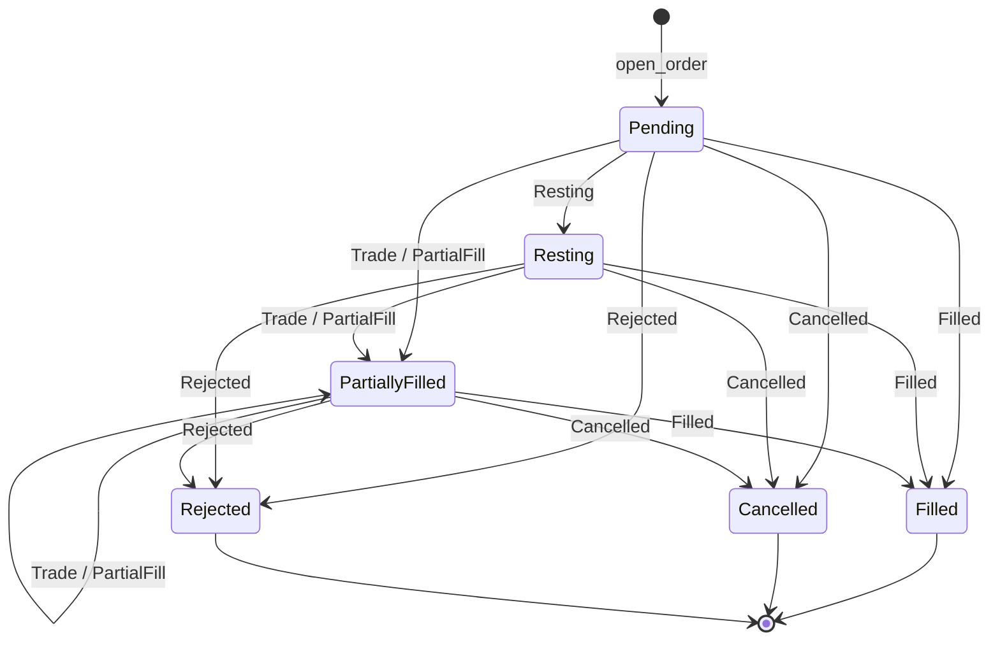
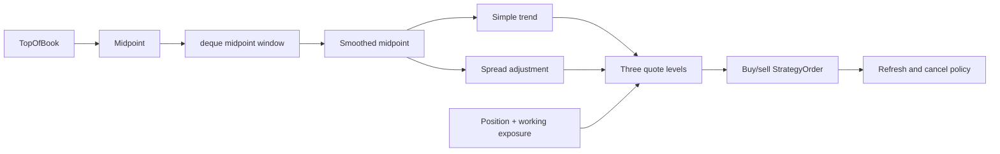

*Section 6 of the module reference, part 1. The index is [`../05-strategy.md`](../05-strategy.md).*

The decision layer: its lifecycle, the order state machine, the family map, and each strategy in
turn up to the `active_l2` mainline.

## 6. Strategy: The Main Decision Module

**Files:** `src/strategy/strategy.h`, `src/strategy/baseline_market_makers.h`, `src/strategy/l2_market_maker_base.h`, `src/strategy/inventory_aware_l2_market_maker.h`, `src/strategy/active_l2_market_maker.h`, `src/strategy/trend_l2.h`, `src/strategy/execution_l2.h`, `src/lines/legacy/l1_market_maker.h`

Eight files and four families, which is worth stating because the file names alone do not say it. `trend_l2.h` is deliberately outside the maker families: it has no quote lifecycle, only a target position. `execution_l2.h` is outside all of them and outside the signal families too: it has no view about direction, only a parent order and a schedule. `strategy.h` is the interface everything implements, and it is where the L2 family stops depending on the L1 one: `tools/gate/check_layering.py` keeps that true rather than trusting it, because a `legacy/` include anywhere under `src/strategy/` fails the gate. `baseline_market_makers.h` holds `NaiveMarketMaker` and `OptimizedMarketMaker`, neither of which implements `on_l2_market_view`: they see the touch and nothing else, and they are the baseline the rest is measured against. The active family is three files with one inheritance chain between them, and the middle one is the root:

| File | Class | Role |
|---|---|---|
| `l2_market_maker_base.h` | `L2MarketMakerBase` | the L2 family root: the fair-price signal, the quote lifecycle, the queue-hold refresh policy, the counters |
| `inventory_aware_l2_market_maker.h` | `InventoryAwareL2MarketMaker` | `final`, adds a position-scaled quote shift on top of the root |
| `active_l2_market_maker.h` | `ActiveL2MarketMaker` | `final`, adds the volatility halt and the warmup on top of the root |

The root's class and its file both carry `Base`, because three names ending in `_l2_market_maker.h` read as siblings otherwise, and the one every other one extends is not the one a reader would pick. Each of the leaves derives from the root rather than holding one and forwarding each callback: a wrapper has to hand-forward every virtual, and a forgotten forward changes behaviour silently rather than failing to compile, which is what happened when `InventoryAwareL2MarketMaker` was written the other way and never forwarded `on_queue_activity`.

The strategy is the decision layer, not the matching layer. It sees `TopOfBook`, keeps its own working-order and position state, and returns candidate `StrategyOrder` values. The pipeline later assigns IDs and converts them to `exchange::Order`.

```cpp
class Strategy
{
   public:
    virtual ~Strategy() = default;

    // Pure virtual: the pipeline calls these on every strategy, so every strategy must answer.
    virtual std::vector<StrategyOrder> on_top_of_book(
        const std::string& symbol, const TopOfBook& tob) = 0;
    virtual void on_order_submitted(const StrategyOrder& order) = 0;
    virtual std::vector<uint64_t> cancel_requests() = 0;
    virtual int64_t net_position() const = 0;
    virtual size_t working_order_count() const = 0;
    virtual void on_order_update(const ExecutionReport& report) = 0;

    // Defaulted, and deliberately not pure: a strategy that has nothing to say about the richer
    // entry point inherits the answer that drops back to the touch.
    virtual std::vector<StrategyOrder> on_l2_market_view(const L2MarketView& view)
    {
        return on_top_of_book(view.symbol, view.top);
    }
    virtual void on_market_trade(const MarketTrade& trade) { (void)trade; }
    virtual void on_queue_activity(Side side, uint64_t consumed_quantity) { ... }
    virtual StrategyMetrics metrics() const { return {}; }
    virtual void on_markout_estimate(const MarkoutEstimate& estimate) { (void)estimate; }
    virtual uint64_t markout_gate_skips() const { return 0; }
    virtual uint64_t flatten_orders() const { return 0; }
    virtual uint64_t flatten_quantity() const { return 0; }
};
```

The split between those two halves is the design, and it is six pure virtuals against nine defaulted
ones. A pure virtual is a question the pipeline asks of every strategy, so a strategy that cannot answer
it should not compile. A defaulted virtual is a question only some strategies have an answer to, and each
default is chosen so that the ones without an answer are still *correct* rather than merely empty:
`on_l2_market_view` falls back to the touch, so a strategy written against `TopOfBook` runs on the L2 path
unchanged, and `on_market_trade` with a `BboQuote` calls the one-argument version rather than duplicating
it. The remaining callbacks report execution quality, queue activity and the two optional gates, and they
default to doing nothing and returning zero, which is what keeps a run that did not ask for a gate
byte-for-byte identical to the same run before the gate existed.

`main.cpp` selects an implementation with `std::make_unique`; the pipeline then uses the common
interface without knowing which strategy is active. The virtual destructor makes polymorphic
ownership safe.

A reader who wants the family as a table rather than as a tour can start at section 6.5, which opens with
every strategy in the repository by the mechanisms it has.

### Strategy lifecycle at a glance



| Callback | Direction | Responsibility |
|---|---|---|
| `on_top_of_book` / `on_l2_market_view` | Pipeline -> strategy | Produce the next candidate quote set |
| `on_market_trade` | Pipeline -> strategy | Update aggressor-flow state |
| `on_order_submitted` | Pipeline -> strategy | Record exchange-assigned working orders |
| `on_order_rejected` | Pipeline -> strategy | A pre-trade control refused the order before it had an id; the default does nothing and `trend_l2` backs off |
| `cancel_requests` | Strategy -> pipeline | Return stale or unsafe order IDs |
| `on_order_update` | MatchingEngine -> strategy | Apply fills, cancellations, partial fills and terminal rejections |

The strategy chooses intent. The pipeline owns sequencing and IDs. The matching engine owns actual
working orders. This separation is the key invariant for every strategy family below.

A report that ends an order is `Filled`, `Cancelled` or `Rejected`, and one `is_terminal` predicate in
`exchange/execution_report.h` is what releases the pending quantity, closes the audit entry and removes
the order from the strategy's open set. `Rejected` carries a `reject_reason` (venue, broker, timeout or
risk) and is not a cancel the strategy asked for; a post-submission venue or broker refusal arrives this
way, while a pre-trade refusal has no order id and uses `on_order_rejected` instead. `Cancelled` carries a
`CancelReason` (user, venue, IOC, FOK, self-trade, timeout): a user cancel or an IOC/FOK expiry is expected,
while a venue, self-trade or timeout cancel is treated like a rejection by `trend_l2`, which backs off instead
of re-quoting immediately. Inside the ledger an order moves Pending -> Resting -> PartiallyFilled ->
Filled/Cancelled/Rejected; a transition that would move it backwards is counted in
`invalid_order_transitions` instead of being applied, and a report for an order whose audit is already
closed is counted in `orphan_order_reports`. Both counts are zero in a normal run and are printed only when
non-zero.

### Order state machine

The ledger's state machine is deliberately small: it covers the life of one order from the moment the
pipeline accepts it for submission to the report that ends it, and it is the one place a strategy's belief
about an order can be checked against the report stream.



| From | Event | To | Where it comes from |
|---|---|---|---|
| none | `open_order` | Pending | `Pipeline::submit_strategy_actions` after the risk checks |
| Pending | `Resting` | Resting | `OrderLedger::mark_resting` |
| Pending | `Trade` / `PartialFill` | PartiallyFilled | an immediate marketable fill |
| Pending | `Filled` | Filled | a full fill, or a fill that never rested |
| Pending | `Cancelled` | Cancelled | a cancel before the order rested |
| Pending | `Rejected` | Rejected | `Pipeline::handle_rejected_order` for a venue or broker refusal |
| Resting | `Trade` / `PartialFill` | PartiallyFilled | the first fill of a resting order |
| Resting | `Filled` | Filled | a terminal fill report |
| Resting | `Cancelled` | Cancelled | user, venue, IOC, self-trade or timeout cancel |
| Resting | `Rejected` | Rejected | a venue or broker refusal |
| PartiallyFilled | `Trade` / `PartialFill` | PartiallyFilled | more fills; the state does not move |
| PartiallyFilled | `Filled` | Filled | the remaining quantity completed |
| PartiallyFilled | `Cancelled` | Cancelled | the remainder was pulled |
| PartiallyFilled | `Rejected` | Rejected | the remainder was refused |
| Filled / Cancelled / Rejected | any further report | no state | counted in `orphan_order_reports` |
| any open state | a backwards event, e.g. `Resting` after a fill | no state | counted in `invalid_order_transitions` |

The three terminal states all run the same cleanup: release the quantity the position gate reserved, close
the audit entry and remove the order from the strategy's open set. A `Rejected` is not a `Cancelled`: it
carries a `RejectReason` (venue, broker, timeout or risk), while a `Cancelled` carries a `CancelReason`
(user, venue, IOC, self-trade or timeout). The reasons are annotations on the terminal report; they do not
add states.

Two things are intentionally outside this machine:

* **A pre-trade refusal** has no order id and no reservation, so it never enters the ledger. It is delivered
  through `Strategy::on_order_rejected` and a strategy that retries must do so itself.
* **A gateway timeout** is not a terminal state. The order is still `Pending` in the ledger; the gateway
  queries the venue with `OrderQuery` and reports `unacknowledged`, `timeouts_working` and `timeouts_unknown`.
  `Working` means the venue still holds it, `Unknown` means it does not, and neither result is a fill or a
  cancel. Treating a timeout as a cancellation would be inventing a fact.

| Component | State it owns | File |
|---|---|---|
| `MatchingEngine` | the resting book and the order index | `src/exchange/matching_engine.*` |
| `OrderGateway` | unacknowledged/in-flight orders, retries, timeout queries and their results | `src/lines/order_gateway.*` |
| `PaperBroker` | held orders, its own statement and the reports it withholds | `src/lines/paper_broker.*` |
| `RiskPipeline` | the pre-trade decision and its counters; no order state | `src/app/risk_pipeline.*` |
| `Pipeline` | position and pending reservations, plus the report fan-out | `src/app/pipeline.*` |
| `OrderLedger` | per-order state, audit and state-transition counters | `src/app/order_ledger.*` |
| each `Strategy` | its own open-order set and retry policy | `src/strategy/*` |

`tests/order_state_test.cpp` is the executable version of this table: it walks Pending -> Resting ->
PartiallyFilled -> Filled, checks that a backwards `Resting` is refused, checks that a duplicate terminal
report is an orphan, and checks that a refused order releases its pending reservation so the next order is
accepted.

### Strategy family map

| Family | Input view | Main purpose | Execution model |
|---|---|---|---|
| Legacy | `Tick` | Compatibility and simple demonstrations | Legacy tick pipeline |
| L1 replay | `TopOfBook` + trades | BBO-aware quoting | Trades+BBO matching |
| L2 replay | `L2MarketView` + trades | Depth-aware quoting and queue diagnostics | Queue-aware L2 matching |

### 6.1 NaiveMarketMaker: baseline quote

The naive strategy requires both sides of the top of book, computes the midpoint, places one quote on each side, and rounds both prices to the configured tick size:

```cpp
double mid = (tob.bid_price + tob.ask_price) / 2.0;
double buy_price = std::round((mid - base_spread / 2.0) / tick_size) * tick_size;
double sell_price = std::round((mid + base_spread / 2.0) / tick_size) * tick_size;

orders.push_back(StrategyOrder(Side::Buy, symbol, buy_price, base_order_size, 0));
orders.push_back(StrategyOrder(Side::Sell, symbol, sell_price, base_order_size, 0));
```

It does not request cancellations, so working orders can accumulate. It updates position from
`Trade` reports and serves as a deliberately simple baseline.

### 6.2 OptimizedMarketMaker: stateful quoting

The optimized strategy adds controls in a deliberate order:



`OptimizedMarketMaker` is the stateful strategy. It keeps a window of recent midpoints in a
`std::deque`, averages that window, and estimates short-term trend from the change in the smoothed
midpoint. It then builds up to three quote levels. The core price adjustment is:

```cpp
double raw_buy = smooth_mid - level_spread / 2.0 - std::max(0.0, trend) -
                 inv_spread_bias * (inventory > 0 ? 1.0 : 0.0);
double raw_sell = smooth_mid + level_spread / 2.0 + std::max(0.0, trend) +
                  inv_spread_bias * (inventory < 0 ? 1.0 : 0.0);

double buy_price = std::round(raw_buy / tick_size) * tick_size;
double sell_price = std::round(raw_sell / tick_size) * tick_size;
```

Inventory is `position + working_exposure`, with buys positive and sells negative. If inventory is
long, the strategy makes buys less attractive and reduces buy size, encouraging future sells. If
inventory is short, it applies the symmetric adjustment to sells. Once the limit is exceeded, the
risky side is disabled.

The refresh policy separates “should quote now?” from “which old orders must be cancelled?”:

- `quote_age_ticks` forces refresh after an age limit.
- `quote_refresh_ticks` compares the smoothed midpoint with `last_quote_mid`.
- `cancel_requests()` returns active IDs when a quote is stale.
- `on_order_submitted()` records IDs and resets quote age.

In short: observations create quotes, submitted IDs become working state, execution reports update
quantities and position, and stale quotes are cancelled before replacement.

### 6.3 L1MarketMaker: BBO-aware quoting

L1 strategies are frozen compatibility implementations. Their CLI names remain available for
reproducing earlier L1 replay and benchmark results; new strategy work belongs to the L2 path.
The archived implementations are in `src/lines/legacy/l1_market_maker.h`. Their behaviour is pinned rather than described: `bash tools/gate/verify_l2.sh fast` checks the L1
invariants on every edit and `bash tools/gate/verify_l2.sh all` compares a full-file run byte for byte,
so a change in those makers that moves the numbers is a change to a recorded result. Execution
quality is not computed inside them; `ExecutionQualityMetrics` in the pipeline owns edge, markout,
quote lifetime and inventory for every strategy, and prints them in `[EXECUTION]`.

#### The two gates

Two different things are called a gate in this project, and they fail in opposite directions. The first refuses a
change that would move a recorded number; the second refuses a quote that cannot pay for itself.

The verification gate is `tools/gate/verify_l2.sh`, and it has four tiers because the checks cost different amounts and
catch different mistakes. Tier zero runs the unit tests, because a failing test once shipped in a commit that the
older gate could not see. Tier one replays a two hundred thousand record slice and compares the event counts,
orders, fills, realized PnL and consumed queue position against the values the documents quote, re-derives every
`toyquant:check` block, including the ones a benchmark binary carries rather than the main one, and lints the prose
for a flag the code accepts that no document mentions. Tier two replays
1.5 GB and compares the hash of the whole output, which is what makes a claim about timing defensible. Tier three
builds with the address and undefined behaviour sanitizers and runs the tests and a slice through them, because a
leak in the block reader or an out-of-range slot in the ladder is invisible in a normal build. A tier that skips
says so on its own line, because a hidden skip and a pass are indistinguishable in a log.

The decision gate lives in the strategy and exists because the fee is larger than the edge at the touch. It has two
knobs and both are off at zero, which is what keeps every recorded run reproducible. `--edge-cover-ticks` requires
the edge a fill would capture, measured from the reference price in ticks, to cover the maker fee plus the ticks it
names, where the fee in ticks is `rate * price / tick_size`: 2.55 ticks on the Deribit contract at 2020 prices and
about 186 on the OKX contract at 2026 prices, which is the ratio that stops the policy being tuned into profit.
`--min-spread-ticks` refuses the situation rather than the price: when the top of book is narrower than it asks for,
nothing is placed at all, because a one tick book leaves the touch half a tick from the midpoint and those are the
fills the bucketed markout shows resolving at or below zero. Both refusals are counted, so a run can report how
often the decision layer declined to act and not only what it did.

One difference matters when reading L1 results: **the L1 path models no queue in front of a quote.** Its book
has no depth-derived levels, so a resting L1 order starts at the touch with nothing ahead of it and a print
through its price fills it. The L2 path fills only after the queue ahead has been consumed. Fill counts on
the two paths therefore answer different questions, and every queue-model result in
`docs/PERFORMANCE_HISTORY.md` comes from the L2 path.

`L1MarketMaker` is the replay-oriented single-level strategy. It consumes BBO updates for quoting
and venue trades for order-flow information. Its behavior is intentionally layered so each risk
control has a distinct purpose:

1. **Input filtering.** A trade is used for imbalance only when a latest BBO exists, the trade is
    not older than the BBO, its BBO age is below `max_market_trade_age`, and its price deviation
    from the BBO midpoint is below `max_trade_deviation_bps`. Direct one-argument calls remain
    available for focused tests; the replay pipeline uses the BBO-aware overload.
2. **Flow and volatility state.** A single FIFO window of `TradeSample` values tracks buy and sell
    aggressor volume. A rolling window of absolute midpoint changes estimates short-term movement.
    This is a simple educational volatility proxy, not a statistical volatility model.
3. **Reservation price.** Effective inventory is `position + working_exposure`, where working buys
    are positive and working sells are negative. The reservation midpoint is shifted by a bounded
    `tanh(inventory / inventory_limit)` term: long inventory shifts the center down to discourage
    more buying, while short inventory shifts it up to encourage buying back.
4. **Quote width.** The effective spread is at least the larger of the configured base spread and
    current market spread, plus twice the average midpoint change. Trade-flow and BBO-size imbalance
    add an adverse shift to both sides. Prices are rounded to the instrument tick and clipped to
    remain passive relative to the venue BBO.
5. **Quote size.** Volatility stress reduces both sides toward a configurable minimum quantity
    ratio. Inventory reduces only the risky side. Above `inventory_risk_threshold`, the risky side is
    disabled and only the inventory-reducing side remains.
6. **Lifecycle.** A changed quote first requests cancellation; replacement waits for cancellation
    reports. The strategy counts what it owns: submitted quantity, fills, cancels, quotes, quote
    refreshes and the queue it consumed. Execution quality is not among them; see below.

The tunable values are grouped in `L1MarketMakerConfig`. The legacy positional constructor remains
for compatibility, while the application entry point uses the named configuration object. The
configuration is deliberately in-process rather than JSON/YAML: this project is an educational
simulator, not a production configuration service.

`StrategyMetrics` carries only what a strategy owns, so the runtime summary can report L1-specific
counters without downcasting the strategy: submitted quantity, fills, cancels, quotes and quote
refreshes. Execution quality is deliberately not included. `captured_edge` is an immediate midpoint
comparison and `adverse_selection` is a later markout after five quote cycles; both belong to
`ExecutionQualityMetrics` in the pipeline, which computes them once for every strategy from the same
reports and the same market events, and prints them in `[EXECUTION]`. The L1 makers used to keep a
second copy of those quantities from their own view of the mid, and it was deleted rather than
reconciled because the two could disagree and nothing compared them. Neither number includes fees or
constitutes a complete portfolio PnL calculation.

