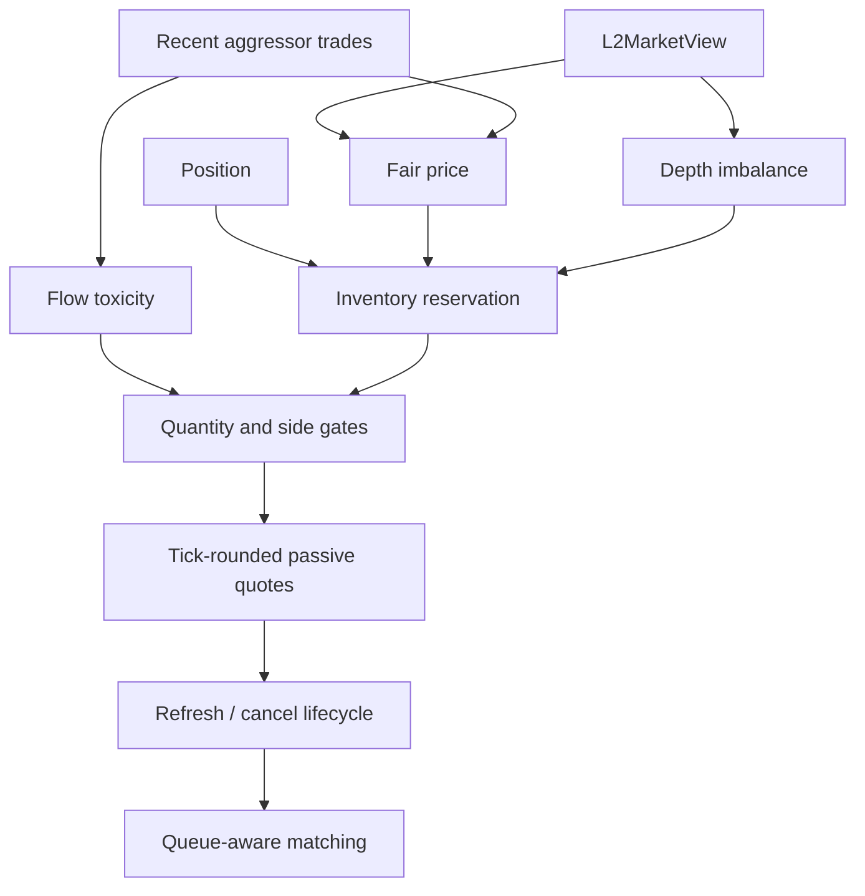

*Section 6 of the module reference, part 2. The index is [`../05-strategy.md`](../05-strategy.md).*

## 6.4 ActiveL2MarketMaker: L2 mainline

The L2 strategy receives an explicit `L2MarketView` from `L2OrderBook`. The view contains the
top of book, micro-price, aggregated depth, depth imbalance, symbol, and snapshot timestamp. L2
strategy state is separate from the L1 `OrderBook`; it never consumes raw vendor rows.



| Production setting | Value | Used for |
|---|---:|---|
| Signal mode | `Flow` | Combines micro-price, depth, and trades |
| Trade window | `16` events | Recent aggressor-flow estimate |
| Imbalance shift | `2 * tick_size` | Depth contribution to fair price |
| Trade shift | `1 * tick_size` | Flow contribution to fair price |
| Refresh threshold | `2` ticks | Repricing trigger |
| Maximum quote age | `50` L2 decisions | Stale-quote fallback |
| Toxicity threshold | `0.65` | Disables the threatened side |
| Weak-flow threshold | `0.9` | Activates extreme-flow protection |
| Volatility alpha | `0.25` | Active-L2 EWMA smoothing |
| Pause threshold | `9` ticks/second | Extreme-volatility risk gate |

## 6.4.1 Fair-price construction

`L2MarketMakerBase` supports `Baseline`, `Depth`, `Micro`, and `Flow` signal modes. The production
factory selects `Flow` with a 16-trade FIFO window. In that mode the fair price is:

```text
fair = micro_price
    + depth_imbalance * imbalance_shift
    + trade_imbalance * trade_imbalance_shift
```

`depth_imbalance` is the normalized bid-versus-ask quantity across the configured visible levels.
`trade_imbalance` is the normalized aggressor buy-versus-sell volume in the recent trade window.
The micro-price uses top-level quantities to move the reference toward the side with less displayed
liquidity. These signals shift the reservation price; they do not authorize crossing the spread.

## 6.4.2 Inventory and toxicity controls

The base engine computes:

```text
inventory_ratio = clamp(position / inventory_limit, -1, 1)
inventory_shift = inventory_ratio * base_spread
```

Long inventory moves the reservation price down and makes additional buys less attractive; short
inventory applies the symmetric behavior. At the hard inventory limit, the risk-increasing side is
disabled.

For flow toxicity, the configured threshold is `0.65`. A strongly positive flow disables the sell
side; a strongly negative flow disables the buy side. When flow magnitude exceeds `0.9` while
inventory is already materially imbalanced, weak-flow protection halves both quote quantities and
moves both prices one tick farther from the center. The name `weak_flow` refers to weakening the
quotes, not to weak market flow.

## 6.4.3 Passive quote construction and lifecycle

Prices are tick-rounded around the fair price, inventory shift, and weak-flow shift. A final passive
clip enforces:

```text
bid <= external_best_bid
ask >= external_best_ask
```

This keeps the L2 strategies maker-only. When orders are working, a fair-price move of two ticks
requests cancellation. The active mainline counts quote age only when the external top-of-book
midpoint moves by at least one tick; depth-only updates do not consume quote lifetime. This avoids
treating incremental feed granularity as market movement. The fallback maximum age remains 50
market-price decisions. The pipeline processes cancellation before allowing replacement, and the
active strategy records price refreshes, age refreshes, and risk pauses separately.

This behavior is specifically important for incremental input: many updates change displayed
quantity without moving the best price. Counting every such update as quote age creates artificial
refresh churn. The retained rule removes that data-resolution artifact without changing the fair
price, inventory, toxicity, or passive-price logic.

The pipeline also reports consumed queue volume back to the strategy. If a quote reaches its age
limit while the queue ahead is actively being consumed and fair price has not changed, L2 retains
the quote and resets its age instead of cancelling and losing time priority. A price change or risk
pause still takes precedence. The preservation is bounded to three holds before a stale quote must
be reconsidered. This is a queue-preservation rule, not a profitability assumption.

## 6.4.4 Active risk overlay

`ActiveL2MarketMaker` composes `L2MarketMakerBase`; it does not duplicate its inventory or flow logic.
It maintains a time-normalized midpoint-movement EWMA:

```text
volatility = alpha * normalized_move + (1 - alpha) * previous_volatility
```

The production value is `alpha = 0.25`. Ordinary volatility does not widen quotes. When the EWMA
reaches `9` ticks per second, active L2 requests cancellation of all working orders and pauses new
submissions. This is a tail-risk gate, not a continuous spread signal. The historical
`adaptive_l2` name is accepted only at the factory boundary and constructs this same class.

For both snapshot and incremental batches, the EWMA uses exchange event time so strategy signals are
normalized against market time rather than file or network processing cadence. Incremental
`local_ts` remains available in `L2MarketView` for future latency diagnostics, but does not alter
the current trading decision. The same market period can still produce different quote-cycle counts
because incremental data contains more update batches; that execution-resolution difference must be
measured before comparing PnL.

## 6.4.5 Execution and queue model

Before L2 strategy decisions, `Pipeline::process_l2_market_view` sends the snapshot top of book to
`MatchingEngine::process_l2_top`. If a maker order joins the displayed best price, the displayed
quantity is stored as `external_queue_ahead`. Subsequent market trades consume that quantity before
the local FIFO order. This prevents a new order from receiving queue-first fills.

The engine exposes `queue_ahead_consumed` in the run summary. Queue-clear diagnostics count price
levels whose external queue reaches zero; they do not measure cleared quantity. Fees are calculated at execution time
from `InstrumentSpec`; the current Deribit BTC perpetual benchmark assumes maker `0.02%` and taker
`0.05%`. The L2 replay is therefore evaluated on net PnL, fees, maker/taker role, queue consumption,
markout, inventory, and refresh-cause metrics together.

The matching engine supports four queue interpretations, and they are one family rather than four
opinions. They are one class with one method in `src/exchange/queue_model.h`, which is a name the table
below can be read against: the arithmetic used to be a lambda inside `MatchingEngine::process_bbo_for`, so
the four names the command line takes and the four rows here were separated by a hundred lines of book
update code. When a level's displayed size falls by `r` with no trade at that price, the only unknown is how
much of that `r` was ahead of a resting order, and each model is a claim about that one random variable,
`X(r)`, with `q` the share of the display that is ahead of the order:

| model | `X(r)` | mean | variance |
|---|---|---|---|
| `Conservative` | `0` | `0` | `0` |
| `ProRata` (default) | `r q` | `r q` | `0` |
| `Lumpy` | `(r / k) Binomial(k, q)` | `r q` | `r^2 q (1 - q) / k` |
| `Optimistic` | `r` | `r` | `0` |

The first and last bracket the **mean**, and `k` moves only the **variance**, which is why `ProRata` is
the neutral default rather than a compromise. `tools/study/calibrate_queue_model.py` measures this feed to put
99.96% of a level's size decrease on cancel or amendment rather than trade, so a queue that only moves
when a trade prints contradicts the mechanism; the cancellation sizes it measures, where a median
decrease removes 74% of a median level and the removed fraction is flat across four orders of magnitude
of level size, are what makes `k = 1` the lumpiest honest reading. The queue arithmetic tests in
`tests/matching_engine_test.cpp` pin the consequences: at `q = 1` every model but the conservative one
removes the whole decrease, and the lumpy mean matches pro-rata over 200 replications. The arrival rule
is separate and is the share `alpha` in `Q0 = alpha D0`, one for a FIFO venue; it is a knob, but a
second-order one, because `q` is a fixed point of the pro-rata dynamics and only trades, 0.04% of what
moves a level, break it. `docs/PERFORMANCE_HISTORY.md` carries the derivations and the measurements.

The C++ replay path supports both source types. The Python benchmark reconstructs a compact top-five
timeline from grouped incremental updates so execution and markout fields use the same report shape
for both sources. This is a top-five comparison timeline, not an order-level queue reconstruction.

The current active L2 implementation is intentionally a conservative research mainline. Its
18-window in-sample baseline and four-window 2020-05-01 sample-out-of-time check remain negative
after fees. The strategy is structurally complete for this simulator, but those results do not
establish live profitability.

Every L2 replay records its queue model. `prorata` is the default and the mainline result: it is the
neutral assumption about the one thing the data cannot show, which is where in a level's queue the
cancellations sit. `conservative` (nothing comes off the queue ahead) and `optimistic` (all of it
does) bracket it, and the measured cancel share says `conservative` reads as a floor that is harsher
than the mechanism. Both are models for information lost by aggregated L2 data, not proof of live fill
probability. A strategy comparison is useful only when its behavior remains reasonable across
multiple windows, dates, and queue models.

The L2 replay applies a fixed one-market-event cancellation delay. Legacy CSV/UDP and ordinary
snapshot replay use the configured delay path; this delay is event-count based, not milliseconds.
Every replay mode marks the portfolio to market at the last market price before reporting, so
`equity` and `unrealized_pnl` account for any position still open when the input ends. The L1
replay path used to skip that step, which left both fields at zero while `cash` was populated.

The run summary also records `audited_orders`, `audited_filled_orders`,
`audited_cancelled_orders`, `cancelled_after_fill_orders`, `cancelled_before_fill_orders`, and
`total_order_lifetime_cycles`. The last field counts quote decision cycles, not elapsed time.

## 6.5 Strategy families and comparison

Every strategy in the repository, by what it can actually do. The columns are the mechanisms that differ
between them rather than the ones they share, and the rows are classes rather than names: the L2 family is
one inheritance chain, so it is three rows, while the frozen L1 line is five separate classes that happen
to share an interface and seven of the L2 names are one class under seven configurations.

| Strategy | CLI name(s) | Input | Fair price from | Inventory | Flow | Queue | Gates | Halt | Discipline |
|---|---|---|---|---|---|---|---|---|---|
| `NaiveMarketMaker` | `naive` | touch | midpoint | none | — | — | — | — | — |
| `OptimizedMarketMaker` | `optimized` | touch | smoothed midpoint + trend | skew, size, limit | — | — | — | — | — |
| `PassiveL1MarketMaker` | `passive_l1` | touch | midpoint | limit | — | — | — | — | — |
| `InventoryAwareL1MarketMaker` | `inventory_aware_l1` | touch | midpoint + skew | skew, size, limit | — | — | — | — | — |
| `FlowAwareL1MarketMaker` | `flow_aware_l1` | touch | midpoint + flow | limit | window, weights 0.6/0.4 | — | — | — | — |
| `L1MarketMaker` | `l1` | touch | midpoint + skew + stress | skew, size, limit | window + weights | — | fee-aware spread | stress widening | — |
| `ActiveL1MarketMaker` | `active_l1` | touch | skew first | skew, size, limit | — | — | — | — | shorter lifetime |
| `L2MarketMakerBase` | `l2`, `passive_l2`, `l2_baseline`, `l2_depth`, `l2_micro`, `l2_flow`, `flow_aware_l2` | touch + depth | microprice + depth + flow, by mode | skew, limit | guards | **hold** | fee + edge + markout | — | flatten |
| `InventoryAwareL2MarketMaker` | `inventory_aware_l2` | touch + depth | as the root | skew, limit, **size, reducing side** | guards | hold | fee + edge + markout | — | flatten |
| `ActiveL2MarketMaker` | `active_l2`, `adaptive_l2` | touch + depth | as the root | skew, limit | guards | hold | fee + edge + markout | **yes, with warmup** | flatten |
| `TrendL2Strategy` | `trend_l2` | touch | EWMA cross | target position, clips at the touch | — | — | — | stop, time stop, cooldown | — |
| `ExecutionL2Strategy` | `execution_l2` | touch | none: a parent order from the configuration | child orders at the touch, by schedule | — | — | — | deadline | — |

Four things that table cannot say, and they matter more than the marks do:

* **The seven `l2` names are one class under seven configurations.** `l2`, `passive_l2`, `l2_baseline`,
  `l2_depth`, `l2_micro`, `l2_flow` and `flow_aware_l2` all build `L2MarketMakerBase` and differ only in
  `L2SignalMode` and in whether the flow guards are on, which is what makes the fair-price row a list
  rather than a value. Adding a signal is a `case` in `fair_price()`, not a class.
* **The L2 row's mechanisms are off unless a run asks for them.** `edge_cover_ticks` is `0`, `markout_cover`
  is `false` and `flatten_band_units` is `0` in every recorded run, and the reason is written into the
  config: a run that does not ask for a gate must behave exactly as it did before the gate existed. So the
  table describes what the strategies *can* do; what the recorded numbers exercised is in
  [Performance History](../../PERFORMANCE_HISTORY.md).
* **`InventoryAwareL2MarketMaker` and `ActiveL2MarketMaker` are `final` and add one behaviour each** to the
  same root, so their rows repeat the root's columns on purpose: they inherit the queue-hold policy, the
  gates and the flatten band, and adding a mechanism to the root adds it to both.
* **The five L1 rows are frozen rather than maintained.** `src/lines/legacy/` carries them so the recorded
  L1 results stay reproducible, and the gate pins them instead of describing them: tier 1 asserts their
  invariants on every edit and tier 2 compares a full-file run byte for byte.

One capability is deliberately absent from the table twice. `NaiveMarketMaker` has no inventory control at
all — its own comment records what that cost before the refresh triggers were added: 234,576 orders, a 52%
fill rate and a position of -12,000 contracts on a 200,000-row window. And no strategy in the repository
crosses the spread on its own initiative: the L2 root rounds each quote onto the tick grid and then clamps
it to the touch (`bid <= best bid`, `ask >= best ask`), which is what keeps the family maker-only.

For the same `sample_ticks.csv` run, the two legacy Tick strategies diverge immediately:

| Strategy | Submitted orders | Submitted quantity | Cancel requests | Fill rate | Net position | Current equity | Max drawdown |
|---|---:|---:|---:|---:|---:|---:|---:|
| `naive` | 38 | 3800 | 0 | 0.231579 | -880 | 999.286800 | 0.000717 |
| `optimized` | 24 | 1379 | 9 | 0.31037 | -428 | 999.670190 | 0.000334 |

The table uses an initial capital of `1000.0`. It shows the core difference: `naive` is more aggressive and leaves more working orders behind, while `optimized` submits less, cancels stale quotes, and ends with smaller adverse position and drawdown. That is why the optimized version is the better demonstration of stateful market making in this project.

`L1MarketMaker` is evaluated on the Trades+BBO replay path rather than this legacy Tick-only
comparison. Its additional runtime measurements are useful for explaining quote safety and
execution quality, but they are not yet folded into the offline PnL report.

The Trades+BBO replay path has an L1 strategy family. These variants share the same `Strategy` interface,
instrument scale, matching engine, and fee model, so the comparison isolates decision behavior:

| Strategy | Main idea | Strength | Limitation | Role in this demo |
|---|---|---|---|---|
| `passive_l1` | Fixed two-sided L1 quotes with basic inventory limits | Simple and easy to explain | Does not use trade flow or volatility | Passive baseline |
| `inventory_aware_l1` | Inventory-dependent price and quantity skew | Demonstrates risk-aware quoting | Can still trade too much in a one-sided market | Inventory baseline |
| `flow_aware_l1` | Adds recent aggressor-flow and BBO-size imbalance | Avoids some flow-against trades | Still a transitional experiment; may reduce activity too much | Flow experiment |
| `active_l1` | Inventory-reversion-first quotes with shorter quote lifetime | More visible activity and inventory rotation | More adverse-selection and inventory risk | Active experiment |
| `l1` | Combines inventory, volatility, flow, markout, refresh, and fee-aware spread controls | Most complete replay strategy | More mechanisms and metrics to interpret | Mainline demo strategy |

`PassiveL1MarketMaker` refreshes quotes when the midpoint, BBO, or quote age changes, but its
prices remain symmetric around the midpoint. Its inventory logic limits the risky side without
using a forecast of short-term direction.

`InventoryAwareL1MarketMaker` shifts the two quote offsets according to the signed inventory and
reduces the risky-side quantity. It is useful for showing the difference between a neutral maker
and one that actively controls exposure, but it does not retain a trade-flow window.

`FlowAwareL1MarketMaker` keeps a quantity-weighted FIFO window of recent aggressor trades. It
combines trade imbalance and displayed BBO imbalance using the current demo weights `0.6` and
`0.4`. When the signal is sufficiently directional, it moves the threatened quote one tick away
and reduces the threatened-side quantity. It is intentionally bounded: it is a learning strategy,
not a claim of production alpha.

The mainline `L1MarketMaker` retains the more mature inventory and volatility controls, then adds
the useful flow-aware behavior as a constrained overlay. It also applies a fee-aware spread floor:
the configured base spread is compared with a fraction of the theoretical two-sided maker-fee
break-even spread. The current demo uses a `0.40` coverage factor, so the strategy does not treat
the result as a production profitability guarantee. The factor is a demonstration control that
helps make the relationship between gross PnL, fees, and net PnL visible.

`ActiveL1MarketMaker` is deliberately separate from `L1MarketMaker`. It gives inventory reduction
priority: when long, it moves the bid farther away and keeps the sell quote comparatively active;
when short, it does the opposite. It also expires quotes sooner and uses a simpler fee-aware
spread. This makes inventory rotation and trade activity easier to observe, but it accepts more
adverse-selection risk. It is an experiment for studying the activity-versus-execution-quality
trade-off, not a replacement for the defensive mainline. A fill immediately marks the quote as
stale, so the next BBO cycle can cancel and rebuild around the updated inventory. Its benchmark
metrics include submitted and filled quantity, quote count, captured edge, fees, average and peak
inventory, inventory sign changes, and quote lifetime.

The L2 replay family uses the separate `L2MarketView` contract described in section 6.4:

| Strategy | Main idea | Role |
|---|---|---|
| `passive_l2` | Baseline depth-aware quoting | Reference baseline |
| `inventory_aware_l2` | Adds an outer inventory adjustment layer | Inventory experiment |
| `flow_aware_l2` | Flow/depth fair-price behavior | Signal comparison |
| `active_l2` | Flow L2 engine plus volatility risk gate | L2 mainline |
| `adaptive_l2` | Compatibility name for `active_l2` | Legacy alias |
| `trend_l2` | EWMA cross sets a target position; clips at the touch; stop, time stop and exit band | Non-market-making line |
| `execution_l2` | Works a parent order from `--parent`; `market`, `twap:N` or `pov:X` children at the touch; shortfall in basis points | Execution line |

Unlike the L1 family, L2 decisions receive depth snapshots and use the queue-aware matching path.
L2 comparisons therefore include `queue_ahead_consumed`, maker/taker role, side-specific markout,
and refresh-cause metrics in addition to PnL and inventory. The detailed L2 decision sequence and
execution boundary remain in section 6.4; this subsection only defines comparison roles.

For the current BTCUSDT replay demo, the benchmark prints `gross_pnl`, `net_pnl`, `fees`,
`fee_ratio`, filtered market trades, filled quantity, final position, captured edge, adverse
selection, inventory path, markout counts, and quote lifetime. These execution-quality metrics are
computed by `Pipeline`, so simple and complex strategies share the same measurement basis. Always read gross PnL and fees together: a strategy can have
more fills or a positive captured edge while still losing after fees.

The benchmark can be run with:

```bash
./out/build/linux-debug/strategy_benchmark \
    --trades=data/v2/fixtures/test_aggTrades_5k.csv \
    --quotes=data/v2/fixtures/test_bookTicker_5k.csv --symbol=BTCUSDT --quantity-scale=1000000
```

The benchmark is an educational replay, not a live-trading validation. Its results depend on the
selected replay window, displayed BBO liquidity, fee assumptions, and the quality of the paired
Trades+BBO data.

