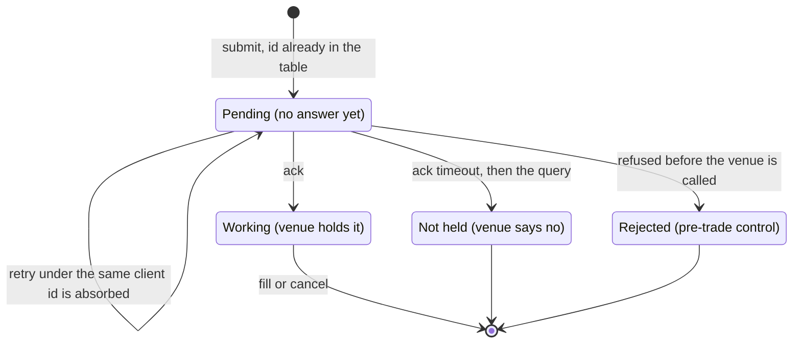

*Part of the [User Guide](../../USER_GUIDE.md), part 2 of 3. The index is [`../03-l2-replay.md`](../03-l2-replay.md).*

Three layers sit between a strategy and a matching engine, and each one answers a different question:

| layer | what it keeps | the question it answers |
|---|---|---|
| `--paper-broker` | its own statement of every fill | did the venue execute what the strategy heard about? |
| `--order-gateway` | client state: sent, answered, in flight | was this order sent once, and did anybody answer? |
| `--live-orders` | nothing; it translates | what did the venue itself say? |

The first two decorate the engine, so the strategy, the book and the accounting do not know they are there; with no
faults configured they forward every call and every report, and `bash tools/gate/verify_l2.sh fast` asserts that a
brokered run reports exactly the numbers of the same run without it.

## The broker and the reconciliation

`--paper-broker` puts a broker between the strategy and the engine, which is a layer a live path has and a
replay does not: it refuses orders for reasons a strategy cannot see in the price, fills in pieces, loses an
execution report, and goes away for a while. With no faults configured it forwards every call and every report and then
prints two lines of its own:

```bash
./out/build/linux-debug/toy_quant l2_replay data/v2/crypto/deribit_trades_2020-04-01_BTC-PERPETUAL.csv.gz \
  /tmp/depth_200k_base.csv BTC-PERPETUAL 0 active_l2 1 prorata --fast-validation --paper-broker
```

```text
[BROKER] orders_submitted=381 orders_rejected=0 fills_seen=3 fills_split=0 fills_dropped=0 outages=0 orders_held=0 orders_released=0 cancels_while_held=0
[RECON] symbols_checked=1 quantity_breaks=0 max_quantity_break=0 net_quantity_break=0 gross_quantity_break=0 report_count_difference=0 fee_difference=0.000000 fees_match=1 status=ok
```

The faults are counts of orders or fills rather than drawn probabilities, so a faulted run is reproducible from its command line alone; the five fault flags, what each withholds and the rule that a fault without `--paper-broker` is refused are in [the flag reference](../../L2_FLAGS.md#the-eight-whose-semantics-need-more-than-a-line).

`[RECON]` is the check the whole thing exists for. The statement is built from the reports the venue sent and
the portfolio from the reports the strategy received, so a fill the strategy never heard about is a position
that disagrees with a statement saying it happened. Only this strategy's own fills are compared, because two
populations would break on every print that was somebody else's, and cash is deliberately not compared: a
broker's USD arithmetic would be a second implementation of the portfolio's instrument model, and a copy
that agrees because it was copied is not a check. The columns are the net position per symbol, the gross
quantity traded, the fills the strategy was sent against the fills it booked, and the fees. Gross is there
because a loss on each side leaves the position exactly where it was: on the 200k slice with every fill
withheld, every position column read zero breaks and the gross column caught both fills —

```text
[RECON] symbols_checked=1 quantity_breaks=0 max_quantity_break=0 net_quantity_break=0 gross_quantity_break=2 report_count_difference=0 fee_difference=0.004000 fees_match=0 status=break
```

A fee difference is read with a tolerance, because splitting one fill into two prints adds the parts in a
different order from the total they came from, and `fees_match` is the verdict on it rather than the number
being exactly zero.

Two things the broker has to do that are easy to leave out, both of which the faults found by being run
rather than by being reasoned about. A cancel that arrives for an order still held — one the venue has never
been given — is answered with a `Cancelled` report, because that order is gone for good and the strategy is
owed the confirmation; resolving it silently left a strategy that keys on cancel acknowledgements with a
working order for the rest of the window, and it stopped quoting 51 orders into a 381 order run. And a fill
is split only when it is more than one unit, since two prints of zero are not a split.

## The order gateway

`--order-gateway` puts the client's side of the order path outside the broker. It is the layer that knows the difference
between an order that was sent and an order the venue answered, and it keeps its own table of every order in between,
printed as `[GATEWAY]`:



The pre-trade edge is the one that never reaches a venue: a limit refuses the order while it is still ours, and the
refusal is booked as a `Rejected` report rather than as a cancel the strategy asked for.

```bash
./out/build/linux-debug/toy_quant l2_replay data/v2/crypto/deribit_trades_2020-04-01_BTC-PERPETUAL.csv.gz \
  /tmp/depth_200k_base.csv BTC-PERPETUAL 0 active_l2 1 conservative --fast-validation \
  --order-latency-us=100000 --order-gateway --gateway-ack-timeout-us=50000 --gateway-retry-timeouts
```

```text
[GATEWAY] submissions=6 duplicates_suppressed=0 acks=6 ack_timeouts=6 unacknowledged=0 timeouts_queried=6 timeouts_working=0 timeouts_unknown=6 retries=6 retry_rejections=0 venue_rejects=0 cancels=6 cancels_after_fill=0
```

A timeout is not a terminal state. The gateway queries the venue with `OrderQuery` and reports the
reconciliation separately: `unacknowledged` is the number still waiting for an answer, `timeouts_working`
means the venue still holds the order, and `timeouts_unknown` means it does not — neither result is treated
as a fill or a cancel. The ledger keeps the order `Pending` until a real report arrives.

The client order id is the strategy's order id, entered in the table before the venue is called. A second
submission under an id already in the table is absorbed rather than forwarded, so a retry cannot become a
second position. Its two flags -- the acknowledgement timeout and the retry under the same client id -- and what each does to a run are in [the flag reference](../../L2_FLAGS.md#the-eight-whose-semantics-need-more-than-a-line).

The symbol decides the instrument, through `instrument_spec_of`: `BTC-PERPETUAL`, `BTC-USDT-SWAP`, `SPY` and
`MESZ6` are the entries today, and a symbol with no entry is an error rather than a default, because a default
would quietly price the wrong tick with the wrong fee. A listed future also states its contract multiplier,
which is what makes one micro E-mini S&P 500 unit worth five times the index price, and its quarter point tick
worth 1.25 USD rather than 0.25, so a commission of about sixty cents a contract is half a tick a side:

```bash
./build/toy_quant l2_replay data/v2/futures/glbx_MESZ6_trades.csv.gz data/v2/futures/glbx_MESZ6_depth.csv.gz \
  MESZ6 0 active_l2 1 conservative --order-size=5 --inventory-limit=20 --base-spread-ticks=1
```

The collateral fields stay a cash-only figure, which is the documented model and not a description of a margined
future: such a run reports exposure over collateral and should be read for its capture, fee and markout columns.

## The live venue

`--live-orders --venue-endpoint=HOST:PORT --venue-max-orders=N` replaces the engine with `LiveVenue` over a socket: the
orders leave the process, a relay signs the venue's own REST calls, and the venue's private `orders` channel answers
with state, so the reports the ledger reads are the venue's rather than the matcher's. The three flags are required
together, the answers arrive asynchronously, and the two recorders are what keep such a session replayable. The relay's
flags, the two channels and the sandbox's own error codes are [the live page](../04-live-and-carry.md).

That is the whole main view: three layers, one comparison, and the state an order is in between them. What follows is the
boundary detail -- pacing, the benchmark's columns, the cash-only ceiling and the terminal rules for immediate orders.

/// details | Pacing, the benchmark, and the cash-only ceiling

`--live-pacing[=SPEED]` delivers the replay against the wall clock instead of as fast as the file reads, which is
what turns a measurement into a rehearsal: a strategy that watches its own quote age, or cancels on a timer, only
behaves like itself when the market arrives at its real speed. The fifth positional delay still works and now
means "pace this run at real time", because a fixed sleep after every event neither reproduced the file's timing
nor scaled. Pacing changes no decision — only when the decision is taken — so a paced run reports the same
`[PNL]` fields as the unpaced one, and the line it adds is the feed's own report card:

```text
[LIVE] paced_events=3582893 late_events=3551778 lateness_mean_us=6827 lateness_p50_us=1024
       lateness_p99_us=65536 lateness_max_us=79282 market_window_s=7199 wall_s=11 speed=600
```

`lateness_*` is how late each delivery was against the schedule the file's own timestamps define, so it is the
sum of everything between the schedule and the delivery, and it is the one number here that a live session would
watch: at 600 times real time the process above is at its limit and says so, and at real time the same window is
six hundred times less work than that.

When the benchmark is given an incremental file, the tool reconstructs a compact top-five timeline
from the grouped updates and reports the same output fields. Python `markout_5/20` means the
mid-price difference at the fifth/twentieth subsequent sampled depth record; it is not the same
as the C++ runtime markout measured in quote cycles, and results with different `depth_every`
values are not directly comparable. The reconstructed timeline is a comparison aid; it is not an
order-level queue reconstruction.

For incremental feeds, active L2 quote age advances only when the external best-price midpoint
moves by at least one tick. Depth-only quantity updates do not consume quote lifetime. In four
valid direct 15-minute windows on the 2020-04-01 incremental file, active L2 reached `-172.15` net
PnL versus `-218.82` for `flow_aware_l2`; this is a relative improvement, not a profitability claim.

When the queue ahead is actively being consumed and fair price has not changed, active L2 also
preserves the quote through the normal age limit instead of cancelling and losing queue priority.
On four queue-aware incremental windows, this version measured `-133.55` versus `-148.21` for
`flow_aware_l2`; both remain negative after fees.

Which fields of this mode's summary appear and which are conditional, and the five that decide whether a run was any
good, are in [reading the output](../06-reading-the-output.md#which-fields-appear-and-when).

For the benchmark binary's CSV columns (the `buy_`/`sell_` split, per-quote queue consumption and the fill probabilities),
the column list is `tools/study/benchmark_l2_strategies.py --help`; those are columns of a file, not fields of a line.

A candidate must remain competitive across at least two moderate windows; a one-window PnL win is
not sufficient. Use `analyze_l2_windows.py` for repeated 15-minute windows:

```bash
python3 tools/study/analyze_l2_windows.py \
  --binary build/toy_quant \
  --trades data/v2/crypto/deribit_trades_2020-04-01_BTC-PERPETUAL.csv.gz \
  --depth data/v2/crypto/deribit_book_snapshot_25_2020-04-01_BTC-PERPETUAL.csv \
  --symbol BTC-PERPETUAL \
  --start-ts 1585699200000000 \
  --end-ts 1585715400000000 \
  --window-minutes 15 \
  --depth-every 1 \
  --csv reports/l2_windows.csv
```

The Deribit benchmark uses `0.02%` maker and `0.05%` taker fee assumptions. Results are
educational replay measurements, not profitability claims. L2 replay uses a fixed one-market-event
cancellation delay; it is not a millisecond latency model. Queue model defaults to `prorata`, the model the measured cancel share supports;
`prorata` and `optimistic` are sensitivity analyses only, with `prorata` chosen because
`tools/study/calibrate_queue_model.py` measures 99.96% of the size removed from a book level as cancellation
rather than trade. Pass `--queue-model` to `analyze_l2_windows.py` when comparing these assumptions.

The replay also reports `max_abs_exposure_usd` next to `starting_cash_usd`, the cash the run began with. The model is
cash only and no margin -- there is no margin freeze to release, which is why the ceiling is this arithmetic and not a
ratio: exposure above it is a modelling violation, and `exposure_over_collateral_fills` counts how often a fill pushed the
marked position past it. `--max-position=N` enforces the ceiling as a pre-trade gate in quantity units, counting the
quantity already resting on the side an order adds to, so two quotes arriving in one cycle cannot jump it;
`strategy_position_mismatches` compares the strategy's own position against the pipeline's on every report, which is how a
dropped callback shows up instead of as an unexplained PnL difference.

The replay has policy levers and model levers, and every one of them is additive to the recorded
defaults, so a run without them reproduces the recorded numbers byte for byte:

**The flag-by-flag table that used to be here is [the flag reference](../../L2_FLAGS.md#the-flags-by-what-they-change)**,
which lists every flag once for both pages. What stays here is what the two components *print* and how to read it.

An immediate order is terminal even when it does not fill. An IOC that takes part of the displayed size emits
its fills and then a `Cancelled` for the remainder; a FOK that cannot fill the whole quantity emits no trade at
all, just the cancel. The `participation-limit` is applied before either decision, so a FOK can fail because the
cap leaves too little displayed capacity even when the raw BBO size would have been enough. `--time-in-force`
overrides every strategy order, which is useful with the taker line (`trend_l2`) and deliberately hostile to a
passive market maker: an IOC quote that does not cross is cancelled in the same event, so use the default `gtc`
for the quoting strategies.

///

