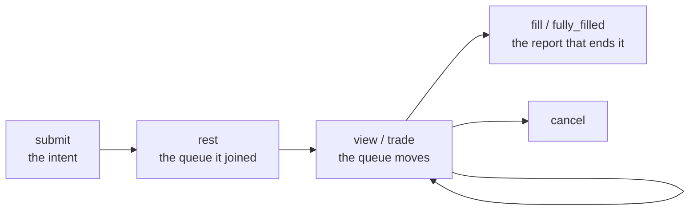

*Part of the [User Guide](../../USER_GUIDE.md), part 3 of 3. The index is [`../03-l2-replay.md`](../03-l2-replay.md).*

## Funding as an input

Funding is a flow rather than a price, so it arrives as a file instead of in the event stream. Two paths consume it, and
they answer different questions:

| | `l2_replay`, funding as an input | `carry`, its own branch |
|---|---|---|
| what it reads | a funding archive beside the depth file | two funding histories, no book |
| what it prints | `[FUNDING]` beside the run's own lines | the carry against its round trip |
| what it answers | what a held position paid inside a replay | whether a differential pays the fees |

`--funding-rates=FILE` applies each settlement at the first event at or after it, on the positions as they stand and at
the last price the run has seen -- the settlement instant is not in the event stream, so that is the nearest causal mark.
The line it adds separates the file from the window: the first four fields describe what a long holding one unit of
notional paid over the archive's span, and the last two count the settlements this window reached and what they moved.

```text
[FUNDING] funding_points=93 funding_span_hours=736 funding_sum_rate=0.0314019
          funding_annualized_rate=0.373751 funding_settlements=88 funding_flow_usd=0
```

> A window that begins after a settlement applies it to an account holding nothing, so it is counted and worth zero --
> which is what the line above shows for a five-minute replay inside a month of history. A file with no settlement for
> the instrument is an error rather than an empty input: a wrong symbol must not look like an instrument that never paid.

## One order's life

An order id is assigned in submission order, so a small id is an early quote, and naming one prints every event that
changed the queue standing in front of it:



`--trace-order=N` prints those rows and `grep QUEUE_TRACE` keeps them; the last row is the fill, the cancel or the
completion that ended the order. A traced run also prints `[TRACE_HINTS]` -- the id of the first order that traded, of the
filled order that waited longest, and of the still-resting order that waited longest -- because the first few ids are
usually the ones that die in the millisecond they arrive.

/// details | The two funding formats, the benchmark, and the cash-only ceiling

Two free funding formats are recognised by their header: an OKX daily archive
(`instrument_name,funding_rate,funding_time`, every swap on the venue in one file) and a Binance Vision monthly
`fundingRate` archive (`calc_time,funding_interval_hours,last_funding_rate`, one symbol). The files this checkout holds are
both archives rather than a Deribit series, so the runnable example uses the v2 L1 replay:

```bash
./out/build/linux-debug/toy_quant replay \
  data/v2/fixtures/test_aggTrades_5k.csv data/v2/fixtures/test_bookTicker_5k.csv BTCUSDT 0 l1 1000000 \
  --funding-rates=data/v2/funding/BTCUSDT-fundingRate-2024-03.csv
```

`tools/fetch/fetch_funding_rates.py` fetches either format for one instrument, and [`DATA.md`](../../DATA.md) records what
the two files hold. A ten-minute window that does hold a position at a settlement is recorded, with its command, in
[Performance History](../../performance/history-03-studies.md#funding-rates-as-an-input).

## Comparing strategies: the benchmark

Every strategy name, with what each one is and whether it is frozen, is in
[the strategy table](../../L2_FLAGS.md#strategy-names); this section is about running them side by side.

For a side-by-side replay comparison, use the benchmark target. It takes named options, and
`--help` lists them with the defaults they carry:

```bash
./out/build/linux-debug/strategy_benchmark \
  --trades=data/v2/fixtures/test_aggTrades_5k.csv \
  --quotes=data/v2/fixtures/test_bookTicker_5k.csv --symbol=BTCUSDT --quantity-scale=1000000
```

To keep one continuous strategy state while recording hourly checkpoints, pass `--timeline=PATH`:

```bash
./out/build/linux-debug/strategy_benchmark \
  --trades=data/v2/crypto/BTCUSDT-aggTrades-2024-03-30.csv \
  --quotes=data/v2/crypto/BTCUSDT-bookTicker-2024-03-30.csv --symbol=BTCUSDT \
  --quantity-scale=1000000 --timeline=reports/strategy_timeline.csv
```

The timeline keeps the replay state continuous and records cumulative hourly orders, fills,
position, gross/net PnL, fees, filtered trades, markout, and inventory metrics. The existing
window tool resets state per window and remains useful for comparing market phases; it is not a
replacement for this continuous timeline.

///

## What the demo claims, and what it does not

The replay strategies are intentionally different teaching baselines, not production algorithms.
L1 implementations are frozen; `flow_aware_l1` is an experimental transition strategy
whose useful bounded behavior has partly been incorporated into `l1`. `active_l1` is a separate
experiment that produces more observable activity and inventory rotation while accepting more
adverse-selection risk. After a fill it rebuilds quotes around the new inventory on the next BBO
cycle, making the inventory-reversion behavior visible in the benchmark diagnostics.

