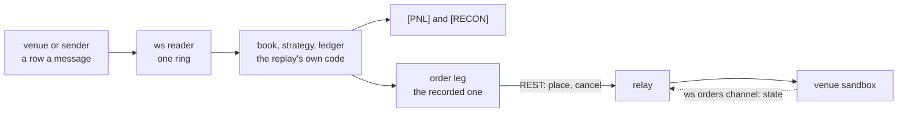

# A live session and the carry line

*Part of the [User Guide](../USER_GUIDE.md).*

One pipeline, two legs, and one branch that is closed: the market leg arrives over a socket, the order leg leaves for a
venue over two channels that are not interchangeable, and the carry branch measures funding instead of quoting.

| channel | carries | direction |
|---|---|---|
| REST `POST /api/v5/trade/order` | every place and every cancel | engine to venue, one call an order |
| private websocket, `orders` channel | state: live, part-filled, filled, cancelled, rejected | venue to engine, a push per change |



> The order never travels the market channel and its state never comes back on the call: an `op: order` sent to the
> private route is `60012`, and the demo account answers `50026` until it is in single-currency margin (`acctLv=2`). The
> size is the other trap: a `BTC-USDT-SWAP` contract is 0.01 BTC (`ctVal`) and the engine's quantity is in its own
> units, so the relay does that division (`--contract-size`, `--quantity-scale`) instead of sending the number it was
> given -- the two ways a first sandbox run looks wrong by a factor of a hundred are in
> [Troubleshooting](07-troubleshooting.md).

## Three commands

```bash
# 1 the shadow session: a local sender, the same engine, both legs recorded
python3 tools/live/websocket_sender.py --port 8765 --trades out/lat/live_trades.csv --depth out/lat/live_depth.csv &
./out/build/linux-debug/toy_quant ws 127.0.0.1:8765 BTC-PERPETUAL active_l2 1 prorata \
  --fast-validation --record=out/lat/live

# 2 the sandbox order leg: the relay places over REST, the engine books the venue's own answer
#   (the three credentials come from the environment: set -a; . secrets/okx-demo.env; set +a)
./out/build/linux-debug/venue_relay --instrument BTC-USDT-SWAP --order-listen 127.0.0.1:8766 \
  --order-rest https://www.okx.com --order-inst-code=10459 &
./out/build/linux-debug/toy_quant l2_replay <trades> <depth> BTC-PERPETUAL 0 active_l2 1 prorata \
  --fast-validation --paper-broker \
  --live-orders --venue-endpoint=127.0.0.1:8766 --venue-max-orders=20

# 3 the carry branch: two funding histories, one line -- and it did not pay
./out/build/linux-debug/toy_quant carry \
  data/v2/funding/BTCUSDT-fundingRate-2024-03.csv \
  data/v2/funding/okx_funding_2024-03-01_2024-03-31_BTC-USDT-SWAP.csv \
  --symbol-a=BTCUSDT --symbol-b=BTC-USDT-SWAP --notional-usd=10000
```

**The carry is closed.** The position needed 745 hours of funding to pay its fees and the window held it for 728:
`carry_to_fees=11.76`, `carry_net_usd=-0.415`. The mode stays in the tree because it is the number that closed the line,
not a lever -- its detail is the last section of this page.

## Run a Live Session Over a WebSocket

`ws` is `l2_replay` with its two readers moved onto a socket and nothing else: the same book, the same engine, the same
recorder, the same broker, the same strategy, because none of them can tell a live feed from a replayed one. A session is
therefore replayable, and a replay is a rehearsal.

```text
ws <host:port> <symbol> [strategy] [quantity_scale] [queue_model] [flags]
```

```bash
./out/build/linux-debug/toy_quant ws 127.0.0.1:8765 BTC-PERPETUAL active_l2 1 prorata \
  --fast-validation --record=out/lat/live
```

The wire, the ring and the flags it accepts are the detail; what a session prints is `[WS]` plus the run's usual lines.

/// details | The session's wire, its ring, and the flags it accepts

The client speaks the WebSocket protocol directly -- the RFC 6455 handshake and text frames -- with no external
dependency, and reads the two replay CSV shapes as its wire format, one row per text message:

```text
exchange,symbol,timestamp,id,side,price,amount                                  a trade, 7 columns
exchange,symbol,timestamp,local_timestamp,is_snapshot,side,price,amount         a depth change, 8 columns
```

A row's kind is its column count and a header row is skipped, so the two files `--record` writes can be streamed
back with no transformation. One reader consumes one ordered ring: the receive thread assembles a run of depth
rows that share a local timestamp into the batch the file reader produces, holds a trade that arrives during
that run until the batch ends, and pushes the batch and then the trade. One stream is what makes a trade gap
unable to stall depth delivery, which the earlier two-ring version could reach when the merge waited for a
trade while the depth ring filled. `--record=PREFIX` then writes the live session back into
`PREFIX_trades.csv` and `PREFIX_depth.csv`, and streaming those two files over the feed again reproduces them
byte for byte.

`tools/live/websocket_sender.py` is a local stand-in for a venue: it is a WebSocket server that streams a trade file
and a depth file, interleaved by their own timestamps, so the whole path can be exercised on a desk:

```bash
python3 tools/live/websocket_sender.py --port 8765 \
  --trades out/lat/live_trades.csv --depth out/lat/live_depth.csv &
./out/build/linux-debug/toy_quant ws 127.0.0.1:8765 BTC-PERPETUAL active_l2 1 prorata --fast-validation
```

The session ends when the peer closes the connection, and the run reports it as a `[WS]` line: the frames and
messages it read, the trades and depth updates it decoded, whether the close was clean, and whether the run
stopped on its own `--ws-seconds=N` instead. `ring_waits` is the number of times the input ring was full:
a full ring waits rather than dropping the row, so the socket is what slows down, and this is the one
counter that says the engine rather than the venue was the limit. `ring_high_water` is the deepest it got;
the live ring holds 131,072 rows against the 4,096 a replay uses, and the measured high-water over two hours
was 3,917. A live capture usually needs a bound, because a venue's socket does not close itself, and the
rows that arrived before the deadline are still drained rather than dropped. The
connect and the opening handshake share a five-second budget, so a host that accepts the connection and then
says nothing fails the run instead of hanging it. `--ws-target=/path` sets the HTTP path the handshake asks
for; it defaults to `/`. Pacing has no meaning on this mode -- the venue sets the speed, not a file's clock --
so `--live-pacing` is refused there, and every other `l2_replay` flag (`--record`, `--feed-thread`,
`--ring-capacity`, `--ws-ring-capacity`, `--idle-wait-us`, `--fast-validation`, `--profile-stages`,
`--paper-broker` and its faults, `--record-orders`, and the strategy and risk flags) is accepted unchanged.

`bash tools/live/soak_push.sh` is the acceptance run for this mode: it streams for `DURATION` seconds with a ping
every `PING` seconds and a forced reconnect every `DROP` seconds, then replays the engine's own recording and
fails if a sequence gap, a parse error, a ring wait, a reconciliation break or a moved field appears.

`--record-orders=PREFIX` writes the order leg of a session to `<prefix>_orders.csv` -- every submission, cancel and
execution report, in order -- and prints `[ORDER-LOG]` with its path and its three counts. `--replay-orders=PREFIX`
makes that file the run's venue and prints `[ORDER-REPLAY]`: each report is released when the replay's own clock
passes the timestamp it was recorded with, so the strategy acts on an answer when the session heard it rather than
when the replay asked. The two flags are refused together, because recording a replay would write a second file of the
same answers.

| flag | takes | what it does |
|---|---|---|
| `--record-orders` | `PREFIX` | writes `<prefix>_orders.csv`: what the venue was asked and what it answered |
| `--replay-orders` | `PREFIX` | makes that file the venue, and releases each answer on its recorded clock |

That channel has two backends and two placement routes; the next fold is the whole of it.

///

/// details | The relay's routes, the sandbox chain, and the venue's error codes

The order half of that relay has moved into the engine: [ADR 0006](../adr/0006-the-venue-order-session-moves-in.md)
accepted the move in four slices, and all four are landed -- the signatures (`src/lines/venue_auth.*`), the translator
(`src/lines/venue_order_translator.*`), the session with its transport (`src/lines/venue_order_session.*`,
`src/lines/venue_order_wire.*`) and the REST placement, `RestPlacer` in that same file. The C++ relay serves the channel
itself: `venue_relay --order-listen HOST:PORT` places over the socket's `op: order`, and `--order-rest=BASE_URL` places
over `POST /api/v5/trade/order` with an ISO-millisecond signature while the socket keeps the `orders` channel, which is
the split this venue forces (`50026` on the websocket trade operation). The engine's side of it is a line socket, one
frame a line, so `TcpVenueTransport` cannot tell the route from the simulated one.

**Both relays serve that route.** The commands below are the Python relay's, because the numbers under them were measured
through it on 2026-11-14; the C++ relay runs the same leg from the engine's side, and *The same leg on the C++ relay* at
the end of this section is the run that says so.

The order channel that produces a recording is in the relay, answering as a simulated venue: `python3
tools/live/venue_relay.py --simulate-orders --order-listen 127.0.0.1:8766`, which `tests/relay_order_channel_test` drives
with the real adapter and the real transport. Without that flag the relay logs in to the venue's own private stream,
subscribes the `orders` channel and translates in both
directions, and reconnects -- logging in and subscribing again -- after a drop, with `logins`, `subscribes` and
`reconnects` in the line it prints when the engine hangs up. The three credentials are read from
`TOYQUANT_API_KEY`, `TOYQUANT_API_SECRET` and `TOYQUANT_PASSPHRASE`, never from the command line, and a listener with
neither backend exits naming the variable that is missing. `--order-venue` points the private route at another
endpoint; its default is the venue's demo environment, which a probe on 2026-11-13 reached: the login and the `orders`
subscription are accepted on port 443, and the login timestamp is Unix epoch seconds. `python3
tools/live/venue_relay.py --self-test` checks the login against a pinned
signature vector and against a local stand-in venue that verifies what crossed the socket, including one deliberate
drop and the re-login after it, and the gate runs that self-test on every change.

The same channel can be the run's *venue* rather than a simulation. `--live-orders --venue-endpoint=HOST:PORT
--venue-max-orders=N` puts `LiveVenue` over a TCP transport in place of the in-process matcher, so orders leave the
process and the venue's answers come back as the same `ExecutionReport`s the ledger already books:

```bash
python3 tools/live/venue_relay.py --simulate-orders --order-listen 127.0.0.1:8766 &
./out/build/linux-debug/toy_quant l2_replay <trades> <depth> BTC-PERPETUAL 0 active_l2 1000000 prorata \
    --fast-validation --paper-broker --order-size=10000 \
    --live-orders --venue-endpoint=127.0.0.1:8766 --venue-max-orders=200
```

> **The two scales have to agree or nothing is placed.** The relay's defaults are the demo instrument's -- a
> `BTC-USDT-SWAP` contract is 0.01 of the coin and a million engine units are one coin -- so an order of one unit is
> 1e-6 of a coin, below one contract, and the relay refuses it naming both numbers. That is why the third positional
> here is `1000000` and `--order-size` is a contract's worth (`10000` units); the replay examples above keep `1`,
> because a replay never asks a venue. With the two scales matched the same command fills: `[VENUE] orders=15
> cancels=15 reports=30`, `[EXECUTION] trade_reports=7`, `[ORDER-LOG] submissions=15 reports=30`, and the relay's
> `orders=7 cancels=15 replies=22 refused=8 deduplicated=7` is its own counter -- one fill per increment of the
> venue's cumulative `accFillSz`, a half fill coming back as 5,000 units.

It prints `[VENUE]` beside `[BROKER]` and `[RECON]`: the frames sent and received, the reports decoded, and the broker's
statement reconciled against the account. The three flags are one decision:

| flag | takes | what it does |
|---|---|---|
| `--live-orders` | nothing | makes the venue the relay's order channel, not the matcher |
| `--venue-endpoint` | `HOST:PORT` | names the relay's listener; there is no default |
| `--venue-max-orders` | integer | the adapter's own cap, below the pipeline's limits |
| `--venue-orders-per-second` | integer | optional: how fast the session may place, if the session cap alone would stop a quoting maker |
| `--venue-max-notional` | USD | optional: one order's notional, priced the way the ledger prices it |

> They are required together: an endpoint without the opt-in reaches nothing, and a live leg with no cap of its own is
> what ADR 0005 decision 4 forbids. They are refused outside `l2_replay` and `ws`, and on a two-book run. The rate is a
> second bound rather than a replacement: the cap counts what a whole run sends, and a maker that replaces its quotes
> spends that budget in seconds and is then refused for the rest of the session, so the rate is what keeps the session
> quoting while still bounding how fast it can spend.

Two things about that channel are the relay's own work rather than the venue's, and `venue_relay.py --self-test`
checks both. **The engine's numbers are not the venue's**: a quantity is divided by `--quantity-scale` and by the
contract's `--contract-size` (0.01 of the coin on `BTC-USDT-SWAP`), rounded down to `--lot-size`, and the price is
rounded onto `--tick-size`; a size that comes out below one contract is refused by the relay with both numbers rather
than sent as `sz=0`, and the four defaults are that instrument's. **The `orders` channel is a stream of states**: the
venue re-sends an order's current state on every change and again after a reconnect, and `accFillSz` is cumulative, so
one fill is booked per increment of that counter, the repeats are counted in the summary as `deduplicated`, and a
counter that goes backwards is refused -- a fill booked twice is a position the account never held.

Pointing the same three at the real private channel is the sandbox run: the relay needs the credentials in the
environment and the engine needs nothing new.

The first attempt at that run says what the next one needs, and its first lesson was that a silence was not a silence.
The private route logged in and subscribed (`logins=1 subscribes=1`) and translated the order and the cancel -- and the
venue's answer was dropped twice over: the request carried no `id` for the venue to correlate, and the client returned
early on the response's empty `data` list, so `{"op":"order","code":"50014","msg":"Parameter id can not be
empty.","data":[]}` never became anything the engine could see.

Two flags now make that attributable rather than mysterious. `--order-dump=FILE` writes every frame both ways, one JSON
object a line, with the login's key and signature redacted; `--order-inst-type` chooses the `orders` subscription's type,
because the venue's two order surfaces want different ones. With the id in the request, the same run becomes a
conversation:

- the venue answers per order and names its own complaint: `sCode 50014, "Parameter instIdCode can not be empty"`;
- both answers reach the engine -- `[VENUE] frames_sent=2 frames_received=2 reports=2` -- and are booked as rejections;
- the business route, which is where an order is normally placed, refuses the `orders` subscription outright (`60018`,
  with `ANY` and with `SWAP`), so the subscription and the order placement live on different surfaces.

So the round trip is proven and a fill is not yet. The chain, in the order it was measured:

- the private route's order operation wants `instIdCode`, the venue's internal code for the contract (10459 for
  `BTC-USDT-SWAP`, read from its public instruments endpoint). `--order-inst-code` passes it through and is deliberately
  required rather than derived: a guessed code is an order on the wrong contract;
- with the code the venue answers `50026 "System error. Try again later."` -- three times, a second apart, with the code
  as a number and as a string, which rules out a type error and a transient blip. The host's clock is within 120 ms of
  the venue's, which rules out drift;
- the same order over REST gets past signing (which needs ISO-8601 milliseconds, where the websocket login needs epoch
  seconds) and answers `sCode 51010, "You can't complete this request under your current account mode."`: the demo
  account was `acctLv=1`, spot-only;
- with the account switched to margin (`acctLv=2`) REST places the order -- `code 0, sCode 0, "Order placed"` and an
  order id -- while the websocket trade operation still answers `50026`, so the demo venue's placement surface is REST
  and its websocket is the `orders` channel.

That is why the relay has a second placement route: `--order-rest https://www.okx.com` sends the translator's own
`args[0]` as the REST body, which is the same object the websocket op would have carried, so there is one translation and
two transports. The acceptance run is the same command as above with the relay on that route:

```bash
python3 tools/live/venue_relay.py --order-listen 127.0.0.1:8774 \
    --order-rest https://www.okx.com --order-inst-code=10459 --order-dump /tmp/frames.json
```

and it says, on the engine's side, `[VENUE] frames_sent=2 frames_received=2 orders=1 cancels=1 reports=2 dropped=0`,
`[ORDER-LOG] submissions=1 cancels=1 reports=2`, `[RECON] status=ok`; on the relay's,
`placed=1 venue_refusals=0 transport_failures=0`. The venue's two answers name the order it made:
`{"code":"0","data":[{"clOrdId":"1","ordId":"4096362816047378433","sCode":"0","sMsg":"Order placed"}]}` and its cancel.

Two things were open when this page was first written, and both are closed: the route subscribes the `orders` channel on
the same login, with `--order-no-subscribe` as the opt-out that restores the placement-only shape it used to have, and
the size reaches the venue in the venue's units (`--contract-size`, `--quantity-scale`, above). The price is closed by
not replaying at all: the venue's own public feed is the market leg, in two relay processes because `--order-listen`
returns rather than serving both.

```bash
set -a; . secrets/okx-demo.env; set +a      # the demo key, read from the environment
./out/build/linux-debug/venue_relay --instrument BTC-USDT-SWAP --listen 127.0.0.1:8765 --max-seconds=150 &
./out/build/linux-debug/venue_relay --instrument BTC-USDT-SWAP --order-listen 127.0.0.1:8766 \
    --order-rest https://www.okx.com --order-inst-code=10459 &
./out/build/linux-debug/toy_quant ws 127.0.0.1:8765 BTC-USDT-SWAP active_l2 1000000 prorata \
  --fast-validation --paper-broker --ws-seconds=120 --order-size=10000 --inventory-limit=10000 \
  --max-exposure-usd=1000 --live-orders --venue-endpoint=127.0.0.1:8766 --venue-max-orders=20
```

A host that cannot reach the venue directly needs one flag rather than another tool: `--proxy=HOST:PORT` puts both legs
and the placement route behind an HTTP `CONNECT` tunnel, and the venue's own name is still what the tunnel asks for and
what the certificate is checked against. Measured on 2026-11-21, on a host whose resolver answers `www.okx.com` with a
link-local address: the market leg carried the venue's public stream through the tunnel, the order leg placed over REST,
and the run closed flat with `[RECON] at=end venue_equity_usd=4914.47 ledger_equity_usd=4914.48
equity_break_usd=-0.00123797 status=ok` beside `[RECON] at=end position venue_units=0 ledger_units=0 position_break=0
status=ok`.

It fills, and the two sides agree. Measured on 2026-11-15 over 120 s through that route: `[VENUE] orders=20 cancels=32
refused_by_adapter=16 write_failures=0 reports=103 dropped=0`, `[EXECUTION] submitted_orders=36 trade_reports=27
fill_rate=0.132222`, `[PORTFOLIO] equity=998.5 fees_paid=1.0772 maker_trade_count=27`, `[PNL] gross_pnl_usd=-0.423298
net_pnl_usd=-1.50049`, and `[RECON] status=ok` with `quantity_breaks=0 fee_difference=0.000000`. On the relay's side:
`order channel done: orders=20 cancels=32 replies=103 refused=0 write_failures=0 sessions=1 placed=20 venue_refusals=19
transport_failures=0 logins=1 subscribes=1 reconnects=0 messages=74 unreadable=0`. `placed=20` is the number this route
exists for: twenty placements signed with an ISO-millisecond timestamp and sent as HTTP, none of them over the socket. The
`venue_refusals=19` are all `51400` on the cancels -- a REST round trip is long enough that the venue has often filled the
order by the time the cancel arrives -- and each was answered `REJECT <id> venue` rather than dropped.

Three things the demo venue taught on the Python route, before the port, and all are in the tree now. **A contract fills in
parts**: a one-contract order came back `accFillSz: "0.45"`, and the channel read that with `int()`, which dropped the
private connection on the first such push and lost every state message after it. **A live fill carried no fee**: the
adapter's `FILL` frame had no field for one, so `fees_paid` was zero while the venue had charged `fee: "-0.14999409"` on the
same fill -- the relay now carries the venue's own `fillFee`, negated because the venue writes a charge as negative.
**A live fill carried no symbol**: the position was booked under the empty string, `[EXPOSURE]` printed `legs=:-14300:-0`,
and the account reported its cash as equity, because no midpoint can be found for a position with no name. The adapter now
stamps the symbol from the order it sent, and the same run prints `legs=BTC-USDT-SWAP:-6700:-439.749`.

### What the route costs, and what it survived

**Three transport defects came after that, each found by trying to run a session.** `connect(2)` had no bound, so a
peer that blackholed a SYN held the caller for minutes -- the Python relay has always passed `timeout=15` to
`socket.create_connection`, and the C++ port dropped it. The bound is now ten seconds for the whole address list,
`venue_ws_test` pins it against a listener whose accept queue is full, and the same test fails on a socket that cannot
complete. **A query held the session lock across the network**: answering `EQUITY` took `session_mutex_` and then blocked
inside the connect, so the venue's read loop waited at `on_connected` -- measured on 2026-11-21 as seventy seconds of a
relay that answered nothing, `frames_received=0` and no error anywhere but `last_error`. The three answers now take no
session lock, because what they read is immutable. **A TLS write on a reset socket killed the relay**: `MSG_NOSIGNAL`
covers the plaintext writes and `SSL_write` has no such flag, so one session ended with `exit=141`; `SIGPIPE` is ignored
once at the relay's entry, and the same write returns an error the caller already handles.

Three more defects, found after the port, all fixed. **The handshakes read the poll as a close**: the socket's
200 ms receive timeout is what keeps a caller's clock, and both the TLS and the WebSocket handshake treated the first
timeout as "the venue hung up", so a 120-second run reported `transport_failures=26` while a loopback test stayed green.
**The keepalive was the wrong shape**: the session sent `{"op":"ping"}` and the venue answered `60012 Illegal request` --
the private channel's ping is the bare text `ping`. **Protocol events counted as unreadable**: `notice` frames and that
error between them made a healthy session print `unreadable=6`, a number that reads as a defect and is not one.

The placement route's cost is counted, because a kept-alive connection would be a design change and a performance change
needs a number before it needs a design: the summary carries `rest_calls`, `rest_connect_ms_avg` and
`rest_place_ms_avg`. Measured on 2026-11-15 over 120 s through this route, 25 REST calls:
`rest_calls=25 rest_connect_ms_avg=94 rest_place_ms_avg=228`, beside `orders=14 cancels=11 placed=14 venue_refusals=3
transport_failures=0` and `[RECON] status=ok`. Connect plus the TLS handshake is therefore about two-fifths of a
placement -- arithmetic on those two averages, not a measured keep-alive -- and that is the share a pooled connection
would have to beat. **The decision is not to pool it now**: what a faster cancel would move is the stale-cancel share
(`venue_refusals=62` of 104 cancels in the reconnect run below), while a pool is a connection state machine with its own
framing, reuse and failure modes, and nothing this page reports needs it today. `rest_calls` and the two averages stay in
the summary, so a later session can re-open the question with a number.

### What a long session asks the venue that a short one does not

| question | where it is answered | the number or line |
|---|---|---|
| what does the venue say the account is worth? | the venue-equity `[RECON]` lines (`at=start`, `at=end`) | `venue_equity_usd`, `equity_break_usd`, `status=ok\|break\|unknown` |
| which of the snapshot's orders are still working? | `--snapshot-in` with `--live-orders` | `[RESUME] orders=… live=… gone=… cancelled=…` |
| is this client inside the venue's budget? | the relay's REST route | `rest_429` in the order channel's summary |
| which stream belongs to the demo account? | `--venue-demo` on the relay | the demo public endpoint, not the live one |

**The balance is a second question, not a second opinion.** `[RECON]` already compares the broker's statement with
the account; neither side is the venue's own balance, so a fee the venue booked but never reported -- or a fill on
another instrument under the same key -- leaves both statements equal while the money is not. A live run prints the
venue-equity `[RECON]` line at `at=start`, before it quotes, and again at `at=end`, after the final mark, from
`GET /api/v5/account/balance`:
`venue_equity_usd=… ledger_equity_usd=… equity_break_usd=… tolerance_usd=… status=ok|break`. **The venue's number is its
USDT equity -- `details[ccy=USDT].eq` -- not the account-wide `totalEq`.** A USD-margined strategy's ledger holds one
currency, and an account can carry spot holdings in others: the demo account's 1 BTC and 100 OKB are about 73,000 of an
80,000 `totalEq`, and their prices move a number the strategy never traded. Measured on 2026-11-17, flat: `totalEq`
80,031.54 against a USDT equity of 4,981.77. The break is signed (venue minus ledger) and the tolerance is printed --
the larger of 0.05 USD and one basis point of the USDT equity, because the venue marks a position at its own price and
the ledger at the last midpoint, while a missing fee is around a basis point of a small account -- which lets the
reader see the width of the claim rather than only its verdict. A venue that cannot answer -- the socket-only placement
route, a refused call -- prints `n/a` and `status=unknown`; a ledger with an unmarked position prints
`ledger_equity_usd=n/a` for the same reason. **Neither is `ok`**: a check that could not be made must not read like one
that passed.

**The opening balance is a flag, and the start line is its check.** `--starting-cash=USD` sets the cash the portfolio
opens with, which is also the exposure ceiling and the `[EXECUTION] starting_cash_usd` field. The default 1000 is the
replay account; a funded venue is why the flag exists. Pass the venue's **USDT equity**, not its `totalEq`. Measured on
2026-11-17 with the account flat: `--starting-cash=4981.77` opened `at=start venue_equity_usd=4981.77
ledger_equity_usd=4981.77 equity_break_usd=0.004472 tolerance_usd=0.498177 status=ok`. The number to pass is what
`tools/live/okx_probe.py all` prints as `"eq"` from `details[ccy=USDT]`, and the same tool's `position` rows are how a
position left over from an earlier session is found and taken off with `market B <contracts>` before the next run -- a
residual is otherwise the only thing that turns the start line into a `break`. A run that ends flat keeps the
same comparison; a position left open makes the venue's mark the other side's price, which is the width the tolerance
covers. A resumed run takes its cash and positions from the snapshot instead (`--snapshot-in` wins over the flag), and
marks the restored positions at the snapshot's prices before the first comparison.

**The earlier 80k figures on this page were the account's `totalEq`.** Seeding the ledger with 80k measured the demo's
spot BTC/OKB as if they were the strategy's cash: a run at `--starting-cash=80076.7` read `-75.65`, another `-22.15`,
and a probe that happened to sit 4.12 USD away read `ok`; those are totalEq movements, not the ledger's accounting.
The strategy's USDT equity is the number that belongs in the flag, and it is about 4,982 here. A run that ends with a
position compares the venue's mark with the ledger's last midpoint; on the demo's thin book the close-out can leave a
residual (`[WIND-DOWN] … no_liquidity=1`), and the end line then breaks by the mark difference -- a position valued
twice, not a missing fill. The single controlled run on that basis opened `ok` and ended `at=end
venue_equity_usd=4980.19 ledger_equity_usd=4981.52 equity_break_usd=-1.32221 status=break`: one contract remained,
`[WIND-DOWN]` closed none (`no_liquidity=1`), and the venue's mark against the run's last midpoint is the 1.32
difference. The account was flattened afterwards with the venue's `close-position`.

**A limit close on the demo has a floor it must stay above.** `--close-out-cross-bps=N` puts the closing IOC N basis
points through the midpoint, because a live venue's book is not the market leg's last snapshot. The band also has an
upper bound: the venue refuses a sell below its own price floor. The 2026-11-17 40 bps run is the measurement of that
bound. The market leg's last mid was 64,250.9 and the venue's mark 64,368.86, so the floor was 64,047; 40 bps put the
sell at 63,993, below it, and the venue refused the order -- `[WIND-DOWN] position=10000 closed=0 residual=10000
spread_bps=40 fees_bps=0 total_bps=40 no_liquidity=1`. That last field was wrong for it: the order was refused, not left
unfilled for want of size, and the exit could not tell the two apart until 2026-11-21, when a reduce-only sell against a
short account was refused the same way and the run again said `no_liquidity=1`. The refusal arrives on the report stream
the exit is waiting on, so the wait now ends when it does and the line reads `refused=1` -- the field the struct's own
comment always said covered a refusal by the venue or by a control. The band is a ceiling in `spread_bps`; the fill is
still the venue's own price.

**The 20 bps band cleared the floor, and the close now books what the venue filled -- but the venue still ends ahead of
the engine.** The 2026-11-17 run with `--close-out-cross-bps=20` put the sell at 64,122, inside the floor.
`[WIND-DOWN] position=10000 closed=8000 residual=2000 notional_usd=643.442 spread_bps=20 fees_usd=0.257375
fees_bps=4.99995 total_bps=25` is that exit priced: 8,000 units in five taker fills and 2,000 left. The demo7 run
printed `closed=0` for a close the venue had filled, because the position was read as soon as the placement was
acknowledged and the reports arrived after it. `Pipeline::close_out` now gives a live venue a bounded wait -- 1000 ms
-- to deliver the fill through the caller's drain before reading what is left; a replay's fill is synchronous and the
wait is skipped, which is why no recorded number moved, and a book with no size still returns its residual and
`no_liquidity=1` after the wait.

**Five minutes through the tunnel, with the position line agreeing on a nonzero number.** Measured 2026-11-21, `ws` on
BTC-USDT-SWAP, cap 4000, rate 2/s, and `--starting-cash` set to the venue's own USDT equity: `[RECON] at=start
venue_equity_usd=4873.97 ledger_equity_usd=4873.97 equity_break_usd=-2.77474e-07 status=ok` and `[RECON] at=end
venue_equity_usd=4850.19 ledger_equity_usd=4850.2 equity_break_usd=-0.00386365 status=ok`, beside `[RECON] at=end
position venue_units=-1400 ledger_units=-1400 position_break=0 status=ok` -- the first session on this line whose two
sides compared a **nonzero** position and agreed. `[VENUE]` read `frames_sent=612 frames_received=869 orders=326
cancels=281 refused_by_adapter=75 write_failures=0 reports=909 dropped=0 duplicates=2 rate_limited=75`: every refusal was
the rate, none the cap. Its wind-down printed `position=-1400 closed=0 residual=-11400 notional_usd=82.602 spread_bps=40
fees_usd=0.295079 fees_bps=0 total_bps=40 no_liquidity=1`, which was two facts in one field -- the exit's reduce-only
order did not fill, and a resting quote filled the other way during its wait, growing the position by 10,000 units -- so
the line now prints `grew=10000` beside it.

A session cap of 200 buys about a minute of quoting. The same 300 s shape with it read `[VENUE] orders=201
rate_limited=43 refused_by_adapter=1004`: the cap was spent early and the rest of the window was refusals. A longer
session needs the cap raised until the rate is the only bound, which is the 4000 above.

**Three five-minute windows, and what their decomposition says.** Measured 2026-11-21 through the tunnel, `ws` on
BTC-USDT-SWAP, cap 4000, rate 2/s, each run given a `--starting-cash` read from the venue first:

| window | gross | fees | net |
|---|---|---|---|
| 1 | -0.41 bps | 3.36 bps | -3.77 bps |
| 2 | +0.92 bps | 3.88 bps | -2.95 bps |
| 3 | +1.07 bps | 3.80 bps | -2.73 bps |

The gross column is `[PNL] gross_pnl_usd` over `maker_notional_usd` (61,884.4, 53,281.2 and 43,208.4 USD), the fee column
is what the venue charged, and the net is what the account did: `net_pnl_usd` -23.309, -15.7405 and -11.7888. The line's
own `breakeven_maker_rate` says the same in the venue's language -- -4.09e-05, 9.217e-05 and 1.07135e-04 -- so this
strategy would need a maker fee between zero and about one basis point, and the demo venue charges two. Three windows are
not evidence of an edge in either direction: one gross is negative and two are positive, and a window selected for being
positive is not an edge. What they pin is the arithmetic of the question: a passive quote capturing around a basis point
cannot pay a two-basis-point maker fee in any of the three.

**The same shape with add-liquidity-only, measured.** 2026-11-23, 300 s, `ws` on BTC-USDT-SWAP, cap 4000, rate 2/s, the
run given `--post-only` and a `--starting-cash` read from the venue first: `[PNL] gross_pnl_usd=0.17664
maker_notional_usd=20803.6 net_pnl_usd=-4.41232 breakeven_maker_rate=8.49085e-06`, `[PORTFOLIO] fees_paid=4.58896
maker_fees=4.16071 taker_fees=0.428249 maker_trade_count=44 taker_trade_count=1`, `[EXECUTION] submitted_orders=172
trade_reports=45 post_only_cancels=87`, and both `[RECON]` lines `status=ok` with the position flat after
`[WIND-DOWN] position=14100 closed=14100 residual=0 fees_bps=5.00091`. Fees were **2.21 bps** of maker notional -- the
maker's own 2.00 plus the exit's 0.21 -- against 3.36 / 3.88 / 3.80 above, so the flag saved 1.15 to 1.67 bps, and the
venue's split is its own word now: 44 maker fills and one taker fill, that being the closing order. The cost is in the
same line: **87 of 172 quotes were declined as marketable**, and the venue delivers that decline as a cancel, which is
why it lands in `post_only_cancels` rather than among the rejected orders. This window's gross was +0.085 bps, not the
+0.92 / +1.07 above, so its net (-2.12 bps) is not a like-for-like comparison; the fee *rate* is, and it says the fee
half is now the venue's two basis points while the gross half is still where a passive quote at this size fails.

**The pair, which is the comparison one window could not make.** The same shape in the same hour, the only difference the
flag -- `post-only` at 02:32 and `baseline` at 03:05:

| window | fees | taker fills | gross | net |
|---|---|---|---|---|
| `post-only` | 2.21 bps | 1 (the exit) | +0.085 bps | -2.12 bps |
| `baseline` | 5.64 bps | 176 | -0.633 bps | -6.27 bps |

`baseline`'s 5.64 is the maker's 2.00 plus 3.64 of taker fees on 17,903 USD of aggressive notional, 42% of what it filled,
and its gross is *lower* than the flagged window's -- so the fills the venue declined were, on average, the bad ones that
half hour. The saving is 3.43 bps here and 1.15 to 1.67 bps against the 2026-11-21 windows: what the flag is worth
depends on how much of the flow would have crossed, and that is not a constant. Both windows reconciled at both ends with
the position flat (`[RECON] ... position_break=0 status=ok`).

The session above is one command now: `bash .run.sh soak post-only` runs `tools/live/soak.sh`, which starts both relays,
requires `STARTING_CASH` (the probe's `eq`), records the market and the order leg under `<OUT>/<mode>`, and refuses to
start without the credentials. `baseline` is the same window without the flag, so the two differ in the one thing under
test. The verb is not a convenience: a session started from the tool's own terminal once left that shell unable to run
anything for twenty minutes while the session ran fine, and the runner is the path that closes every descriptor.

**A run can end with the ledger one fill behind the venue.** Window 2 closed `[RECON] at=end position venue_units=0
ledger_units=-1800 position_break=1800 status=break` while its equity line read `ok`. Its `[EXECUTION]` explains it: 280
of its 304 trade reports were `late_fill_reports`, because this venue answers a cancel for an order it has already filled
with `51400` and sends the fill afterwards, and the last one arrived after the run's final drain. The account was flat,
the ledger caught up on the next query, and the line reported what was true at that instant -- which is the point of
printing quantity beside equity. `late_fill_reports` is how a reader recognises the shape.

What the wait does not fix was visible in the next run, and two more changes followed. The venue's position probe read
`pos: -1` where the engine's book held `+2000` units, and `close-position` flattened it: a working quote the engine still
counted had filled at the venue after the session's clock had stopped. `send_close_order` now cancels every working
order before it sends the exit, drains the cancels (and any fill they raced) for the same bounded second, and sizes the
exit against the position that is left; and the app drains the order leg until the venue is quiet (one second, ended
early by 100 ms of no frames) before it prices the summary and the close. Both are live-only -- the pump and the live
venue are the signal -- so every replay's close keeps its synchronous read and no recorded number moved.

Measured on 2026-11-17 with a fresh 60 s run: `[WIND-DOWN] position=10000 closed=0 residual=10000 notional_usd=650.005
spread_bps=20 fees_usd=0 fees_bps=0 total_bps=20 no_liquidity=1`, and the venue's probe afterwards read `pos: "1"` --
the engine's 10,000 units are one contract, so the two sides agree. The close did not fill because the venue's bid was
below the 20 bps sell.

The live close is a reduce-only market order instead: `CLOSE <id> <symbol> <side> <qty>` becomes the venue's
`ordType: market` with `reduceOnly: true`, the size rounded up to the contract grid, so a fractional position (0.95 of
a contract) is closed by one contract and the venue caps it at the position. A reduce-only order is also exempt from
the adapter's order count: the passive session placed 65 orders against a cap of 20, and the cap refused the exit
before the wire -- the one order it must not stop. The replay's close is still the limit IOC.

**Two things a live order says that a replay's does not have to.** The kind of order leaves as the venue's own
`ordType`: a quote asked to add liquidity only is `post_only`, an IOC is `ioc`, a FOK is `fok`, and only a Gtc quote is
a plain `limit` -- so a quote whose price the book has gone through on the way is declined by the venue rather than
filled against it at five basis points. A venue that cancels such a quote answers `CANCELED <id> post_only`, which the
engine counts as `post_only_cancels`; one refused at placement arrives as a rejected order, and the two counters are
read together. And the fill's role is the venue's word: the relay forwards OKX's `execType` (`M` rested, `T` took) as a
sixth field after the fee, and the adapter books the fee under that role. Without it a resting order was assumed to be a
maker, so the taker fill a stale price turned it into was booked in `maker_trade_count` -- which is why the three
windows' 3.36-3.88 bps of maker notional could only be decomposed by arithmetic instead of by the venue's own split.

The session that followed closed the last gap. The venue answers a cancel for an order it has already filled with
`sCode 51400`, which the relay reports as `REJECT`, and the fill that made the order unfillable arrives after it; the
adapter now keeps an order's entry for the whole session, so those fills are booked in the order's own side instead of
being dropped. Measured on 2026-11-17 (60 s, passive_l2): `[WIND-DOWN] position=-10000 closed=10000 residual=0
notional_usd=647.473 spread_bps=0.101008 fees_usd=0.32374 fees_bps=5.00005 total_bps=5.10106`, the venue's probe
afterwards `position: flat`, `[VENUE] orders=4 cancels=3 refused_by_adapter=0 dropped=0`, and `[RECON] at=end
venue_equity_usd=4956.58 ledger_equity_usd=4956.58 equity_break_usd=-8.49732e-08 tolerance_usd=0.495658 status=ok`.
The exit cost 0.10 bps against the mark and 5.00 bps of taker fee, and the account the run ends with is flat on both
sides. That run also read `strategy_net_position=20000` against the flat account with `strategy_position_mismatches=10`,
and the cause was not the close: the fills whose cancel the venue answered `51400` arrived after the `REJECT`, the
strategy had already forgotten the order's id, and it booked the cancel without the fill. A strategy now keeps the ids
it submitted for the whole session (`SubmittedOrders`), so a fill is attributed by the id it was placed under;
`l2_strategy_test` and `pipeline_accounting_test` pin it, and the demo's next run reads the metric.

`strategy_position_mismatches` is zero when every fill the account books is one this process can attribute. It is
non-zero for a fill of an order the process never submitted, which is what a resumed session (`--snapshot-in`) looks
like, and the 20000/10 line above is kept as the measurement of the defect rather than as a property of the metric.

**A fill after its order's ending report is counted as a late fill, not as a fault.** The ledger closes an order's
audit at the report that ends it -- that is when its queue profile, its size bucket and its commission floor are
settled, and a late fill cannot re-open them -- so such a fill used to be counted in `orphan_order_reports` beside a
report that could not be attributed at all. The ledger now keeps the ids it placed for the session and reports the two
apart: a fill for one of them is `late_fill_reports`/`late_fill_quantity`, and `orphan_order_reports` is left for a
duplicate terminal report or a fill of an order the process never placed, which is what `--snapshot-in` restores. The
`pipeline_accounting_test` case reads `late_fill_reports=1 late_fill_quantity=10` and `orphan_order_reports=0` for its
one late fill; before this change it read `orphan_order_reports=1`.

**The adapter's own refusals now reach the pipeline, and an ending is reported once.** Two gaps in the seam between
`LiveVenue` and the pipeline showed up in the 2026-11-18 run. A refusal at the adapter's caps emits no report, and the
adapter did not override `rejected_orders`, so the pipeline could not tell a refused order from a resting one: 37 of the
session's 58 orders were refused, the strategy kept quoting against all of them, and the venue received a cancel for
each of the 37 orders it had never seen. And the relay answers a cancel on its REST path while the private `orders`
channel reports the same cancellation, so one ending arrived twice: the ledger counted the second as
`orphan_order_reports` and the order's pending quantity was released a second time. `LiveVenue::rejected_orders` is that
counter now, and a second terminal report for an order the adapter has already ended is dropped and counted as
`duplicates` in `[VENUE]`. Measured on 2026-11-18 (60 s, passive_l2, `--venue-max-orders=20`): before, `[VENUE] orders=21
cancels=57 refused_by_adapter=37 reports=100 dropped=0` with `[EXECUTION] audited_rejected_orders=44
orphan_order_reports=13`; after, `[VENUE] frames_sent=43 frames_received=70 orders=21 cancels=20 refused_by_adapter=362
reports=54 dropped=0 duplicates=14` with `[EXECUTION] submitted_orders=383 audited_rejected_orders=368 ...
late_fill_reports=8 late_fill_quantity=40400`, `strategy_net_position=0` with `strategy_position_mismatches=0`,
`[WIND-DOWN] position=-400 closed=400 residual=0 notional_usd=25.606 spread_bps=0 fees_bps=4.99964 total_bps=4.99964`,
the venue's probe `pos=0`, and `[RECON] at=end venue_equity_usd=4952.84 ledger_equity_usd=4952.85
equity_break_usd=-0.00457172 status=ok`. The orphan count is not printed at all, because it is zero. The submission
count is the other half of the same fact: with the refusals visible, the strategy quotes again after each one instead of
believing it is working, so 383 quotes met a 20-order cap and 362 were refused. The cap bounds a session rather than a
rate, so a maker that re-quotes spends the rest of the run being refused; that is the cap behaving as specified and the
run saying so, and whether the bound should be a rate is a scope question rather than a defect.

**The live order leg has a rate bound beside its session cap.** `--venue-max-orders` counts the orders a whole run
sends, and with the adapter's refusals visible to the strategy a maker that replaces its quotes spends that budget in
seconds: the 2026-11-18 run met a twenty-order cap with 383 quotes and 362 refusals, and its exposure was whatever those
twenty filled. `--venue-orders-per-second=N` bounds how fast the session places instead -- a one-second window on the
adapter's own clock, a close exempt like the session cap, and its refusals counted apart as `rate_limited` because the
next window will take the order. Measured on 2026-11-18, 60 s, passive_l2, back to back on the same book: with the cap
alone, `[VENUE] frames_sent=43 frames_received=74 orders=21 cancels=20 refused_by_adapter=186 reports=61 dropped=0
duplicates=11 max_orders=20 orders_per_second=0 rate_limited=0` and `[EXECUTION] submitted_orders=207 trade_reports=20`;
with `--venue-max-orders=200 --venue-orders-per-second=2`, `[VENUE] frames_sent=97 frames_received=154 orders=48
cancels=47 refused_by_adapter=19 reports=118 dropped=0 duplicates=34 max_orders=200 orders_per_second=2
rate_limited=19`, `[EXECUTION] submitted_orders=67 trade_reports=23 trade_report_quantity=141200 orders_that_filled=7
late_fill_reports=13 late_fill_quantity=70600`, and `[WIND-DOWN] position=7600 closed=7600 residual=0 notional_usd=486.631
spread_bps=0.671555 fees_bps=4.99966 total_bps=5.67122`. The rate run placed more than twice as many orders, was refused
a tenth as often, and its own attempt count fell by two thirds: a strategy whose orders rest does not need to replace
them as often as one whose orders are refused. Both runs end with `strategy_net_position=0`, the venue's probe `pos=0`
and `[RECON] at=end status=ok`; a session's activity varies with the market, so the numbers to read are the ratio of
refusals to placements and whether the run is still quoting at the last second, not the fill count of one window.

**A cancel the venue refuses is counted as a rejection.** When the venue answers a cancel with `51400` -- the order has
been filled, cancelled or does not exist -- the relay passes that answer on as `REJECT` and the order ends as rejected,
so `audited_rejected_orders` includes those orders in a run that had them. The fills such an order carried arrive after
the ending and are `late_fill_reports`, which is how a run keeps the two apart. Measured on 2026-11-18, 60 s, passive_l2:
`audited_orders=57 audited_filled_orders=10 audited_cancelled_orders=31 audited_rejected_orders=16`, where the 16 are the
ten rate refusals (`rate_limited=10`) and six refused cancels, and `cancels=37` with `duplicates=31` accounts for the
thirty-one cancels the venue answered twice. Every refusal the demo sent that day was `51400`; a venue that refuses a
cancel for an order it still holds would answer differently, and the relay would still print the code and the venue's
own words.

**A cancel is answered once, by the venue's state.** The relay used to report an accepted cancel twice -- the REST
reply's `CANCELED <id> user` and the venue's own `state: canceled` from the `orders` channel -- so every successful
cancellation reached the adapter as two endings and the second was dropped as a duplicate: 31 of a 60 s session's 37
cancels on 2026-11-18. A cancel's success is the request being accepted, not the order ending, so both relays answer it
with nothing and the channel's state change is the line. Measured on 2026-11-18, 60 s, passive_l2, cap 200 rate 2:
`[VENUE] frames_sent=135 frames_received=172 orders=73 cancels=60 refused_by_adapter=36 reports=183 dropped=0
duplicates=0`, `[EXECUTION] audited_orders=109 audited_filled_orders=13 audited_cancelled_orders=55
audited_rejected_orders=41 late_fill_reports=14 late_fill_quantity=50000 strategy_net_position=0
strategy_position_mismatches=0`, `[WIND-DOWN] position=10500 closed=10500 residual=0 notional_usd=665.05
total_bps=5.00003`, the venue's probe `pos=0` and `[RECON] at=end equity_break_usd=0.00282702 status=ok`; the run
before it read `duplicates=1`, and the session before the change `duplicates=31`. A refused cancel is untouched: it
still ends the order, because the channel has nothing to say about an order the venue refused to cancel.

**Equity is not quantity, and the run now checks both.** One of the 2026-11-18 sessions ended with `[WIND-DOWN]
position=200 closed=0 residual=-900 no_liquidity=1` and `working_orders=1` while the venue's own probe read `pos=0`: the
exit had filled and its report arrived after the close's one-second wait, and `[RECON] at=end` read `ok` because it
compares the venue's **equity** against the ledger's -- the account was worth the same either way, the ledger holding the
position and having paid for it. The adapter now asks the venue for its position too (`GET
/api/v5/account/positions`, signed on the balance's own surface, converted to engine units by the translator's contract
size and signed, because a short is a negative quantity here), and the run prints it at both ends of the session:
`[RECON] at=start position venue_units=… ledger_units=… position_break=… tolerance_units=0 status=ok|break|unknown` and
the same at `at=end`. The start line is what a resumed session needs: `--snapshot-in` puts positions back from a file,
and the venue is the only one that can say whether those are still the positions it holds. The tolerance is zero units
because a quantity is exact. Measured on 2026-11-19, 60 s, passive_l2: `[RECON] at=start position venue_units=0
ledger_units=0 position_break=0 tolerance_units=0 status=ok` and the same at the end, beside `[RECON] at=end
venue_equity_usd=4917.96 ledger_equity_usd=4917.96 equity_break_usd=9.74505e-05 status=ok`, with `[WIND-DOWN]
position=10000 closed=10000 residual=0 total_bps=5`.

**The venue's own break was measured on 2026-11-21**, in the one shape whose two sides count the same thing: `ws` on
BTC-USDT-SWAP, whose instrument is the venue's. With the account flat the run read `[RECON] at=start position
venue_units=0 ledger_units=0 position_break=0 tolerance_units=0 status=ok` and the same pair at the end. One contract sold
on the venue from outside the engine made the next run read `[RECON] at=start position venue_units=-10000 ledger_units=0
position_break=-10000 tolerance_units=0 status=break` beside `[RECON] at=start venue_equity_usd=4908.6
ledger_equity_usd=4917.96 equity_break_usd=-9.35721 status=break`: both lines see the same position, which is why both are
printed. The size of that fault is what the venue says it is, not what the order asked for -- an IOC priced at a bid
that moved fills a fraction or nothing, so a probe that reads `pos=-0.01` after sending `sz=1` has a hundredth of a
contract, and its break is `-100` units rather than `-10000`. Read the row, then read the line.

**A resumed session's positions meet the venue's.** The snapshot flags are refused on `ws` -- a session is written and
resumed against a replay's own clock -- so the shape that reaches `at=start` on a resume is `l2_replay --live-orders
--snapshot-in`: the market leg a file, the order leg a socket. `tools/live/resume_live.sh fresh|resume|break` is the
three runs, and they were measured against the demo venue on 2026-11-19. The fresh one wrote `[SNAPSHOT] orders=1
legs=0 cash_usd=4917.96`; the resume printed `[RESUME] symbol=BTC-PERPETUAL last_ts=1585785597986000 orders=1 live=0
gone=1 cancelled=0 cash_usd=4917.96 legs=0 next_order_id=2` -- the venue had already let the order go -- and `[RECON]
at=start position venue_units=0 ledger_units=0 position_break=0 tolerance_units=0 status=ok`. The third run is the
`break` verdict, and the fault was the file rather than the venue: a copy of that snapshot with one fabricated position
of 10,000 units added, resumed to `[RECON] at=start venue_equity_usd=4917.96 ledger_equity_usd=104918
equity_break_usd=-100000 tolerance_usd=10.4918 status=break` beside `[RECON] at=start position venue_units=0
ledger_units=10000 position_break=-10000 tolerance_units=0 status=break`. Both lines see the same disagreement, which is
the point of printing both: a position the venue does not hold is 100,000 USD of face in the ledger's account -- this
instrument's unit is a 10 USD contract -- and nothing at the venue.

/// details | What the line can refuse to compare, and why two books have no such line

The line compares units, so the ledger's instrument and the venue's have to mean the same thing by one unit: 1e6 engine
units per coin, of the same coin. That is now a check rather than a note -- the relay's `POSITION` answer states the
conversion it used (`POSITION <units> <units_per_coin> <coin>`, and `POSITION <units>` for a relay that states
nothing), the engine compares it with the run's own instrument, and a disagreement reads `position_break=n/a
venue_units_per_coin=… venue_coin=… ledger_units_per_coin=… ledger_coin=… status=unknown` with no magnitude at all.
The two instruments' names differ on purpose and that is not the fault: the runs above trade `BTC-PERPETUAL` against a
venue holding `BTC-USDT-SWAP`, and either is a quantity of BTC. A relay started with another `--quantity-scale`, or a
venue holding another coin, is what the line refuses to compare. `paper_broker_test` pins all three branches (agreeing,
disagreeing, unstated). The venue-side *break* has now been run (the paragraph above, 2026-11-21), and one unit fact came
out of it: the venue's `pos` is already the contract count -- a one-contract short reads `pos=-1` beside
`notionalUsd=582.5454` and `imr=194.5729`, and the relay's answer for it is `POSITION -10000 1000000 BTC`, which is the
contract size (0.01) times the scale (1e6) and therefore correct. The replay shape is the one that cannot compare at all:
`l2_replay`'s ledger counts coins (`ledger_units_per_coin=1`) against the venue's 1e6 units per coin, so a resumed run
reads `status=unknown` with `position_break=n/a` -- the check refusing a magnitude that would mean nothing.

The two-book path has no position line, and cannot have one today. Every layer that would be asked is refused on a run
with two books, each for the same reason and with its own message: `--live-orders` ("names one venue, and a two-book run
has two engines"), and `--paper-broker`/`--order-gateway` ("wrap one venue; a two-symbol run builds one venue per symbol,
and the wrapper is not per leg yet"). So that path has no second statement to compare the account with: its venues are
in-process matchers, and the check it carries is inside each book's pipeline, `[EXECUTION]`'s
`strategy_net_position`/`strategy_position_mismatches` against the engine that book owns, beside `[EXPOSURE]` across the
two legs. A live two-leg session would need one order adapter per leg and one line per leg -- a single number would merge
two instruments' units -- and until one exists the absence is the decision rather than an omission.

///

**An order that fills completely ends as filled.** The venue's `orders` channel says `state: filled` and neither relay
turns that state into a line, so until now the only thing that closed a filled order was a cancel for it being refused:
`[EXECUTION]` read `audited_filled_orders=0` on every live run and those orders were counted as cancelled or rejected.
The adapter knows the size it sent, so the fills reaching it is the fact -- the last fill is forwarded, then a `Filled`,
and the ending is reported once (the venue's later answer to a cancel for that order is a `duplicates`). Measured on
2026-11-18, 60 s, passive_l2, `--venue-max-orders=200 --venue-orders-per-second=2`: `[EXECUTION] audited_orders=57
audited_filled_orders=10 audited_cancelled_orders=31 cancelled_after_fill_orders=0 orders_that_filled=10
filled_orders_by_size=0/0,0/0,0/0,0/0,0/0,10/102700 late_fill_reports=11 late_fill_quantity=62700
strategy_net_position=0 strategy_position_mismatches=0`, `[VENUE] orders=47 cancels=37 refused_by_adapter=10
duplicates=31 rate_limited=10`, `[WIND-DOWN] position=12700 closed=12700 residual=0 notional_usd=811.726
fees_bps=4.99999 total_bps=5.01447`, the venue's probe `pos=0` and `[RECON] at=end equity_break_usd=0.00361225
status=ok`. The two halves of the run's fills add up: ten completed orders carried 102,700 units and the eleven late
fills the remaining 62,700 of `trade_report_quantity=165400`.

**The end-of-run balance was asked twice in the earlier run and answered once; the fixed run answered twice.** The 20 bps
demo7 run sent 17 frames (9 orders, 6 cancels, 2 `EQUITY`) and received 23 (22 order reports and one answer):
`at=start` read `venue_equity_usd=4977.92 ledger_equity_usd=4977.92 equity_break_usd=4.28026e-07 status=ok`, `at=end`
read `venue_equity_usd=n/a status=unknown`. `LiveVenue::refresh_equity` now splits its timeout into two attempts, so a
lost request or answer is retried inside the same budget; a venue that answers `unavailable` is not retried, because
that is its word rather than a lost frame. The fixed run's `at=start` read `equity_break_usd=-2.46474e-07 status=ok` and
`at=end venue_equity_usd=4976.7 ledger_equity_usd=4976.62 equity_break_usd=0.0802475 tolerance_usd=0.497662 status=ok`,
with 20 frames sent and 34 received -- both answers landed on the first send, so the retry was exercised by the stand-in
that ignores the first send rather than by the venue.

The route itself was exercised in those runs: `--venue-demo` delivered `frames=3713 messages=3713 trades=657
depth_updates=3054` in the first 60 seconds, and the order leg placed 20 orders and read 60 reports; the second run's two
quotes were both cancelled on the demo's thin book.

**A restart asks the venue rather than believing its own file.** `--snapshot-in` lists the orders the previous process
had, and `LiveVenue::query_order` answers from the venue's `GET /api/v5/trade/orders-pending` list -- refreshed before
the recovery asks and again after each cancel (`settle_queries`), because a venue answers a cancel on its own
connection. The rule is the simulator's: a working order is cancelled, a forgotten one is counted, and `[RESUME]` prints
both. If the venue does not answer the first query the run refuses to resume, naming the relay's `--order-rest`,
because assuming "none working" would leave every inherited order alive. The same refusal covers the answer that arrives
late: an order the venue did not reply about is counted as `unknown=` on the `[RESUME]` line, and any `unknown` above
zero ends the run before it quotes -- the operator confirms the account with `tools/live/okx_probe.py` and starts again,
which is cheaper than any recovery this side could invent.

**The recovery pair, measured on 2026-11-17.** A replay with `--live-orders` wrote `[SNAPSHOT] orders=1`; the
`--snapshot-in` run printed `[RESUME] orders=1 live=0 gone=1 cancelled=0` -- the venue had already let the order go, so
the recovery counted it rather than assuming a fill or a cancel. A controlled order placed through the relay's line
protocol and still working at the snapshot produced `[RESUME] orders=1 live=1 gone=0 cancelled=1` with `[VENUE]
cancels=1`: query, cancel, settle and query again all against the venue. The placement reply carries no `sz`, so the
ACK used to read that missing field and say `ACK <id> 0`; it is now the size sent (`ACK 907654 10000`). The two queries
also answer outside a session: `PENDING 0`, `EQUITY 80089.191`.

**The budget is per endpoint.** A token bucket in the REST placer allows ten calls a second per path -- well under the
venue's quota -- and an HTTP 429 is retried twice before it becomes a `REJECT`. The two facts are counted separately:
`rest_429` is this client's budget, `venue_refusals` is the venue's judgment of the order.

**The demo's streams are a different endpoint.** `venue_relay --venue-demo` points the market leg at
`wss://wspap.okx.com:8443/ws/v5/public`, the public stream that belongs to the demo account's instrument ids; the order
leg already defaults to the demo private channel. A run that mixes them is a run whose prices and contracts are from
two different venues.

Three differences remain, and they are properties of the environment rather than defects: the demo fee schedule is not
the live one, so `fees_paid` from a demo run is not a live conclusion; `x-simulated-trading: 1` is hard-coded in the
REST placer on purpose, and a live key needs that changed to a flag first; and the demo's book is thinner, so `51400`
on a cancel -- the order had already filled -- is more common here than it will be in production.

A session that hears nothing can be asked what crossed: `--order-dump=FILE` appends every frame both ways, one JSON
object a line, with the login's key, passphrase and signature replaced by `***` -- the file exists to explain a silent
run, so it must not be the copy of the key that leaked. The Python route has had this since its first sandbox order,
where the venue had answered twice and the client had dropped both; the C++ route has it now, and
`tests/venue_order_session_test` asserts that both directions appear in the file and that the api key never does.

The reconnect path was exercised against the venue too, because a healthy session never takes it:
`--order-drop-after-seconds=N` closes and reopens the private connection every N seconds, and the session has to log in and
subscribe again each time. Measured on 2026-11-15 over 300 s with a drop every 50 s and the order cap raised to 60:
`order channel done: orders=60 cancels=104 replies=241 refused=0 write_failures=0 sessions=6 placed=60 venue_refusals=62
transport_failures=0 logins=6 subscribes=6 reconnects=5 messages=151 unreadable=0`, and the engine still reconciles --
`[RECON] status=ok` with `quantity_breaks=0 report_count_difference=0 fee_difference=0.000000` over `trade_reports=31` and
`[BROKER] fills_dropped=0`. That is the claim the session's design makes, and this run has fills on both sides of every
gap rather than the four an earlier 180-second run happened to collect: a gap costs a re-subscription, not a fill, because
the channel re-sends a live order's cumulative state when it comes back. The `venue_refusals=62` are `51400` on the
cancels, which a REST round trip makes routine, and `refused_by_adapter=56` of 116 submissions is the 60-order cap still
binding -- the strategy replaces faster than the cap allows. Those refusals were silent to the pipeline until
2026-11-18 (`LiveVenue::rejected_orders`); the paragraph above measures what making them visible changed.

**A run that ends on an empty book says so.** Two guards protect the figure that went wrong first: the closing mark is the
last *positive* midpoint, so an empty book's zero cannot overwrite it, and where no mark exists at all the run prints
`[MARK] missing symbol=… quantity=… reason=no_positive_midpoint equity_is_n/a`, `equity=n/a marks_complete=0` on the
account and `unmarked=1` on the exposure, rather than a cash figure a reader could quote as equity.

**A live session records; it does not replay.** One `ws` session through the live adapter, recorded twice, was the step
this page used to name. It cannot do that: the same command run twice on the same market recording gave 154 and 261
submissions and two different order legs, while the two market legs were byte-identical (`md5sum` equal), because the
venue's answers are drained between market events and *which* answers have arrived by then is the receive thread's
timing. `RecordedVenue` requires the replay to ask in exactly the recorded order, so a live recording stops it at the
first answer the two realizations placed differently. The loop that does reproduce is the one whose venue is the
in-process matcher -- recording and replaying then run the same reader over the same rows, and `[ORDER-REPLAY]
submissions=305 cancels=290 reports=655 rows_left=0` ends on the same `[PNL]`. A live recording is an audit trail: what
was asked, what was answered, and when. `LiveVenue` now stamps each answer with the run's market clock, so that "when"
is in the file at all -- before the stamp every report row carried `ts=0`.

/// details | The same route through the Python relay, kept as the reference the port was written from
The order session moved out of `tools/live/venue_relay.py` and into the engine in four slices (ADR 0006), and the Python
file stays in the tree on purpose: its `--self-test`, its stand-in venues and its frame dump are what the C++ tests were
written against, and a reader checking the port has the file it was ported from. It is not the route a run uses.

```bash
set -a; . secrets/okx-demo.env; set +a
python3 tools/live/venue_relay.py --instrument BTC-USDT-SWAP --listen 127.0.0.1:8765 --max-seconds=120 &
python3 tools/live/venue_relay.py --instrument BTC-USDT-SWAP --order-listen 127.0.0.1:8766 \
    --order-rest https://www.okx.com --order-inst-code=10459 &
```

Measured on 2026-11-14 over ninety seconds through it, with the exposure cap set: `[VENUE] orders=20 cancels=20 reports=66
dropped=0`, `[EXECUTION] submitted_orders=28 trade_reports=15 fill_rate=0.333214` with `max_abs_exposure_usd=656.583` and
`exposure_over_collateral_fills=0`, `[BROKER] fills_seen=15`, `[RECON] status=ok` with `quantity_breaks=0
fee_difference=0.000000`. The account closed at `[PORTFOLIO] cash=1437.13 realized_pnl=-2.55906
unrealized_pnl=-0.064655 equity=997.376 fees_paid=2.99724` and `[PNL] gross_pnl_usd=0.373523
net_pnl_usd=-2.62371`: gross positive, net not, because the fee is 2.99724 of a 0.373523 gross. Fifteen fills in ninety
seconds is a wire acceptance, not a rate.
///

### The error codes this line has actually produced

| code | surface | what it meant here |
|---|---|---|
| `60004` | websocket login | the login timestamp must be epoch **seconds** |
| `50112` | REST | the REST timestamp must be ISO 8601 **milliseconds** -- the opposite format |
| `50014` | `op: order` | a field was missing: first `id`, then `instIdCode` |
| `50026` | `op: order` | a system error, which here was the `51010` below |
| `51010` | REST order | the account cannot trade this instrument: `acctLv=1` is spot-only |
| `60012` | business endpoint, private channel | that endpoint does not serve `op: order`; the private channel refuses an `{"op":"ping"}` keepalive, which is the bare text `ping` |
| `60018` | business endpoint | it does not serve the `orders` channel either; the private route does |
| `51400` | `op: cancel-order` | the order never existed, or had already filled or been cancelled by the time the cancel arrived |

The two timestamp formats are the trap worth remembering: a login signed in the wrong format is refused by one surface
and a REST call by the other, so a client that shares one timestamp function across both is exactly one code away from
looking like it has the wrong key.

> And a `403` whose body is `error code: 1010` is not a venue code at all: it is the proxy in front of it refusing the
> client's `User-Agent`. Python's `urllib` default hits it and a `curl` one does not, which reads as "the venue refused
> my request" until the body is looked at.

///


## Carry: Two Legs Over Two Funding Histories

A carry is a position and its hedge, so it needs two instruments and it does not need a book: what it earns is
funding and what it pays is a round trip of fees. The mode states the position and measures both:

```bash
./out/build/linux-debug/toy_quant carry \
  data/v2/funding/BTCUSDT-fundingRate-2024-03.csv \
  data/v2/funding/okx_funding_2024-03-01_2024-03-31_BTC-USDT-SWAP.csv \
  --symbol-a=BTCUSDT --symbol-b=BTC-USDT-SWAP --notional-usd=10000
```

| Flag | Effect | Default |
|---|---|---|
| `--symbol-a=SYM`, `--symbol-b=SYM` | Which instrument each leg holds; the venue's fee schedule is looked up by symbol | Required |
| `--notional-usd=N` | USD held on each leg, so the position is a hedge of 2N gross and zero net | 10000 |
| `--long=a`/`--long=b` | Which leg is bought; the other is sold | `a` |

The window is whatever the two histories cover together, the position is opened at its first settlement and
closed at its last, and each settlement inside the window is charged to its own leg at its own mark. The
position is stated rather than chosen: `--long` fixes the side before the run looks at the data, so the number
is a measurement and not a fitted result. Entry and exit are taker fills at the venues' published rates, which
is the expensive assumption; a maker entry would halve the fee and is not assumed.

The report is one line:

```text
[CARRY] carry_leg_a=BTCUSDT carry_leg_b=BTC-USDT-SWAP carry_notional_usd=10000
        carry_gross_notional_usd=20000 carry_net_notional_usd=0 carry_window_hours=728
        carry_settlements=182 carry_leg_a_funding_usd=-304.656 carry_leg_b_funding_usd=322.241
        carry_funding_usd=17.5849 carry_fees_usd=18 carry_net_usd=-0.415093
        carry_annualized_carry_usd=211.599 carry_annualized_return=0.0211599
        carry_to_fees=11.7555 carry_breakeven_hours=745.184
```

`carry_gross_notional_usd` and `carry_net_notional_usd` are the two ways to read the same book and only the
second is the account's exposure: both legs carry a notional, and their sum is what the position is worth to
someone who reads one leg as the position. The per-leg funding shows what flows and what is left after the
hedge takes its side back: 304.66 USD paid on one venue and 322.24 received on the other leave 17.58 USD, which
is the carry. `carry_net_usd` is that minus the fees, `carry_annualized_carry_usd` is the carry as a yearly
rate, and `carry_to_fees` divides it by the fees: the acceptance number. `carry_breakeven_hours` is the same
comparison in the form a decision needs, because the fees are paid once and the carry accrues every interval —
here the position must be held 745 hours to pay for its fees and it was held for 728, which is why the net is
just below zero. The run is recorded with its numbers in
[Performance History](../performance/history-03-studies.md#the-acceptance-number)

The replay then reports a `[PNL]` line for every run, which splits what completed from what is still open and
adds the fees back to each:

```text
[PNL] gross_pnl_usd=-0.0818127 net_pnl_usd=-0.123813 gross_closed_pnl_usd=-0.0672835
      closed_pnl_usd=-0.109283 maker_notional_usd=210 net_per_fill_usd=-0.00589584
      gross_closed_per_fill_usd=-0.00320398 breakeven_maker_rate=-0.000389584
```

`closed_pnl_usd` is the portfolio's realized PnL, so a position the run was still holding at the end is not in
it; `net_pnl_usd` adds that position marked at the last price; the `gross_` pair adds the fees back to each, and
a negative gross PnL says the run lost money before the venue charged anything. `maker_notional_usd` is what the
maker fees were charged on, and `breakeven_maker_rate` is the maker rate at which this window's total PnL would
have been zero: **a negative answer means no fee at all would still have lost money**, and that size of rebate
would have been needed instead. `tools/sweep/fee_sweep.sh` runs the sweep over the windows the documents quote and
prints the table with the block that re-derives it.

