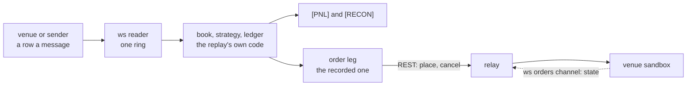

# A live session and the carry line

*Part of the [User Guide](../USER_GUIDE.md).*

One pipeline, two legs, and one branch that is closed: the market leg arrives over a socket, the order leg leaves for a
venue over two channels that are not interchangeable, and the carry branch measures funding instead of quoting.

| channel | carries | direction |
|---|---|---|
| REST `POST /api/v5/trade/order` | every place and every cancel | engine to venue, one call an order |
| private websocket, `orders` channel | state: live, part-filled, filled, cancelled, rejected | venue to engine, a push per change |



> The order never travels the market channel and its state never comes back on the call: an `op: order` sent to the
> private route is `60012`, and the demo account answers `50026` until it is in single-currency margin (`acctLv=2`). The
> size is the other trap: a `BTC-USDT-SWAP` contract is 0.01 BTC (`ctVal`) and the engine's quantity is in its own
> units, so the relay does that division (`--contract-size`, `--quantity-scale`) instead of sending the number it was
> given -- the two ways a first sandbox run looks wrong by a factor of a hundred are in
> [Troubleshooting](07-troubleshooting.md).

## Three commands

```bash
# 1 the shadow session: a local sender, the same engine, both legs recorded
python3 tools/live/websocket_sender.py --port 8765 --trades out/lat/live_trades.csv --depth out/lat/live_depth.csv &
./out/build/linux-debug/toy_quant ws 127.0.0.1:8765 BTC-PERPETUAL active_l2 1 prorata \
  --fast-validation --record=out/lat/live

# 2 the sandbox order leg: the relay places over REST, the engine books the venue's own answer
python3 tools/live/venue_relay.py --order-listen 127.0.0.1:8766 \
  --order-rest https://www.okx.com --order-inst-code=10459 &
./out/build/linux-debug/toy_quant l2_replay <trades> <depth> BTC-PERPETUAL 0 active_l2 1 prorata \
  --fast-validation --paper-broker \
  --live-orders --venue-endpoint=127.0.0.1:8766 --venue-max-orders=20

# 3 the carry branch: two funding histories, one line -- and it did not pay
./out/build/linux-debug/toy_quant carry \
  data/v2/funding/BTCUSDT-fundingRate-2024-03.csv \
  data/v2/funding/okx_funding_2024-03-01_2024-03-31_BTC-USDT-SWAP.csv \
  --symbol-a=BTCUSDT --symbol-b=BTC-USDT-SWAP --notional-usd=10000
```

**The carry is closed.** The position needed 745 hours of funding to pay its fees and the window held it for 728:
`carry_to_fees=11.76`, `carry_net_usd=-0.415`. The mode stays in the tree because it is the number that closed the line,
not a lever -- its detail is the last section of this page.

## Run a Live Session Over a WebSocket

`ws` is `l2_replay` with its two readers moved onto a socket and nothing else: the same book, the same engine, the same
recorder, the same broker, the same strategy, because none of them can tell a live feed from a replayed one. A session is
therefore replayable, and a replay is a rehearsal.

```text
ws <host:port> <symbol> [strategy] [quantity_scale] [queue_model] [flags]
```

```bash
./out/build/linux-debug/toy_quant ws 127.0.0.1:8765 BTC-PERPETUAL active_l2 1 prorata \
  --fast-validation --record=out/lat/live
```

The wire, the ring and the flags it accepts are the detail; what a session prints is `[WS]` plus the run's usual lines.

/// details | The session's wire, its ring, and the flags it accepts

The client speaks the WebSocket protocol directly -- the RFC 6455 handshake and text frames -- with no external
dependency, and reads the two replay CSV shapes as its wire format, one row per text message:

```text
exchange,symbol,timestamp,id,side,price,amount                                  a trade, 7 columns
exchange,symbol,timestamp,local_timestamp,is_snapshot,side,price,amount         a depth change, 8 columns
```

A row's kind is its column count and a header row is skipped, so the two files `--record` writes can be streamed
back with no transformation. One reader consumes one ordered ring: the receive thread assembles a run of depth
rows that share a local timestamp into the batch the file reader produces, holds a trade that arrives during
that run until the batch ends, and pushes the batch and then the trade. One stream is what makes a trade gap
unable to stall depth delivery, which the earlier two-ring version could reach when the merge waited for a
trade while the depth ring filled. `--record=PREFIX` then writes the live session back into
`PREFIX_trades.csv` and `PREFIX_depth.csv`, and streaming those two files over the feed again reproduces them
byte for byte.

`tools/live/websocket_sender.py` is a local stand-in for a venue: it is a WebSocket server that streams a trade file
and a depth file, interleaved by their own timestamps, so the whole path can be exercised on a desk:

```bash
python3 tools/live/websocket_sender.py --port 8765 \
  --trades out/lat/live_trades.csv --depth out/lat/live_depth.csv &
./out/build/linux-debug/toy_quant ws 127.0.0.1:8765 BTC-PERPETUAL active_l2 1 prorata --fast-validation
```

The session ends when the peer closes the connection, and the run reports it as a `[WS]` line: the frames and
messages it read, the trades and depth updates it decoded, whether the close was clean, and whether the run
stopped on its own `--ws-seconds=N` instead. `ring_waits` is the number of times the input ring was full:
a full ring waits rather than dropping the row, so the socket is what slows down, and this is the one
counter that says the engine rather than the venue was the limit. `ring_high_water` is the deepest it got;
the live ring holds 131,072 rows against the 4,096 a replay uses, and the measured high-water over two hours
was 3,917. A live capture usually needs a bound, because a venue's socket does not close itself, and the
rows that arrived before the deadline are still drained rather than dropped. The
connect and the opening handshake share a five-second budget, so a host that accepts the connection and then
says nothing fails the run instead of hanging it. `--ws-target=/path` sets the HTTP path the handshake asks
for; it defaults to `/`. Pacing has no meaning on this mode -- the venue sets the speed, not a file's clock --
so `--live-pacing` is refused there, and every other `l2_replay` flag (`--record`, `--feed-thread`,
`--ring-capacity`, `--ws-ring-capacity`, `--idle-wait-us`, `--fast-validation`, `--profile-stages`,
`--paper-broker` and its faults, `--record-orders`, and the strategy and risk flags) is accepted unchanged.

`bash tools/live/soak_push.sh` is the acceptance run for this mode: it streams for `DURATION` seconds with a ping
every `PING` seconds and a forced reconnect every `DROP` seconds, then replays the engine's own recording and
fails if a sequence gap, a parse error, a ring wait, a reconciliation break or a moved field appears.

`--record-orders=PREFIX` writes the order leg of a session to `<prefix>_orders.csv` -- every submission, cancel and
execution report, in order -- and prints `[ORDER-LOG]` with its path and its three counts. `--replay-orders=PREFIX`
makes that file the run's venue and prints `[ORDER-REPLAY]`: each report is released when the replay's own clock
passes the timestamp it was recorded with, so the strategy acts on an answer when the session heard it rather than
when the replay asked. The two flags are refused together, because recording a replay would write a second file of the
same answers.

| flag | takes | what it does |
|---|---|---|
| `--record-orders` | `PREFIX` | writes `<prefix>_orders.csv`: what the venue was asked and what it answered |
| `--replay-orders` | `PREFIX` | makes that file the venue, and releases each answer on its recorded clock |

That channel has two backends and two placement routes; the next fold is the whole of it.

///

/// details | The relay's routes, the sandbox chain, and the venue's error codes

The order channel that produces a recording is in the relay, answering as a simulated venue: `python3
tools/live/venue_relay.py --simulate-orders --order-listen 127.0.0.1:8766`, which `tests/relay_order_channel_test` drives
with the real adapter and the real transport. Without that flag the relay logs in to the venue's own private stream,
subscribes the `orders` channel and translates in both
directions, and reconnects -- logging in and subscribing again -- after a drop, with `logins`, `subscribes` and
`reconnects` in the line it prints when the engine hangs up. The three credentials are read from
`TOYQUANT_API_KEY`, `TOYQUANT_API_SECRET` and `TOYQUANT_PASSPHRASE`, never from the command line, and a listener with
neither backend exits naming the variable that is missing. `--order-venue` points the private route at another
endpoint; its default is the venue's demo environment, which a probe on 2026-11-13 reached: the login and the `orders`
subscription are accepted on port 443, and the login timestamp is Unix epoch seconds. `python3
tools/live/venue_relay.py --self-test` checks the login against a pinned
signature vector and against a local stand-in venue that verifies what crossed the socket, including one deliberate
drop and the re-login after it, and the gate runs that self-test on every change.

The same channel can be the run's *venue* rather than a simulation. `--live-orders --venue-endpoint=HOST:PORT
--venue-max-orders=N` puts `LiveVenue` over a TCP transport in place of the in-process matcher, so orders leave the
process and the venue's answers come back as the same `ExecutionReport`s the ledger already books:

```bash
python3 tools/live/venue_relay.py --simulate-orders --order-listen 127.0.0.1:8766 &
./out/build/linux-debug/toy_quant l2_replay <trades> <depth> BTC-PERPETUAL 0 active_l2 1 prorata \
    --fast-validation --paper-broker \
    --live-orders --venue-endpoint=127.0.0.1:8766 --venue-max-orders=200
```

It prints `[VENUE]` beside `[BROKER]` and `[RECON]`: the frames sent and received, the reports decoded, and the broker's
statement reconciled against the account. The three flags are one decision:

| flag | takes | what it does |
|---|---|---|
| `--live-orders` | nothing | makes the venue the relay's order channel, not the matcher |
| `--venue-endpoint` | `HOST:PORT` | names the relay's listener; there is no default |
| `--venue-max-orders` | integer | the adapter's own cap, below the pipeline's limits |
| `--venue-max-notional` | USD | optional: one order's notional, priced the way the ledger prices it |

> They are required together: an endpoint without the opt-in reaches nothing, and a live leg with no cap of its own is
> what ADR 0005 decision 4 forbids. They are refused outside `l2_replay` and `ws`, and on a two-book run.

Two things about that channel are the relay's own work rather than the venue's, and `venue_relay.py --self-test`
checks both. **The engine's numbers are not the venue's**: a quantity is divided by `--quantity-scale` and by the
contract's `--contract-size` (0.01 of the coin on `BTC-USDT-SWAP`), rounded down to `--lot-size`, and the price is
rounded onto `--tick-size`; a size that comes out below one contract is refused by the relay with both numbers rather
than sent as `sz=0`, and the four defaults are that instrument's. **The `orders` channel is a stream of states**: the
venue re-sends an order's current state on every change and again after a reconnect, and `accFillSz` is cumulative, so
one fill is booked per increment of that counter, the repeats are counted in the summary as `deduplicated`, and a
counter that goes backwards is refused -- a fill booked twice is a position the account never held.

Pointing the same three at the real private channel is the sandbox run: the relay needs the credentials in the
environment and the engine needs nothing new.

The first attempt at that run says what the next one needs, and its first lesson was that a silence was not a silence.
The private route logged in and subscribed (`logins=1 subscribes=1`) and translated the order and the cancel -- and the
venue's answer was dropped twice over: the request carried no `id` for the venue to correlate, and the client returned
early on the response's empty `data` list, so `{"op":"order","code":"50014","msg":"Parameter id can not be
empty.","data":[]}` never became anything the engine could see.

Two flags now make that attributable rather than mysterious. `--order-dump=FILE` writes every frame both ways, one JSON
object a line, with the login's key and signature redacted; `--order-inst-type` chooses the `orders` subscription's type,
because the venue's two order surfaces want different ones. With the id in the request, the same run becomes a
conversation:

- the venue answers per order and names its own complaint: `sCode 50014, "Parameter instIdCode can not be empty"`;
- both answers reach the engine -- `[VENUE] frames_sent=2 frames_received=2 reports=2` -- and are booked as rejections;
- the business route, which is where an order is normally placed, refuses the `orders` subscription outright (`60018`,
  with `ANY` and with `SWAP`), so the subscription and the order placement live on different surfaces.

So the round trip is proven and a fill is not yet. The chain, in the order it was measured:

- the private route's order operation wants `instIdCode`, the venue's internal code for the contract (10459 for
  `BTC-USDT-SWAP`, read from its public instruments endpoint). `--order-inst-code` passes it through and is deliberately
  required rather than derived: a guessed code is an order on the wrong contract;
- with the code the venue answers `50026 "System error. Try again later."` -- three times, a second apart, with the code
  as a number and as a string, which rules out a type error and a transient blip. The host's clock is within 120 ms of
  the venue's, which rules out drift;
- the same order over REST gets past signing (which needs ISO-8601 milliseconds, where the websocket login needs epoch
  seconds) and answers `sCode 51010, "You can't complete this request under your current account mode."`: the demo
  account was `acctLv=1`, spot-only;
- with the account switched to margin (`acctLv=2`) REST places the order -- `code 0, sCode 0, "Order placed"` and an
  order id -- while the websocket trade operation still answers `50026`, so the demo venue's placement surface is REST
  and its websocket is the `orders` channel.

That is why the relay has a second placement route: `--order-rest https://www.okx.com` sends the translator's own
`args[0]` as the REST body, which is the same object the websocket op would have carried, so there is one translation and
two transports. The acceptance run is the same command as above with the relay on that route:

```bash
python3 tools/live/venue_relay.py --order-listen 127.0.0.1:8774 \
    --order-rest https://www.okx.com --order-inst-code=10459 --order-dump /tmp/frames.json
```

and it says, on the engine's side, `[VENUE] frames_sent=2 frames_received=2 orders=1 cancels=1 reports=2 dropped=0`,
`[ORDER-LOG] submissions=1 cancels=1 reports=2`, `[RECON] status=ok`; on the relay's,
`placed=1 venue_refusals=0 transport_failures=0`. The venue's two answers name the order it made:
`{"code":"0","data":[{"clOrdId":"1","ordId":"4096362816047378433","sCode":"0","sMsg":"Order placed"}]}` and its cancel.

Two things are still open, and they are why this is not a profitable run: the `orders` channel is not subscribed on the
REST route, so a *fill* would not be seen (that is the next piece, and it needs a de-duplication rule for the state
changes it would also deliver); and `sz` is in the replay instrument's units, not the venue's -- one contract of
`BTC-USDT-SWAP` is 0.01 BTC, and the replay's prices are from 2020, so a fill here would be a number about nothing.

### The error codes this line has actually produced

| code | surface | what it meant here |
|---|---|---|
| `60004` | websocket login | the login timestamp must be epoch **seconds** |
| `50112` | REST | the REST timestamp must be ISO 8601 **milliseconds** -- the opposite format |
| `50014` | `op: order` | a field was missing: first `id`, then `instIdCode` |
| `50026` | `op: order` | a system error, which here was the `51010` below |
| `51010` | REST order | the account cannot trade this instrument: `acctLv=1` is spot-only |
| `60012` | business endpoint | that endpoint does not serve `op: order` |
| `60018` | business endpoint | it does not serve the `orders` channel either; the private route does |
| `51400` | `op: cancel-order` | the order never existed, so the cancel had nothing to cancel |

The two timestamp formats are the trap worth remembering: a login signed in the wrong format is refused by one surface
and a REST call by the other, so a client that shares one timestamp function across both is exactly one code away from
looking like it has the wrong key.

> And a `403` whose body is `error code: 1010` is not a venue code at all: it is the proxy in front of it refusing the
> client's `User-Agent`. Python's `urllib` default hits it and a `curl` one does not, which reads as "the venue refused
> my request" until the body is looked at.

///


## Carry: Two Legs Over Two Funding Histories

A carry is a position and its hedge, so it needs two instruments and it does not need a book: what it earns is
funding and what it pays is a round trip of fees. The mode states the position and measures both:

```bash
./out/build/linux-debug/toy_quant carry \
  data/v2/funding/BTCUSDT-fundingRate-2024-03.csv \
  data/v2/funding/okx_funding_2024-03-01_2024-03-31_BTC-USDT-SWAP.csv \
  --symbol-a=BTCUSDT --symbol-b=BTC-USDT-SWAP --notional-usd=10000
```

| Flag | Effect | Default |
|---|---|---|
| `--symbol-a=SYM`, `--symbol-b=SYM` | Which instrument each leg holds; the venue's fee schedule is looked up by symbol | Required |
| `--notional-usd=N` | USD held on each leg, so the position is a hedge of 2N gross and zero net | 10000 |
| `--long=a`/`--long=b` | Which leg is bought; the other is sold | `a` |

The window is whatever the two histories cover together, the position is opened at its first settlement and
closed at its last, and each settlement inside the window is charged to its own leg at its own mark. The
position is stated rather than chosen: `--long` fixes the side before the run looks at the data, so the number
is a measurement and not a fitted result. Entry and exit are taker fills at the venues' published rates, which
is the expensive assumption; a maker entry would halve the fee and is not assumed.

The report is one line:

```text
[CARRY] carry_leg_a=BTCUSDT carry_leg_b=BTC-USDT-SWAP carry_notional_usd=10000
        carry_gross_notional_usd=20000 carry_net_notional_usd=0 carry_window_hours=728
        carry_settlements=182 carry_leg_a_funding_usd=-304.656 carry_leg_b_funding_usd=322.241
        carry_funding_usd=17.5849 carry_fees_usd=18 carry_net_usd=-0.415093
        carry_annualized_carry_usd=211.599 carry_annualized_return=0.0211599
        carry_to_fees=11.7555 carry_breakeven_hours=745.184
```

`carry_gross_notional_usd` and `carry_net_notional_usd` are the two ways to read the same book and only the
second is the account's exposure: both legs carry a notional, and their sum is what the position is worth to
someone who reads one leg as the position. The per-leg funding shows what flows and what is left after the
hedge takes its side back: 304.66 USD paid on one venue and 322.24 received on the other leave 17.58 USD, which
is the carry. `carry_net_usd` is that minus the fees, `carry_annualized_carry_usd` is the carry as a yearly
rate, and `carry_to_fees` divides it by the fees: the acceptance number. `carry_breakeven_hours` is the same
comparison in the form a decision needs, because the fees are paid once and the carry accrues every interval —
here the position must be held 745 hours to pay for its fees and it was held for 728, which is why the net is
just below zero. The run is recorded with its numbers in
[Performance History](../performance/history-03-studies.md#the-acceptance-number)

The replay then reports a `[PNL]` line for every run, which splits what completed from what is still open and
adds the fees back to each:

```text
[PNL] gross_pnl_usd=-0.0818127 net_pnl_usd=-0.123813 gross_closed_pnl_usd=-0.0672835
      closed_pnl_usd=-0.109283 maker_notional_usd=210 net_per_fill_usd=-0.00589584
      gross_closed_per_fill_usd=-0.00320398 breakeven_maker_rate=-0.000389584
```

`closed_pnl_usd` is the portfolio's realized PnL, so a position the run was still holding at the end is not in
it; `net_pnl_usd` adds that position marked at the last price; the `gross_` pair adds the fees back to each, and
a negative gross PnL says the run lost money before the venue charged anything. `maker_notional_usd` is what the
maker fees were charged on, and `breakeven_maker_rate` is the maker rate at which this window's total PnL would
have been zero: **a negative answer means no fee at all would still have lost money**, and that size of rebate
would have been needed instead. `tools/sweep/fee_sweep.sh` runs the sweep over the windows the documents quote and
prints the table with the block that re-derives it.

